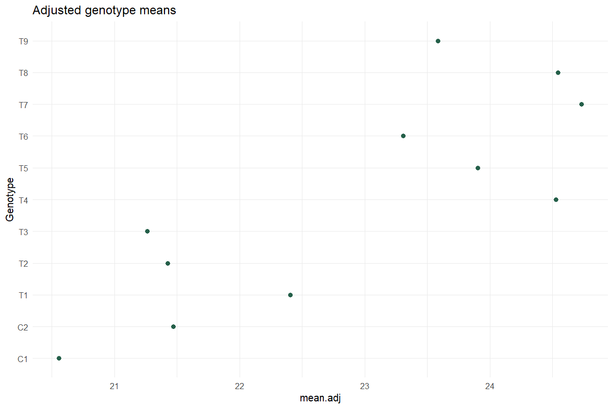

# Augmented Trial Analysis

Adjust unreplicated entries using replicated checks

## Question and data
Include at least two checks once in every block and each test entry exactly once. Select the checks explicitly; do not infer check status from a treatment name.

## Read and report the results
Report adjusted means and the appropriate comparison standard errors. The ANOVA is sequential, with blocks fitted before adjusted genotype effects. Differences from the average adjusted check mean are descriptive contrasts.

## Scope and assumptions
Unreplicated test entries do not acquire independent replication through adjustment. DAU Fisher LSD comparisons are unadjusted for multiplicity; prioritize scientifically planned comparisons.

## Setup
```r
source("tools/example-cases.R")
load_drdesign()
```

## augmented

[Example CSV](../data/augmented.csv) · [R script](../code/augmented.R)

Synthetic teaching data; not observations from a field experiment.

```r
data <- research_example("augmented-trial")
result <- run_augmented_trial(data,c("C1","C2"))
```

### Adjusted means

[Full-precision CSV](../data/augmented-table-1.csv)

| Genotype | y | std | r | Min | Max | Q25 | Q50 | Q75 | Adjusted mean | SE | block | Is Check | Difference From Check Mean |
| --- | --- | --- | --- | --- | --- | --- | --- | --- | --- | --- | --- | --- | --- |
| C1 | 20.558 | 0.685 | 3.000 | 19.843 | 21.209 | 20.232 | 20.621 | 20.915 | 20.558 | 0.099 |  | True | -0.456 |
| C2 | 21.470 | 0.642 | 3.000 | 20.956 | 22.189 | 21.110 | 21.263 | 21.726 | 21.470 | 0.099 |  | True | 0.456 |
| T1 | 23.091 | NA | 1.000 | 23.091 | 23.091 | 23.091 | 23.091 | 23.091 | 22.405 | 0.171 | B1 | False | 1.391 |
| T2 | 22.112 | NA | 1.000 | 22.112 | 22.112 | 22.112 | 22.112 | 22.112 | 21.426 | 0.171 | B1 | False | 0.413 |
| T3 | 21.949 | NA | 1.000 | 21.949 | 21.949 | 21.949 | 21.949 | 21.949 | 21.263 | 0.171 | B1 | False | 0.250 |
| T4 | 23.913 | NA | 1.000 | 23.913 | 23.913 | 23.913 | 23.913 | 23.913 | 24.527 | 0.171 | B2 | False | 3.513 |
| T5 | 23.291 | NA | 1.000 | 23.291 | 23.291 | 23.291 | 23.291 | 23.291 | 23.905 | 0.171 | B2 | False | 2.892 |
| T6 | 22.694 | NA | 1.000 | 22.694 | 22.694 | 22.694 | 22.694 | 22.694 | 23.308 | 0.171 | B2 | False | 2.295 |
| T7 | 24.663 | NA | 1.000 | 24.663 | 24.663 | 24.663 | 24.663 | 24.663 | 24.734 | 0.171 | B3 | False | 3.721 |
| T8 | 24.471 | NA | 1.000 | 24.471 | 24.471 | 24.471 | 24.471 | 24.471 | 24.543 | 0.171 | B3 | False | 3.529 |

First 10 rows shown. Download the CSV for every row.

### ANOVA: blocks then adjusted genotypes

[Full-precision CSV](../data/augmented-table-2.csv)

| Source / term | df | SS | MS | F | p-value |
| --- | --- | --- | --- | --- | --- |
| Block | 2 | 2.036 | 1.018 | 34.684 | 0.028 |
| Genotype | 10 | 27.022 | 2.702 | 92.076 | 0.011 |
| Residuals | 2 | 0.059 | 0.029 | NA | NA |

### LSD comparisons

[Full-precision CSV](../data/augmented-table-3.csv)

| Comparison | Difference | p-value | sig. |
| --- | --- | --- | --- |
| C1 - C2 | -0.912 | 0.023 | * |
| C1 - T1 | -1.847 | 0.017 | * |
| C1 - T2 | -0.869 | 0.070 | . |
| C1 - T3 | -0.706 | 0.100 |   |
| C1 - T4 | -3.969 | 0.004 | ** |
| C1 - T5 | -3.348 | 0.005 | ** |
| C1 - T6 | -2.751 | 0.008 | ** |
| C1 - T7 | -4.177 | 0.003 | ** |
| C1 - T8 | -3.985 | 0.004 | ** |
| C1 - T9 | -3.026 | 0.006 | ** |

First 10 rows shown. Download the CSV for every row.

### Comparison standard errors

[Full-precision CSV](../data/augmented-table-4.csv)

| Source / term | Std Error Diff. |
| --- | --- |
| Two Control Treatments | 0.140 |
| Two Augmented Treatments (Same Block) | 0.242 |
| Two Augmented Treatments(Different Blocks) | 0.297 |
| A Augmented Treatment and A Control Treatment | 0.221 |

### Exclusions

[Full-precision CSV](../data/augmented-table-5.csv)

No rows to report.

### Reviewed data

[Full-precision CSV](../data/augmented-table-6.csv)

| Block | Genotype | Value |
| --- | --- | --- |
| B1 | C1 | 21.209 |
| B2 | C1 | 19.843 |
| B3 | C1 | 20.621 |
| B1 | C2 | 22.189 |
| B2 | C2 | 20.956 |
| B3 | C2 | 21.263 |
| B1 | T1 | 23.091 |
| B1 | T2 | 22.112 |
| B1 | T3 | 21.949 |
| B2 | T4 | 23.913 |

First 10 rows shown. Download the CSV for every row.

### Software versions

[Full-precision CSV](../data/augmented-table-7.csv)

| Source / term | Package | Version |
| --- | --- | --- |
|  | R | 4.5.3 |
| shiny | shiny | 1.13.0 |
| agricolae | agricolae | 1.3.7 |
| metan | metan | 1.19.0 |
| lme4 | lme4 | 2.0.1 |
| emmeans | emmeans | 2.0.2 |
| SpATS | SpATS | 1.0.20 |
| DiallelAnalysisR | DiallelAnalysisR | 0.6.0 |

### Analysis settings

[Full-precision CSV](../data/augmented-table-8.csv)

| Setting | Value |
| --- | --- |
| Checks | C1, C2 |
| Alpha | 0.05 |
| Method | Augmented RCBD; Fisher LSD |



### Diagnostics and model notes

- Fisher LSD comparisons are unadjusted for multiplicity. Interpret planned comparisons in their experimental context.

## Reporting conventions
Tables: estimates and standard errors to 3 decimals; p-values below 0.001 shown as <0.001. Very small or large values use scientific notation. NA means unavailable or not applicable. CSV files retain numerical precision. Confidence levels and multiplicity corrections follow the stated analysis settings; shared letters indicate non-rejection, not equivalence.

[Validation and limitations](../VALIDATION.md)
