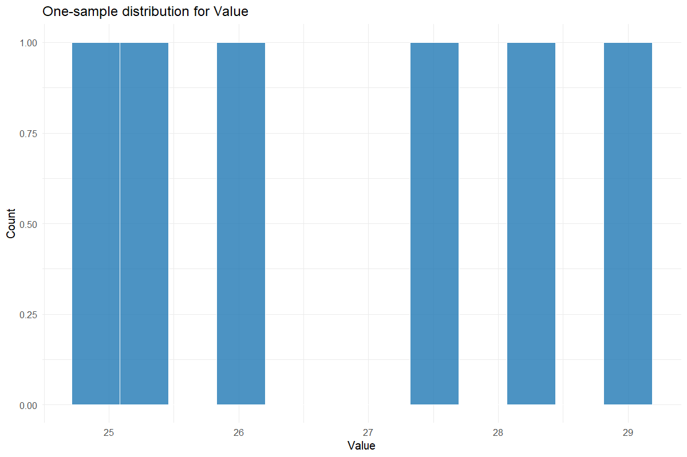
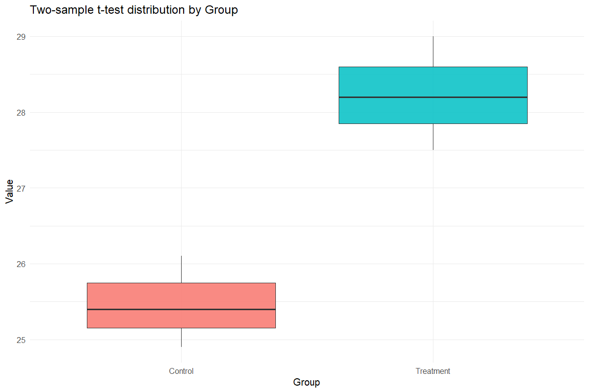
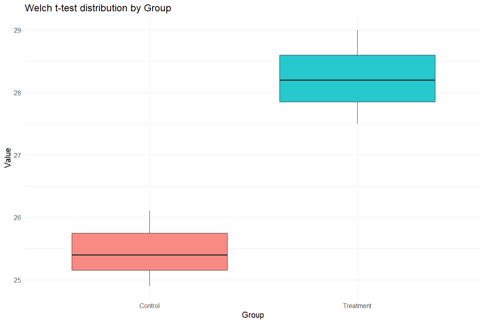
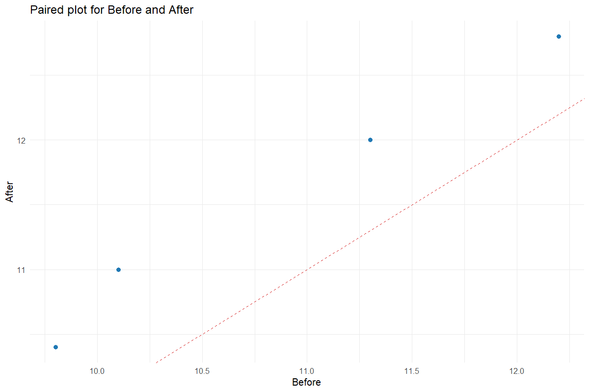

# Compare Means

Report the difference with its uncertainty

## Question and data
Choose a one-sample, equal-variance two-sample, Welch or paired t-test. Paired data must have the two measurements aligned within each experimental unit.

## Read and report the results
The result contains the explicitly named contrast, difference estimate, SE, df, t, p-value and 95% confidence interval for that same difference. The independent contrast subtracts the second factor level from the first; paired contrasts subtract right from left.

## Scope and assumptions
One-sample results express the mean minus the hypothesized value. Welch allows unequal variances; pairing must follow the design rather than data ordering alone. All tests here are two-sided. A variance test is diagnostic, not an automatic rule for choosing a t-test.

## Setup
```r
source("tools/example-cases.R")
load_drdesign()
```

## ttest-one-sample

[Example CSV](../data/ttest-one-sample.csv) · [R script](../code/ttest-one-sample.R)

Synthetic teaching data; not observations from a field experiment.

```r
data <- read_pasted_table(default_data[["Compare Means"]])
result <- run_ttest_analysis(data,"one-sample",value_var="Value",group_var="Group",mu=25)
```

### dataset

[Full-precision CSV](../data/ttest-one-sample-table-1.csv)

| Group | Value |
| --- | --- |
| Control | 25.400 |
| Control | 26.100 |
| Treatment | 28.200 |
| Treatment | 27.500 |
| Control | 24.900 |
| Treatment | 29.000 |

### summary

[Full-precision CSV](../data/ttest-one-sample-table-2.csv)

| Variable | N | Mean | SD |
| --- | --- | --- | --- |
| Value | 6 | 26.850 | 1.633 |

### variance

[Full-precision CSV](../data/ttest-one-sample-table-3.csv)

| Statistic | Value |
| --- | --- |
| Hypothesized mean | 25.000 |
| Alternative | two.sided |

### test_result

[Full-precision CSV](../data/ttest-one-sample-table-4.csv)

| Contrast | Estimate | SE | df | t | p-value | CI lower | CI upper | Method |
| --- | --- | --- | --- | --- | --- | --- | --- | --- |
| Value minus 25 | 1.850 | 0.667 | 5 | 2.775 | 0.039 | 0.136 | 3.564 | One Sample t-test |



## ttest-two-sample

[Example CSV](../data/ttest-two-sample.csv) · [R script](../code/ttest-two-sample.R)

Synthetic teaching data; not observations from a field experiment.

```r
data <- read_pasted_table(default_data[["Compare Means"]])
result <- run_ttest_analysis(data,"two-sample",value_var="Value",group_var="Group",mu=25)
```

### dataset

[Full-precision CSV](../data/ttest-two-sample-table-1.csv)

| Group | Value |
| --- | --- |
| Control | 25.400 |
| Control | 26.100 |
| Treatment | 28.200 |
| Treatment | 27.500 |
| Control | 24.900 |
| Treatment | 29.000 |

### summary

[Full-precision CSV](../data/ttest-two-sample-table-2.csv)

| Group | N | Mean | SD |
| --- | --- | --- | --- |
| Control | 3 | 25.467 | 0.603 |
| Treatment | 3 | 28.233 | 0.751 |

### variance

[Full-precision CSV](../data/ttest-two-sample-table-3.csv)

| Source / term | Statistic | Value |
| --- | --- | --- |
| F | F statistic | 0.645 |
| num df | df1 | 2.000 |
| denom df | df2 | 2.000 |
|  | p value | 0.784 |

### test_result

[Full-precision CSV](../data/ttest-two-sample-table-4.csv)

| Contrast | Estimate | SE | df | t | p-value | CI lower | CI upper | Method |
| --- | --- | --- | --- | --- | --- | --- | --- | --- |
| Control minus Treatment | -2.767 | 0.556 | 4 | -4.978 | 0.008 | -4.310 | -1.224 |  Two Sample t-test |



## ttest-welch

[Example CSV](../data/ttest-welch.csv) · [R script](../code/ttest-welch.R)

Synthetic teaching data; not observations from a field experiment.

```r
data <- read_pasted_table(default_data[["Compare Means"]])
result <- run_ttest_analysis(data,"welch",value_var="Value",group_var="Group",mu=25)
```

### dataset

[Full-precision CSV](../data/ttest-welch-table-1.csv)

| Group | Value |
| --- | --- |
| Control | 25.400 |
| Control | 26.100 |
| Treatment | 28.200 |
| Treatment | 27.500 |
| Control | 24.900 |
| Treatment | 29.000 |

### summary

[Full-precision CSV](../data/ttest-welch-table-2.csv)

| Group | N | Mean | SD |
| --- | --- | --- | --- |
| Control | 3 | 25.467 | 0.603 |
| Treatment | 3 | 28.233 | 0.751 |

### variance

[Full-precision CSV](../data/ttest-welch-table-3.csv)

| Source / term | Statistic | Value |
| --- | --- | --- |
| F | F statistic | 0.645 |
| num df | df1 | 2.000 |
| denom df | df2 | 2.000 |
|  | p value | 0.784 |

### test_result

[Full-precision CSV](../data/ttest-welch-table-4.csv)

| Contrast | Estimate | SE | df | t | p-value | CI lower | CI upper | Method |
| --- | --- | --- | --- | --- | --- | --- | --- | --- |
| Control minus Treatment | -2.767 | 0.556 | 3.822 | -4.978 | 0.009 | -4.339 | -1.195 | Welch Two Sample t-test |



## ttest-paired

[Example CSV](../data/ttest-paired.csv) · [R script](../code/ttest-paired.R)

Synthetic teaching data; not observations from a field experiment.

```r
data <- data.frame(Before=c(10.1,11.3,9.8,12.2),After=c(11,12,10.4,12.8))
result <- run_ttest_analysis(data,"paired",value_var="Before",pair_left="Before",pair_right="After")
```

### dataset

[Full-precision CSV](../data/ttest-paired-table-1.csv)

| Before | After |
| --- | --- |
| 10.100 | 11.000 |
| 11.300 | 12.000 |
| 9.800 | 10.400 |
| 12.200 | 12.800 |

### summary

[Full-precision CSV](../data/ttest-paired-table-2.csv)

| Variable | Mean | SD | N |
| --- | --- | --- | --- |
| Before | 10.850 | 1.109 | 4 |
| After | 11.550 | 1.063 | 4 |

### variance

[Full-precision CSV](../data/ttest-paired-table-3.csv)

| Statistic | Value |
| --- | --- |
| Paired t-test | Paired t-test |

### test_result

[Full-precision CSV](../data/ttest-paired-table-4.csv)

| Contrast | Estimate | SE | df | t | p-value | CI lower | CI upper | Method |
| --- | --- | --- | --- | --- | --- | --- | --- | --- |
| Before minus After | -0.700 | 0.071 | 3 | -9.899 | 0.002 | -0.925 | -0.475 | Paired t-test |



## Reporting conventions
Tables: estimates and standard errors to 3 decimals; p-values below 0.001 shown as <0.001. Very small or large values use scientific notation. NA means unavailable or not applicable. CSV files retain numerical precision. Confidence levels and multiplicity corrections follow the stated analysis settings; shared letters indicate non-rejection, not equivalence.

[Validation and limitations](../VALIDATION.md)
