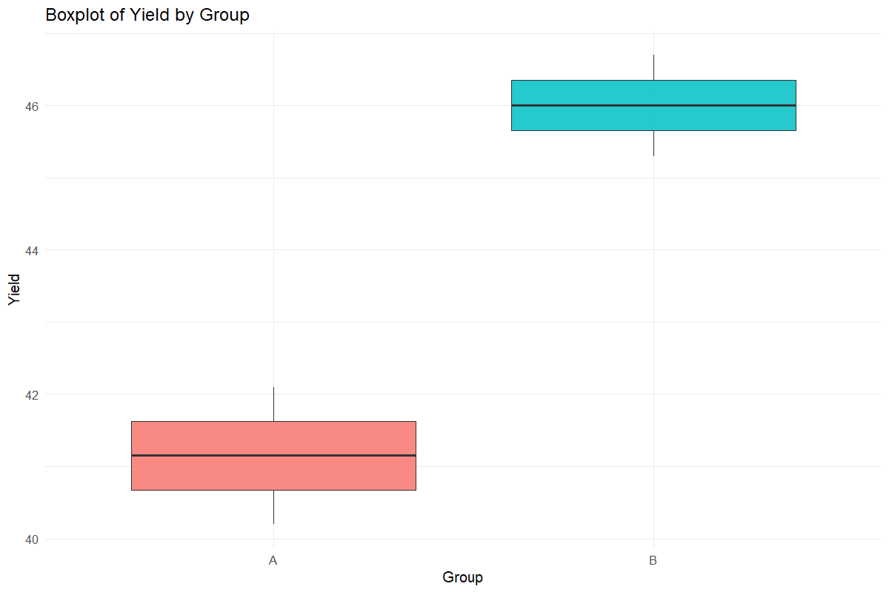
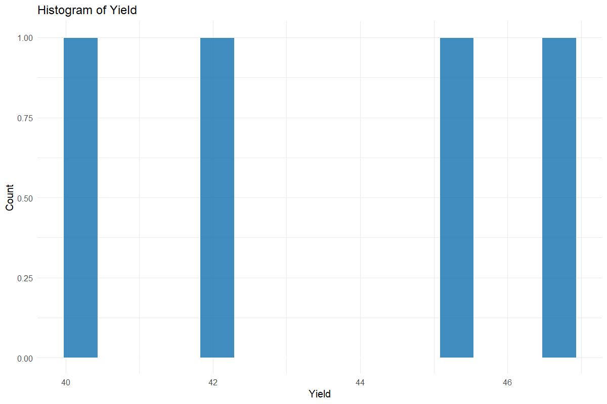
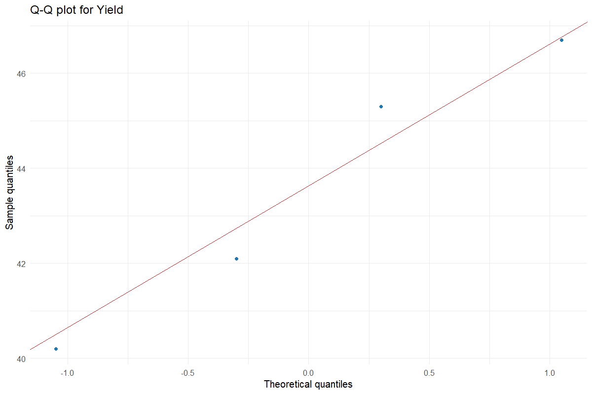

# Descriptive Statistics

Describe the observations before modelling

## Question and data
Select numeric traits and, if appropriate, a grouping variable. The examples cover overall and grouped summaries, boxplots, histograms, Q–Q plots and Shapiro–Wilk normality checks.

## Read and report the results
Report the number of observations, mean, sample SD and observed range for each trait or group. State units. SD describes dispersion of observations; it is not the SE of a mean.

## Scope and assumptions
Normality of raw observations is not the same as normality of model residuals. A nonsignificant Shapiro–Wilk result does not prove normality. Missing observations must first be reviewed in Data Preparation.

## Setup
```r
source("tools/example-cases.R")
load_drdesign()
```

## descriptive-summary

[Example CSV](../data/descriptive-summary.csv) · [R script](../code/descriptive-summary.R)

Synthetic teaching data; not observations from a field experiment.

```r
data <- read_pasted_table(default_data[["Descriptive Statistics"]])
result <- run_descriptive_analysis(data,"summary",c("Yield","Height"),"Group")
```

### dataset

[Full-precision CSV](../data/descriptive-summary-table-1.csv)

| Group | Yield | Height |
| --- | --- | --- |
| A | 42.100 | 120.000 |
| B | 45.300 | 125.000 |
| A | 40.200 | 118.000 |
| B | 46.700 | 128.000 |

### summary

[Full-precision CSV](../data/descriptive-summary-table-2.csv)

| Variable | N | Mean | SD | Min | Max |
| --- | --- | --- | --- | --- | --- |
| Yield | 4 | 43.575 | 2.961 | 40.200 | 46.700 |
| Height | 4 | 122.750 | 4.573 | 118.000 | 128.000 |

### by_group

[Full-precision CSV](../data/descriptive-summary-table-3.csv)

No rows to report.

## descriptive-sumbygrp

[Example CSV](../data/descriptive-sumbygrp.csv) · [R script](../code/descriptive-sumbygrp.R)

Synthetic teaching data; not observations from a field experiment.

```r
data <- read_pasted_table(default_data[["Descriptive Statistics"]])
result <- run_descriptive_analysis(data,"sumbygrp",c("Yield","Height"),"Group")
```

### dataset

[Full-precision CSV](../data/descriptive-sumbygrp-table-1.csv)

| Group | Yield | Height |
| --- | --- | --- |
| A | 42.100 | 120.000 |
| B | 45.300 | 125.000 |
| A | 40.200 | 118.000 |
| B | 46.700 | 128.000 |

### summary

[Full-precision CSV](../data/descriptive-sumbygrp-table-2.csv)

| Variable | N | Mean | SD | Min | Max |
| --- | --- | --- | --- | --- | --- |
| Yield | 4 | 43.575 | 2.961 | 40.200 | 46.700 |
| Height | 4 | 122.750 | 4.573 | 118.000 | 128.000 |

### by_group

[Full-precision CSV](../data/descriptive-sumbygrp-table-3.csv)

| Group | Variable | N | Mean | SD | Min | Max |
| --- | --- | --- | --- | --- | --- | --- |
| A | Height | 2 | 119.000 | 1.414 | 118.000 | 120.000 |
| A | Yield | 2 | 41.150 | 1.344 | 40.200 | 42.100 |
| B | Height | 2 | 126.500 | 2.121 | 125.000 | 128.000 |
| B | Yield | 2 | 46.000 | 0.990 | 45.300 | 46.700 |

## descriptive-boxplot

[Example CSV](../data/descriptive-boxplot.csv) · [R script](../code/descriptive-boxplot.R)

Synthetic teaching data; not observations from a field experiment.

```r
data <- read_pasted_table(default_data[["Descriptive Statistics"]])
result <- run_descriptive_analysis(data,"boxplot",c("Yield","Height"),"Group")
```

### dataset

[Full-precision CSV](../data/descriptive-boxplot-table-1.csv)

| Group | Yield | Height |
| --- | --- | --- |
| A | 42.100 | 120.000 |
| B | 45.300 | 125.000 |
| A | 40.200 | 118.000 |
| B | 46.700 | 128.000 |

### summary

[Full-precision CSV](../data/descriptive-boxplot-table-2.csv)

| Variable | N | Mean | SD | Min | Max |
| --- | --- | --- | --- | --- | --- |
| Yield | 4 | 43.575 | 2.961 | 40.200 | 46.700 |
| Height | 4 | 122.750 | 4.573 | 118.000 | 128.000 |

### by_group

[Full-precision CSV](../data/descriptive-boxplot-table-3.csv)

No rows to report.



## descriptive-histogram

[Example CSV](../data/descriptive-histogram.csv) · [R script](../code/descriptive-histogram.R)

Synthetic teaching data; not observations from a field experiment.

```r
data <- read_pasted_table(default_data[["Descriptive Statistics"]])
result <- run_descriptive_analysis(data,"histogram",c("Yield","Height"),"Group")
```

### dataset

[Full-precision CSV](../data/descriptive-histogram-table-1.csv)

| Group | Yield | Height |
| --- | --- | --- |
| A | 42.100 | 120.000 |
| B | 45.300 | 125.000 |
| A | 40.200 | 118.000 |
| B | 46.700 | 128.000 |

### summary

[Full-precision CSV](../data/descriptive-histogram-table-2.csv)

| Variable | N | Mean | SD | Min | Max |
| --- | --- | --- | --- | --- | --- |
| Yield | 4 | 43.575 | 2.961 | 40.200 | 46.700 |
| Height | 4 | 122.750 | 4.573 | 118.000 | 128.000 |

### by_group

[Full-precision CSV](../data/descriptive-histogram-table-3.csv)

No rows to report.



## descriptive-qqplot

[Example CSV](../data/descriptive-qqplot.csv) · [R script](../code/descriptive-qqplot.R)

Synthetic teaching data; not observations from a field experiment.

```r
data <- read_pasted_table(default_data[["Descriptive Statistics"]])
result <- run_descriptive_analysis(data,"qqplot",c("Yield","Height"),"Group")
```

### dataset

[Full-precision CSV](../data/descriptive-qqplot-table-1.csv)

| Group | Yield | Height |
| --- | --- | --- |
| A | 42.100 | 120.000 |
| B | 45.300 | 125.000 |
| A | 40.200 | 118.000 |
| B | 46.700 | 128.000 |

### summary

[Full-precision CSV](../data/descriptive-qqplot-table-2.csv)

| Variable | N | Mean | SD | Min | Max |
| --- | --- | --- | --- | --- | --- |
| Yield | 4 | 43.575 | 2.961 | 40.200 | 46.700 |
| Height | 4 | 122.750 | 4.573 | 118.000 | 128.000 |

### by_group

[Full-precision CSV](../data/descriptive-qqplot-table-3.csv)

No rows to report.



## descriptive-nt

[Example CSV](../data/descriptive-nt.csv) · [R script](../code/descriptive-nt.R)

Synthetic teaching data; not observations from a field experiment.

```r
data <- read_pasted_table(default_data[["Descriptive Statistics"]])
result <- run_descriptive_analysis(data,"nt",c("Yield","Height"),"Group")
```

### dataset

[Full-precision CSV](../data/descriptive-nt-table-1.csv)

| Group | Yield | Height |
| --- | --- | --- |
| A | 42.100 | 120.000 |
| B | 45.300 | 125.000 |
| A | 40.200 | 118.000 |
| B | 46.700 | 128.000 |

### summary

[Full-precision CSV](../data/descriptive-nt-table-2.csv)

| Variable | N | Mean | SD | Min | Max |
| --- | --- | --- | --- | --- | --- |
| Yield | 4 | 43.575 | 2.961 | 40.200 | 46.700 |
| Height | 4 | 122.750 | 4.573 | 118.000 | 128.000 |

### by_group

[Full-precision CSV](../data/descriptive-nt-table-3.csv)

No rows to report.


## Reporting conventions
Tables: estimates and standard errors to 3 decimals; p-values below 0.001 shown as <0.001. Very small or large values use scientific notation. NA means unavailable or not applicable. CSV files retain numerical precision. Confidence levels and multiplicity corrections follow the stated analysis settings; shared letters indicate non-rejection, not equivalence.

[Validation and limitations](../VALIDATION.md)
