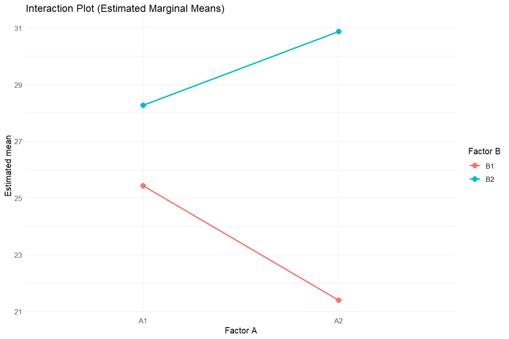
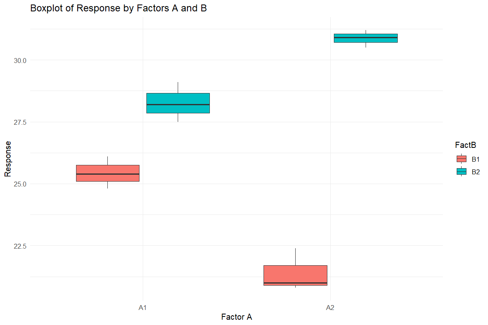
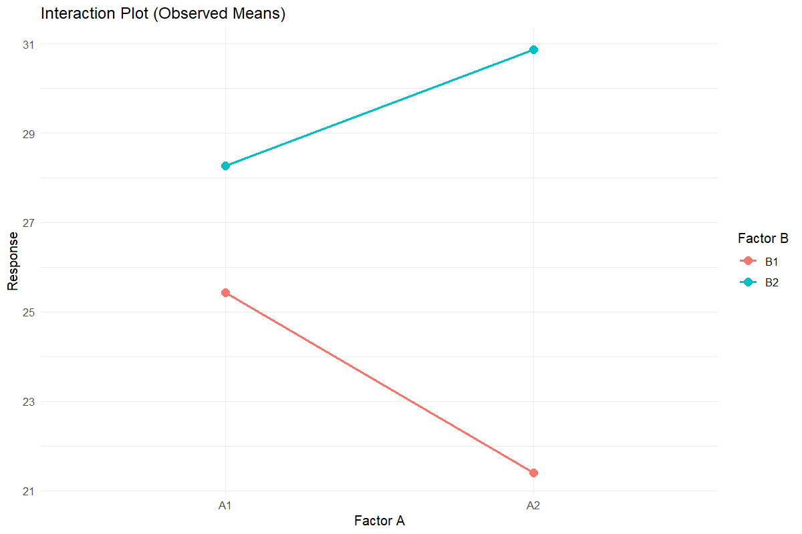
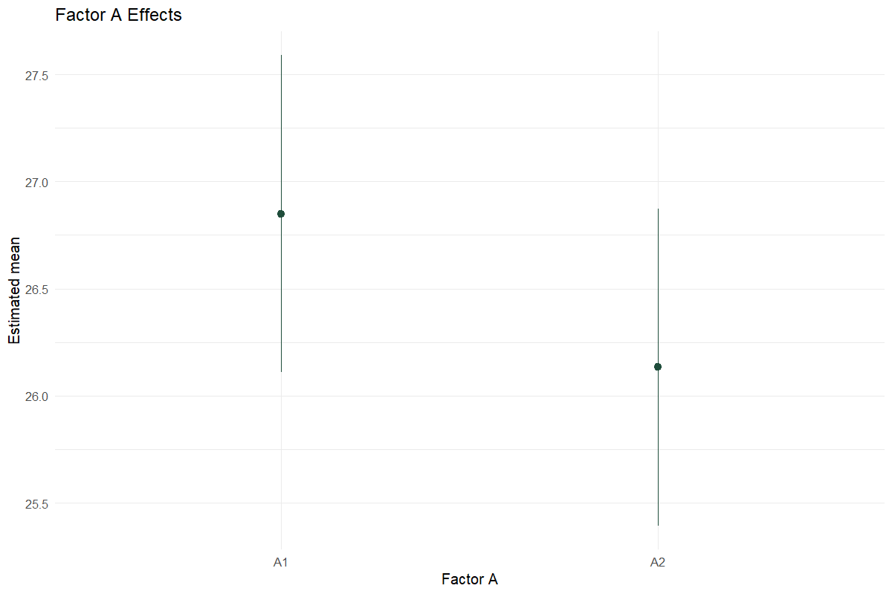
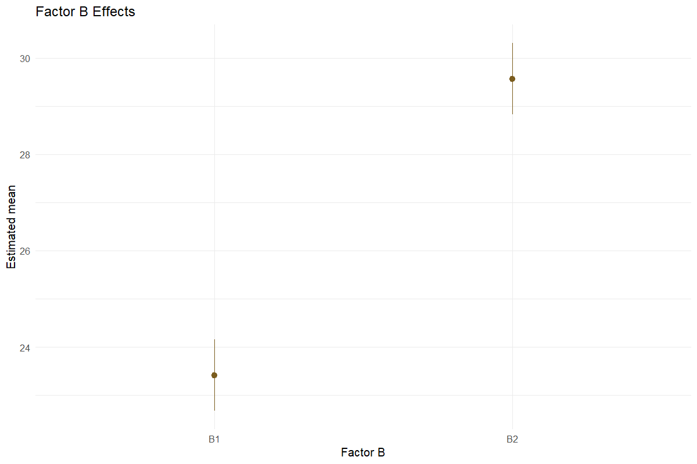

# Factorial Design

Retain the interaction and explain the simple effects

## Question and data
Provide one row per factor combination, in A-major/B-minor order: A1B1, A1B2, then A2B1, A2B2. Set the actual number of levels and choose CRD or RBD.

## Read and report the results
The full factorial model remains the inference model. Report the interaction with main effects and interpret marginal means in that context. Tukey pairwise tables and compact-letter displays are provided; the additive ANOVA is a separate descriptive comparison.

## Scope and assumptions
The software does not choose an additive model from an interaction p-value. Main effects can obscure a strong interaction. Confirm the row-to-factor mapping shown in the long-data table.

## Setup
```r
source("tools/example-cases.R")
load_drdesign()
```

## Factorial-CRD

[Example CSV](../data/Factorial-CRD.csv) · [R script](../code/Factorial-CRD.R)

Synthetic teaching data; not observations from a field experiment.

```r
data <- read_pasted_table(default_data[["Factorial CRD"]])
result <- run_design_analysis(data, "Factorial CRD", levels_a=2, levels_b=2)
```

### dataset

[Full-precision CSV](../data/Factorial-CRD-table-1.csv)

| Treatment | Rep | Value | Factor A | Factor B |
| --- | --- | --- | --- | --- |
| A1B1 | Rep1 | 25.400 | A1 | B1 |
| A1B1 | Rep2 | 26.100 | A1 | B1 |
| A1B1 | Rep3 | 24.800 | A1 | B1 |
| A1B2 | Rep1 | 28.200 | A1 | B2 |
| A1B2 | Rep2 | 27.500 | A1 | B2 |
| A1B2 | Rep3 | 29.100 | A1 | B2 |
| A2B1 | Rep1 | 21.000 | A2 | B1 |
| A2B1 | Rep2 | 22.400 | A2 | B1 |
| A2B1 | Rep3 | 20.800 | A2 | B1 |
| A2B2 | Rep1 | 30.500 | A2 | B2 |

First 10 rows shown. Download the CSV for every row.

### anova

[Full-precision CSV](../data/Factorial-CRD-table-2.csv)

| df | SS | MS | F | p-value | Source / term |
| --- | --- | --- | --- | --- | --- |
| 1 | 1.541 | 1.541 | 3.161 | 0.113 | FactA |
| 1 | 113.467 | 113.467 | 232.754 | <0.001 | FactB |
| 1 | 33.001 | 33.001 | 67.694 | <0.001 | FactA:FactB |
| 8 | 3.900 | 0.487 | NA | NA | Residuals |

### stats

[Full-precision CSV](../data/Factorial-CRD-table-3.csv)

| Statistic | Value |
| --- | --- |
| Replications detected | 3.000 |
| Grand Mean | 26.492 |
| Mean Square Error (MSE) | 0.487 |
| Standard Error of Mean - SE(m) | 0.403 |
| Standard Error of Difference - SE(d) | 0.570 |
| Coefficient of Variation - CV (%) | 2.636 |

### means

[Full-precision CSV](../data/Factorial-CRD-table-4.csv)

| Treatment | Value | std | r | se | LCL | UCL | Min | Max | Q25 | Q50 | Q75 |
| --- | --- | --- | --- | --- | --- | --- | --- | --- | --- | --- | --- |
| A1:B1 | 25.433 | 0.651 | 3.000 | 0.403 | 24.504 | 26.363 | 24.800 | 26.100 | 25.100 | 25.400 | 25.750 |
| A1:B2 | 28.267 | 0.802 | 3.000 | 0.403 | 27.337 | 29.196 | 27.500 | 29.100 | 27.850 | 28.200 | 28.650 |
| A2:B1 | 21.400 | 0.872 | 3.000 | 0.403 | 20.470 | 22.330 | 20.800 | 22.400 | 20.900 | 21.000 | 21.700 |
| A2:B2 | 30.867 | 0.351 | 3.000 | 0.403 | 29.937 | 31.796 | 30.500 | 31.200 | 30.700 | 30.900 | 31.050 |

### groups

[Full-precision CSV](../data/Factorial-CRD-table-5.csv)

| Treatment | Value | Group |
| --- | --- | --- |
| A2:B2 | 30.867 | a |
| A1:B2 | 28.267 | b |
| A1:B1 | 25.433 | c |
| A2:B1 | 21.400 | d |

### lsd_stats

[Full-precision CSV](../data/Factorial-CRD-table-6.csv)

| Source / term | Metric | Value |
| --- | --- | --- |
| MSerror | MSerror | 0.487 |
| Df | Df | 8.000 |
| Mean | Mean | 26.492 |
| CV | CV | 2.636 |
| t.value | t value | 2.306 |
| LSD | LSD | 1.315 |

### factorial full_anova

[Full-precision CSV](../data/Factorial-CRD-table-7.csv)

| df | SS | MS | F | p-value | Source / term |
| --- | --- | --- | --- | --- | --- |
| 1 | 1.541 | 1.541 | 3.161 | 0.113 | FactA |
| 1 | 113.467 | 113.467 | 232.754 | <0.001 | FactB |
| 1 | 33.001 | 33.001 | 67.694 | <0.001 | FactA:FactB |
| 8 | 3.900 | 0.487 | NA | NA | Residuals |

### factorial additive_anova

[Full-precision CSV](../data/Factorial-CRD-table-8.csv)

| df | SS | MS | F | p-value | Source / term |
| --- | --- | --- | --- | --- | --- |
| 1 | 1.541 | 1.541 | 0.376 | 0.555 | FactA |
| 1 | 113.467 | 113.467 | 27.674 | <0.001 | FactB |
| 9 | 36.901 | 4.100 | NA | NA | Residuals |

### factorial assumptions

[Full-precision CSV](../data/Factorial-CRD-table-9.csv)

| Metric | Value |
| --- | --- |
| Alpha | 0.050 |
| Interaction p-value | <0.001 |
| Selected final model | Interaction model |

### factorial shapiro

[Full-precision CSV](../data/Factorial-CRD-table-10.csv)

| Metric | Value |
| --- | --- |
| W statistic | 0.932 |
| p-value | 0.401 |

### factorial levene

[Full-precision CSV](../data/Factorial-CRD-table-11.csv)

| Source / term | df | F | p-value |
| --- | --- | --- | --- |
| group | 3 | 0.244 | 0.863 |
|   | 8 | NA | NA |

### factorial diagnostics

[Full-precision CSV](../data/Factorial-CRD-table-12.csv)

| Observation | Fitted | Residual |
| --- | --- | --- |
| 1 | 25.433 | -0.033 |
| 2 | 25.433 | 0.667 |
| 3 | 25.433 | -0.633 |
| 4 | 28.267 | -0.067 |
| 5 | 28.267 | -0.767 |
| 6 | 28.267 | 0.833 |
| 7 | 21.400 | -0.400 |
| 8 | 21.400 | 1.000 |
| 9 | 21.400 | -0.600 |
| 10 | 30.867 | -0.367 |

First 10 rows shown. Download the CSV for every row.

### factorial emmeans_interaction

[Full-precision CSV](../data/Factorial-CRD-table-13.csv)

| Factor A | Factor B | Estimated mean | SE | df | CI lower | CI upper |
| --- | --- | --- | --- | --- | --- | --- |
| A1 | B1 | 25.433 | 0.403 | 8 | 24.504 | 26.363 |
| A2 | B1 | 21.400 | 0.403 | 8 | 20.470 | 22.330 |
| A1 | B2 | 28.267 | 0.403 | 8 | 27.337 | 29.196 |
| A2 | B2 | 30.867 | 0.403 | 8 | 29.937 | 31.796 |

Confidence level used: 0.95

### factorial emmeans_a

[Full-precision CSV](../data/Factorial-CRD-table-14.csv)

| Factor A | Estimated mean | SE | df | CI lower | CI upper |
| --- | --- | --- | --- | --- | --- |
| A1 | 26.850 | 0.285 | 8 | 26.193 | 27.507 |
| A2 | 26.133 | 0.285 | 8 | 25.476 | 26.791 |

Results are averaged over the levels of: FactB

Confidence level used: 0.95

### factorial emmeans_b

[Full-precision CSV](../data/Factorial-CRD-table-15.csv)

| Factor B | Estimated mean | SE | df | CI lower | CI upper |
| --- | --- | --- | --- | --- | --- |
| B1 | 23.417 | 0.285 | 8 | 22.759 | 24.074 |
| B2 | 29.567 | 0.285 | 8 | 28.909 | 30.224 |

Results are averaged over the levels of: FactA

Confidence level used: 0.95

### factorial tukey_interaction

[Full-precision CSV](../data/Factorial-CRD-table-16.csv)

| contrast | estimate | SE | df | t | p-value |
| --- | --- | --- | --- | --- | --- |
| A1 B1 - A2 B1 | 4.033 | 0.570 | 8 | 7.075 | <0.001 |
| A1 B1 - A1 B2 | -2.833 | 0.570 | 8 | -4.970 | 0.005 |
| A1 B1 - A2 B2 | -5.433 | 0.570 | 8 | -9.531 | <0.001 |
| A2 B1 - A1 B2 | -6.867 | 0.570 | 8 | -12.045 | <0.001 |
| A2 B1 - A2 B2 | -9.467 | 0.570 | 8 | -16.606 | <0.001 |
| A1 B2 - A2 B2 | -2.600 | 0.570 | 8 | -4.561 | 0.008 |

P value adjustment: tukey method for comparing a family of 4 estimates

### factorial tukey_a

[Full-precision CSV](../data/Factorial-CRD-table-17.csv)

| contrast | estimate | SE | df | t | p-value |
| --- | --- | --- | --- | --- | --- |
| A1 - A2 | 0.717 | 0.403 | 8 | 1.778 | 0.113 |

Results are averaged over the levels of: FactB

### factorial tukey_b

[Full-precision CSV](../data/Factorial-CRD-table-18.csv)

| contrast | estimate | SE | df | t | p-value |
| --- | --- | --- | --- | --- | --- |
| B1 - B2 | -6.150 | 0.403 | 8 | -15.256 | <0.001 |

Results are averaged over the levels of: FactA

### factorial cld_interaction

[Full-precision CSV](../data/Factorial-CRD-table-19.csv)

| Source / term | Factor A | Factor B | Estimated mean | SE | df | CI lower | CI upper | Group |
| --- | --- | --- | --- | --- | --- | --- | --- | --- |
| 2 | A2 | B1 | 21.400 | 0.403 | 8 | 20.113 | 22.687 |  a    |
| 1 | A1 | B1 | 25.433 | 0.403 | 8 | 24.146 | 26.721 |   b   |
| 3 | A1 | B2 | 28.267 | 0.403 | 8 | 26.979 | 29.554 |    c  |
| 4 | A2 | B2 | 30.867 | 0.403 | 8 | 29.579 | 32.154 |     d |

Confidence level used: 0.95

Conf-level adjustment: sidak method for 4 estimates

P value adjustment: tukey method for comparing a family of 4 estimates

significance level used: alpha = 0.05

NOTE: If two or more means share the same grouping symbol, then we cannot show them to be different. But we also did not show them to be the same.

### factorial cld_a

[Full-precision CSV](../data/Factorial-CRD-table-20.csv)

| Source / term | Factor A | Estimated mean | SE | df | CI lower | CI upper | Group |
| --- | --- | --- | --- | --- | --- | --- | --- |
| 2 | A2 | 26.133 | 0.285 | 8 | 25.351 | 26.915 |  a |
| 1 | A1 | 26.850 | 0.285 | 8 | 26.068 | 27.632 |  a |

Results are averaged over the levels of: FactB

Confidence level used: 0.95

Conf-level adjustment: sidak method for 2 estimates

significance level used: alpha = 0.05

NOTE: If two or more means share the same grouping symbol, then we cannot show them to be different. But we also did not show them to be the same.

### factorial cld_b

[Full-precision CSV](../data/Factorial-CRD-table-21.csv)

| Factor B | Estimated mean | SE | df | CI lower | CI upper | Group |
| --- | --- | --- | --- | --- | --- | --- |
| B1 | 23.417 | 0.285 | 8 | 22.635 | 24.199 |  a  |
| B2 | 29.567 | 0.285 | 8 | 28.785 | 30.349 |   b |

Results are averaged over the levels of: FactA

Confidence level used: 0.95

Conf-level adjustment: sidak method for 2 estimates

significance level used: alpha = 0.05

NOTE: If two or more means share the same grouping symbol, then we cannot show them to be different. But we also did not show them to be the same.





### Diagnostics and model notes

- NOTE: Results may be misleading due to involvement in interactions

- Model: Factorial CRD at alpha 0.05 using LSD comparisons Diagnostics: NOTE: Results may be misleading due to involvement in interactions


## Factorial-RBD

[Example CSV](../data/Factorial-RBD.csv) · [R script](../code/Factorial-RBD.R)

Synthetic teaching data; not observations from a field experiment.

```r
data <- read_pasted_table(default_data[["Factorial RBD"]])
result <- run_design_analysis(data, "Factorial RBD", levels_a=2, levels_b=2)
```

### dataset

[Full-precision CSV](../data/Factorial-RBD-table-1.csv)

| Treatment | Rep | Value | Factor A | Factor B |
| --- | --- | --- | --- | --- |
| A1B1 | Rep1 | 25.400 | A1 | B1 |
| A1B1 | Rep2 | 26.100 | A1 | B1 |
| A1B1 | Rep3 | 24.800 | A1 | B1 |
| A1B2 | Rep1 | 28.200 | A1 | B2 |
| A1B2 | Rep2 | 27.500 | A1 | B2 |
| A1B2 | Rep3 | 29.100 | A1 | B2 |
| A2B1 | Rep1 | 21.000 | A2 | B1 |
| A2B1 | Rep2 | 22.400 | A2 | B1 |
| A2B1 | Rep3 | 20.800 | A2 | B1 |
| A2B2 | Rep1 | 30.500 | A2 | B2 |

First 10 rows shown. Download the CSV for every row.

### anova

[Full-precision CSV](../data/Factorial-RBD-table-2.csv)

| df | SS | MS | F | p-value | Source / term |
| --- | --- | --- | --- | --- | --- |
| 2 | 0.602 | 0.301 | 0.547 | 0.605 | Rep |
| 1 | 1.541 | 1.541 | 2.803 | 0.145 | FactA |
| 1 | 113.467 | 113.467 | 206.409 | <0.001 | FactB |
| 1 | 33.001 | 33.001 | 60.032 | <0.001 | FactA:FactB |
| 6 | 3.298 | 0.550 | NA | NA | Residuals |

### stats

[Full-precision CSV](../data/Factorial-RBD-table-3.csv)

| Statistic | Value |
| --- | --- |
| Replications detected | 3.000 |
| Grand Mean | 26.492 |
| Mean Square Error (MSE) | 0.550 |
| Standard Error of Mean - SE(m) | 0.428 |
| Standard Error of Difference - SE(d) | 0.605 |
| Coefficient of Variation - CV (%) | 2.799 |

### means

[Full-precision CSV](../data/Factorial-RBD-table-4.csv)

| Treatment | Value | std | r | se | LCL | UCL | Min | Max | Q25 | Q50 | Q75 |
| --- | --- | --- | --- | --- | --- | --- | --- | --- | --- | --- | --- |
| A1:B1 | 25.433 | 0.651 | 3.000 | 0.428 | 24.386 | 26.481 | 24.800 | 26.100 | 25.100 | 25.400 | 25.750 |
| A1:B2 | 28.267 | 0.802 | 3.000 | 0.428 | 27.219 | 29.314 | 27.500 | 29.100 | 27.850 | 28.200 | 28.650 |
| A2:B1 | 21.400 | 0.872 | 3.000 | 0.428 | 20.353 | 22.447 | 20.800 | 22.400 | 20.900 | 21.000 | 21.700 |
| A2:B2 | 30.867 | 0.351 | 3.000 | 0.428 | 29.819 | 31.914 | 30.500 | 31.200 | 30.700 | 30.900 | 31.050 |

### groups

[Full-precision CSV](../data/Factorial-RBD-table-5.csv)

| Treatment | Value | Group |
| --- | --- | --- |
| A2:B2 | 30.867 | a |
| A1:B2 | 28.267 | b |
| A1:B1 | 25.433 | c |
| A2:B1 | 21.400 | d |

### lsd_stats

[Full-precision CSV](../data/Factorial-RBD-table-6.csv)

| Source / term | Metric | Value |
| --- | --- | --- |
| MSerror | MSerror | 0.550 |
| Df | Df | 6.000 |
| Mean | Mean | 26.492 |
| CV | CV | 2.799 |
| t.value | t value | 2.447 |
| LSD | LSD | 1.481 |

### factorial full_anova

[Full-precision CSV](../data/Factorial-RBD-table-7.csv)

| df | SS | MS | F | p-value | Source / term |
| --- | --- | --- | --- | --- | --- |
| 2 | 0.602 | 0.301 | 0.547 | 0.605 | Rep |
| 1 | 1.541 | 1.541 | 2.803 | 0.145 | FactA |
| 1 | 113.467 | 113.467 | 206.409 | <0.001 | FactB |
| 1 | 33.001 | 33.001 | 60.032 | <0.001 | FactA:FactB |
| 6 | 3.298 | 0.550 | NA | NA | Residuals |

### factorial additive_anova

[Full-precision CSV](../data/Factorial-RBD-table-8.csv)

| df | SS | MS | F | p-value | Source / term |
| --- | --- | --- | --- | --- | --- |
| 2 | 0.602 | 0.301 | 0.058 | 0.944 | Rep |
| 1 | 1.541 | 1.541 | 0.297 | 0.603 | FactA |
| 1 | 113.467 | 113.467 | 21.881 | 0.002 | FactB |
| 7 | 36.299 | 5.186 | NA | NA | Residuals |

### factorial assumptions

[Full-precision CSV](../data/Factorial-RBD-table-9.csv)

| Metric | Value |
| --- | --- |
| Alpha | 0.050 |
| Interaction p-value | <0.001 |
| Selected final model | Interaction model |

### factorial shapiro

[Full-precision CSV](../data/Factorial-RBD-table-10.csv)

| Metric | Value |
| --- | --- |
| W statistic | 0.979 |
| p-value | 0.981 |

### factorial levene

[Full-precision CSV](../data/Factorial-RBD-table-11.csv)

| Source / term | df | F | p-value |
| --- | --- | --- | --- |
| group | 3 | 0.244 | 0.863 |
|   | 8 | NA | NA |

### factorial diagnostics

[Full-precision CSV](../data/Factorial-RBD-table-12.csv)

| Observation | Fitted | Residual |
| --- | --- | --- |
| 1 | 25.217 | 0.183 |
| 2 | 25.742 | 0.358 |
| 3 | 25.342 | -0.542 |
| 4 | 28.050 | 0.150 |
| 5 | 28.575 | -1.075 |
| 6 | 28.175 | 0.925 |
| 7 | 21.183 | -0.183 |
| 8 | 21.708 | 0.692 |
| 9 | 21.308 | -0.508 |
| 10 | 30.650 | -0.150 |

First 10 rows shown. Download the CSV for every row.

### factorial emmeans_interaction

[Full-precision CSV](../data/Factorial-RBD-table-13.csv)

| Factor A | Factor B | Estimated mean | SE | df | CI lower | CI upper |
| --- | --- | --- | --- | --- | --- | --- |
| A1 | B1 | 25.433 | 0.428 | 6 | 24.386 | 26.481 |
| A2 | B1 | 21.400 | 0.428 | 6 | 20.353 | 22.447 |
| A1 | B2 | 28.267 | 0.428 | 6 | 27.219 | 29.314 |
| A2 | B2 | 30.867 | 0.428 | 6 | 29.819 | 31.914 |

Results are averaged over the levels of: Rep

Confidence level used: 0.95

### factorial emmeans_a

[Full-precision CSV](../data/Factorial-RBD-table-14.csv)

| Factor A | Estimated mean | SE | df | CI lower | CI upper |
| --- | --- | --- | --- | --- | --- |
| A1 | 26.850 | 0.303 | 6 | 26.109 | 27.591 |
| A2 | 26.133 | 0.303 | 6 | 25.393 | 26.874 |

Results are averaged over the levels of: Rep, FactB

Confidence level used: 0.95

### factorial emmeans_b

[Full-precision CSV](../data/Factorial-RBD-table-15.csv)

| Factor B | Estimated mean | SE | df | CI lower | CI upper |
| --- | --- | --- | --- | --- | --- |
| B1 | 23.417 | 0.303 | 6 | 22.676 | 24.157 |
| B2 | 29.567 | 0.303 | 6 | 28.826 | 30.307 |

Results are averaged over the levels of: Rep, FactA

Confidence level used: 0.95

### factorial tukey_interaction

[Full-precision CSV](../data/Factorial-RBD-table-16.csv)

| contrast | estimate | SE | df | t | p-value |
| --- | --- | --- | --- | --- | --- |
| A1 B1 - A2 B1 | 4.033 | 0.605 | 6 | 6.663 | 0.002 |
| A1 B1 - A1 B2 | -2.833 | 0.605 | 6 | -4.680 | 0.013 |
| A1 B1 - A2 B2 | -5.433 | 0.605 | 6 | -8.975 | <0.001 |
| A2 B1 - A1 B2 | -6.867 | 0.605 | 6 | -11.343 | <0.001 |
| A2 B1 - A2 B2 | -9.467 | 0.605 | 6 | -15.638 | <0.001 |
| A1 B2 - A2 B2 | -2.600 | 0.605 | 6 | -4.295 | 0.020 |

Results are averaged over the levels of: Rep

P value adjustment: tukey method for comparing a family of 4 estimates

### factorial tukey_a

[Full-precision CSV](../data/Factorial-RBD-table-17.csv)

| contrast | estimate | SE | df | t | p-value |
| --- | --- | --- | --- | --- | --- |
| A1 - A2 | 0.717 | 0.428 | 6 | 1.674 | 0.145 |

Results are averaged over the levels of: Rep, FactB

### factorial tukey_b

[Full-precision CSV](../data/Factorial-RBD-table-18.csv)

| contrast | estimate | SE | df | t | p-value |
| --- | --- | --- | --- | --- | --- |
| B1 - B2 | -6.150 | 0.428 | 6 | -14.367 | <0.001 |

Results are averaged over the levels of: Rep, FactA

### factorial cld_interaction

[Full-precision CSV](../data/Factorial-RBD-table-19.csv)

| Source / term | Factor A | Factor B | Estimated mean | SE | df | CI lower | CI upper | Group |
| --- | --- | --- | --- | --- | --- | --- | --- | --- |
| 2 | A2 | B1 | 21.400 | 0.428 | 6 | 19.899 | 22.901 |  a    |
| 1 | A1 | B1 | 25.433 | 0.428 | 6 | 23.933 | 26.934 |   b   |
| 3 | A1 | B2 | 28.267 | 0.428 | 6 | 26.766 | 29.767 |    c  |
| 4 | A2 | B2 | 30.867 | 0.428 | 6 | 29.366 | 32.367 |     d |

Results are averaged over the levels of: Rep

Confidence level used: 0.95

Conf-level adjustment: sidak method for 4 estimates

P value adjustment: tukey method for comparing a family of 4 estimates

significance level used: alpha = 0.05

NOTE: If two or more means share the same grouping symbol, then we cannot show them to be different. But we also did not show them to be the same.

### factorial cld_a

[Full-precision CSV](../data/Factorial-RBD-table-20.csv)

| Source / term | Factor A | Estimated mean | SE | df | CI lower | CI upper | Group |
| --- | --- | --- | --- | --- | --- | --- | --- |
| 2 | A2 | 26.133 | 0.303 | 6 | 25.238 | 27.029 |  a |
| 1 | A1 | 26.850 | 0.303 | 6 | 25.954 | 27.746 |  a |

Results are averaged over the levels of: Rep, FactB

Confidence level used: 0.95

Conf-level adjustment: sidak method for 2 estimates

significance level used: alpha = 0.05

NOTE: If two or more means share the same grouping symbol, then we cannot show them to be different. But we also did not show them to be the same.

### factorial cld_b

[Full-precision CSV](../data/Factorial-RBD-table-21.csv)

| Factor B | Estimated mean | SE | df | CI lower | CI upper | Group |
| --- | --- | --- | --- | --- | --- | --- |
| B1 | 23.417 | 0.303 | 6 | 22.521 | 24.312 |  a  |
| B2 | 29.567 | 0.303 | 6 | 28.671 | 30.462 |   b |

Results are averaged over the levels of: Rep, FactA

Confidence level used: 0.95

Conf-level adjustment: sidak method for 2 estimates

significance level used: alpha = 0.05

NOTE: If two or more means share the same grouping symbol, then we cannot show them to be different. But we also did not show them to be the same.










### Diagnostics and model notes

- NOTE: Results may be misleading due to involvement in interactions

- Model: Factorial RBD at alpha 0.05 using LSD comparisons Diagnostics: NOTE: Results may be misleading due to involvement in interactions


## Reporting conventions
Tables: estimates and standard errors to 3 decimals; p-values below 0.001 shown as <0.001. Very small or large values use scientific notation. NA means unavailable or not applicable. CSV files retain numerical precision. Confidence levels and multiplicity corrections follow the stated analysis settings; shared letters indicate non-rejection, not equivalence.

[Validation and limitations](../VALIDATION.md)
