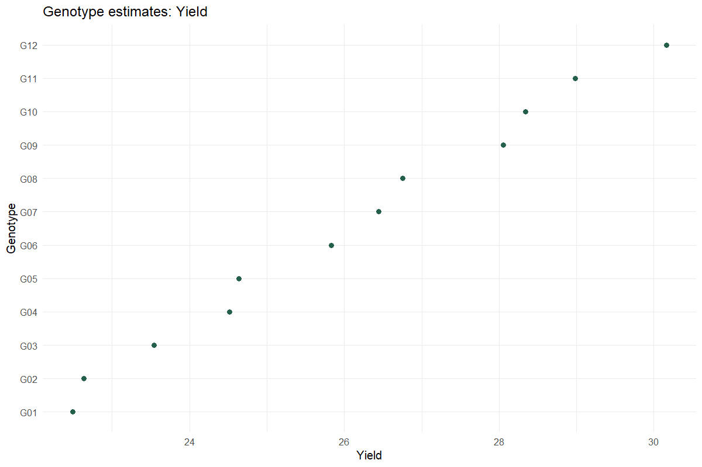

# Genetic Variability & Heritability

Distinguish plot and entry-mean heritability

## Question and data
Use replicated single-environment genotype observations. Genotype is random and replication fixed. Multiple selected traits share the reviewed complete-case set.

## Read and report the results
For balanced RCBD, genetic variance equals (MSgenotype − MSerror)/r when the REML solution is interior. Entry-mean H² is σg²/(σg² + σe²/r); conditional plot H² uses σg²/(σg² + σe²). Report the scale explicitly. Predicted means average fixed replication effects equally.

## Scope and assumptions
CVs require a positive trait mean. Genetic advance is a model-based expectation at the chosen selection intensity, not observed realized gain. BLUP intervals describe conditional genotypic effects, not uncertainty of the absolute predicted mean.

## Setup
```r
source("tools/example-cases.R")
load_drdesign()
```

## genetic

[Example CSV](../data/genetic.csv) · [R script](../code/genetic.R)

Synthetic teaching data; not observations from a field experiment.

```r
data <- research_example("genetic-variability")
result <- run_genetic_variability(data,c("Yield","Height"))
```

### Yield genetic parameters

[Full-precision CSV](../data/genetic-table-1.csv)

| Trait | Genetic Variance | Residual Variance | H2 plot conditional on blocks | H2 entry mean balanced RCBD | GCV percent | PCV plot percent | Selection Accuracy balanced RCBD | Genetic Advance entry mean |
| --- | --- | --- | --- | --- | --- | --- | --- | --- |
| Yield | 7.341 | 3.222 | 0.695 | 0.872 | 10.408 | 12.485 | 0.934 | 3.934 |

### Yield variance components

[Full-precision CSV](../data/genetic-table-2.csv)

| grp | var1 | var2 | vcov | sdcor |
| --- | --- | --- | --- | --- |
| GEN | (Intercept) | NA | 7.341 | 2.710 |
| Residual | NA | NA | 3.222 | 1.795 |

### Yield BLUPs

[Full-precision CSV](../data/genetic-table-3.csv)

| Rank | Genotype | Genotypic effect (BLUP) | Predicted | Conditional SE | Effect interval lower | Effect interval upper |
| --- | --- | --- | --- | --- | --- | --- |
| 1 | G12 | 4.130 | 30.162 | 0.968 | 2.232 | 6.027 |
| 2 | G11 | 2.954 | 28.986 | 0.968 | 1.057 | 4.851 |
| 3 | G10 | 2.307 | 28.339 | 0.968 | 0.410 | 4.204 |
| 4 | G09 | 2.019 | 28.051 | 0.968 | 0.122 | 3.916 |
| 5 | G08 | 0.724 | 26.756 | 0.968 | -1.173 | 2.621 |
| 6 | G07 | 0.412 | 26.444 | 0.968 | -1.485 | 2.309 |
| 7 | G06 | -0.203 | 25.829 | 0.968 | -2.100 | 1.694 |
| 8 | G05 | -1.397 | 24.635 | 0.968 | -3.294 | 0.500 |
| 9 | G04 | -1.517 | 24.515 | 0.968 | -3.414 | 0.380 |
| 10 | G03 | -2.489 | 23.543 | 0.968 | -4.386 | -0.592 |

First 10 rows shown. Download the CSV for every row.

### Height genetic parameters

[Full-precision CSV](../data/genetic-table-4.csv)

| Trait | Genetic Variance | Residual Variance | H2 plot conditional on blocks | H2 entry mean balanced RCBD | GCV percent | PCV plot percent | Selection Accuracy balanced RCBD | Genetic Advance entry mean |
| --- | --- | --- | --- | --- | --- | --- | --- | --- |
| Height | 14.689 | 17.163 | 0.461 | 0.720 | 6.646 | 9.787 | 0.848 | 5.054 |

### Height variance components

[Full-precision CSV](../data/genetic-table-5.csv)

| grp | var1 | var2 | vcov | sdcor |
| --- | --- | --- | --- | --- |
| GEN | (Intercept) | NA | 14.689 | 3.833 |
| Residual | NA | NA | 17.163 | 4.143 |

### Height BLUPs

[Full-precision CSV](../data/genetic-table-6.csv)

| Rank | Genotype | Genotypic effect (BLUP) | Predicted | Conditional SE | Effect interval lower | Effect interval upper |
| --- | --- | --- | --- | --- | --- | --- |
| 1 | G10 | 4.312 | 61.978 | 2.029 | 0.335 | 8.290 |
| 2 | G11 | 4.194 | 61.860 | 2.029 | 0.217 | 8.171 |
| 3 | G12 | 3.600 | 61.265 | 2.029 | -0.378 | 7.577 |
| 4 | G09 | 1.737 | 59.403 | 2.029 | -2.240 | 5.715 |
| 5 | G07 | 1.320 | 58.986 | 2.029 | -2.657 | 5.297 |
| 6 | G06 | 0.520 | 58.186 | 2.029 | -3.457 | 4.497 |
| 7 | G08 | 0.333 | 57.998 | 2.029 | -3.644 | 4.310 |
| 8 | G03 | -1.761 | 55.905 | 2.029 | -5.738 | 2.216 |
| 9 | G05 | -2.210 | 55.455 | 2.029 | -6.188 | 1.767 |
| 10 | G04 | -2.657 | 55.009 | 2.029 | -6.634 | 1.320 |

First 10 rows shown. Download the CSV for every row.

### Genotype trait matrix

[Full-precision CSV](../data/genetic-table-7.csv)

| Genotype | Yield | Height |
| --- | --- | --- |
| G01 | 22.492 | 51.771 |
| G02 | 22.633 | 54.170 |
| G03 | 23.543 | 55.905 |
| G04 | 24.515 | 55.009 |
| G05 | 24.635 | 55.455 |
| G06 | 25.829 | 58.186 |
| G07 | 26.444 | 58.986 |
| G08 | 26.756 | 57.998 |
| G09 | 28.051 | 59.403 |
| G10 | 28.339 | 61.978 |

First 10 rows shown. Download the CSV for every row.

### Exclusions

[Full-precision CSV](../data/genetic-table-8.csv)

No rows to report.

### Reviewed data

[Full-precision CSV](../data/genetic-table-9.csv)

| Genotype | Rep | Yield | Height | Maturity |
| --- | --- | --- | --- | --- |
| G01 | R1 | 22.691 | 50.556 | 102.324 |
| G02 | R1 | 20.013 | 47.566 | 102.328 |
| G03 | R1 | 23.957 | 55.490 | 99.823 |
| G04 | R1 | 24.046 | 59.147 | 96.930 |
| G05 | R1 | 22.649 | 52.990 | 96.123 |
| G06 | R1 | 27.087 | 53.629 | 97.962 |
| G07 | R1 | 25.236 | 62.330 | 100.571 |
| G08 | R1 | 25.931 | 62.159 | 101.368 |
| G09 | R1 | 29.522 | 56.210 | 99.436 |
| G10 | R1 | 26.708 | 60.624 | 96.368 |

First 10 rows shown. Download the CSV for every row.

### Software versions

[Full-precision CSV](../data/genetic-table-10.csv)

| Source / term | Package | Version |
| --- | --- | --- |
|  | R | 4.5.3 |
| shiny | shiny | 1.13.0 |
| agricolae | agricolae | 1.3.7 |
| metan | metan | 1.19.0 |
| lme4 | lme4 | 2.0.1 |
| emmeans | emmeans | 2.0.2 |
| SpATS | SpATS | 1.0.20 |
| DiallelAnalysisR | DiallelAnalysisR | 0.6.0 |

### Analysis settings

[Full-precision CSV](../data/genetic-table-11.csv)

| Setting | Value |
| --- | --- |
| Traits | Yield, Height |
| Replication | Fixed |
| Genotype | Random |
| Selection_percent | 15 |
| Alpha | 0.05 |



### Diagnostics and model notes

- BLUP effect intervals use conditional random-effect uncertainty with fitted variance components held fixed. They are not confidence intervals for the absolute predicted genotype mean.

## Reporting conventions
Tables: estimates and standard errors to 3 decimals; p-values below 0.001 shown as <0.001. Very small or large values use scientific notation. NA means unavailable or not applicable. CSV files retain numerical precision. Confidence levels and multiplicity corrections follow the stated analysis settings; shared letters indicate non-rejection, not equivalence.

[Validation and limitations](../VALIDATION.md)
