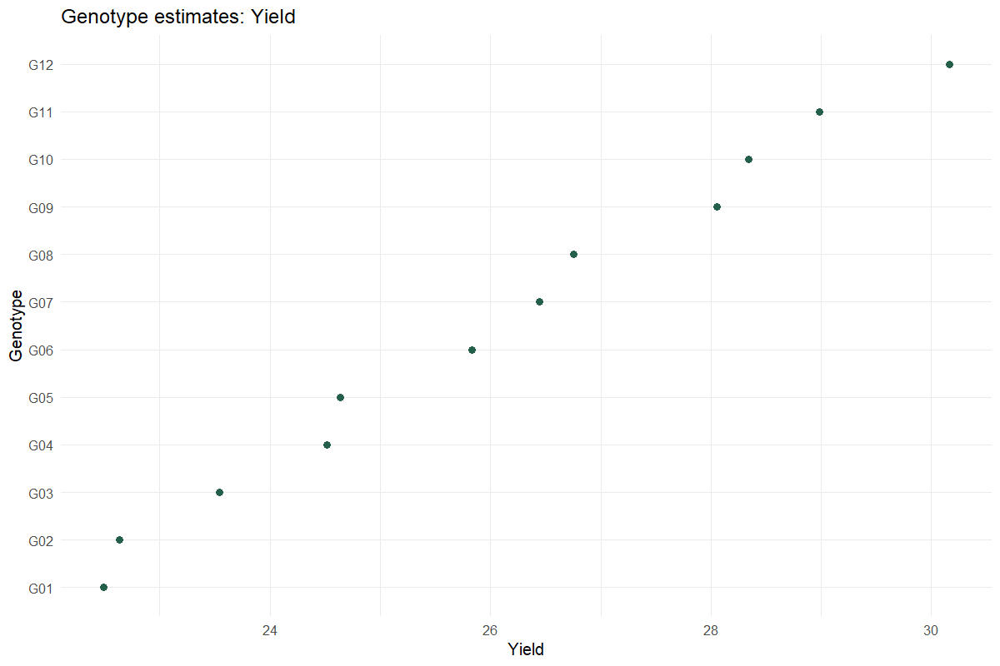
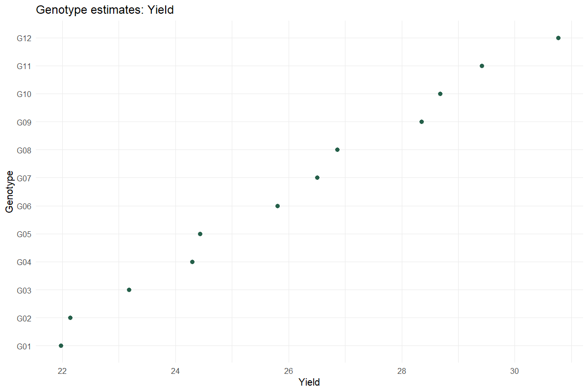

# Incomplete-Block Trials

Recover genotype information across small blocks

## Question and data
Provide Genotype, Rep, Block and numeric traits. Every genotype must occur once in each complete replicate; incomplete blocks must be equal-sized and smaller than a replicate.

## Read and report the results
Replication is fixed and incomplete blocks within replication are random. Choose fixed genotypes for adjusted means or random genotypes for BLUPs. Report the model, variance components and any boundary diagnostics.

## Scope and assumptions
The simple balanced-RCBD entry-mean heritability and advance formulas are deliberately unavailable here. Conditional BLUP-effect intervals hold fitted variance components fixed.

## Setup
```r
source("tools/example-cases.R")
load_drdesign()
```

## incomplete-random

[Example CSV](../data/incomplete-random.csv) · [R script](../code/incomplete-random.R)

Synthetic teaching data; not observations from a field experiment.

```r
data <- research_example("incomplete-block")
result <- run_genetic_variability(data,"Yield",incomplete=TRUE,genotype_random=TRUE)
```

### Yield genetic parameters

[Full-precision CSV](../data/incomplete-random-table-1.csv)

| Trait | Genetic Variance | Residual Variance | H2 plot conditional on blocks | H2 entry mean balanced RCBD | GCV percent | PCV plot percent | Selection Accuracy balanced RCBD | Genetic Advance entry mean |
| --- | --- | --- | --- | --- | --- | --- | --- | --- |
| Yield | 7.341 | 3.222 | 0.695 | NA | 10.408 | 12.485 | NA | NA |

### Yield variance components

[Full-precision CSV](../data/incomplete-random-table-2.csv)

| grp | var1 | var2 | vcov | sdcor |
| --- | --- | --- | --- | --- |
| GEN | (Intercept) | NA | 7.341 | 2.710 |
| REP:BLOCK | (Intercept) | NA | 0.000 | 0.000 |
| Residual | NA | NA | 3.222 | 1.795 |

### Yield BLUPs

[Full-precision CSV](../data/incomplete-random-table-3.csv)

| Rank | Genotype | Genotypic effect (BLUP) | Predicted | Conditional SE | Effect interval lower | Effect interval upper |
| --- | --- | --- | --- | --- | --- | --- |
| 1 | G12 | 4.130 | 30.162 | 0.968 | 2.232 | 6.027 |
| 2 | G11 | 2.954 | 28.986 | 0.968 | 1.057 | 4.851 |
| 3 | G10 | 2.307 | 28.339 | 0.968 | 0.410 | 4.204 |
| 4 | G09 | 2.019 | 28.051 | 0.968 | 0.122 | 3.916 |
| 5 | G08 | 0.724 | 26.756 | 0.968 | -1.173 | 2.621 |
| 6 | G07 | 0.412 | 26.444 | 0.968 | -1.485 | 2.309 |
| 7 | G06 | -0.203 | 25.829 | 0.968 | -2.100 | 1.694 |
| 8 | G05 | -1.397 | 24.635 | 0.968 | -3.294 | 0.500 |
| 9 | G04 | -1.517 | 24.515 | 0.968 | -3.414 | 0.380 |
| 10 | G03 | -2.489 | 23.543 | 0.968 | -4.386 | -0.592 |

First 10 rows shown. Download the CSV for every row.

### Genotype trait matrix

[Full-precision CSV](../data/incomplete-random-table-4.csv)

| Genotype | Yield |
| --- | --- |
| G01 | 22.492 |
| G02 | 22.633 |
| G03 | 23.543 |
| G04 | 24.515 |
| G05 | 24.635 |
| G06 | 25.829 |
| G07 | 26.444 |
| G08 | 26.756 |
| G09 | 28.051 |
| G10 | 28.339 |

First 10 rows shown. Download the CSV for every row.

### Exclusions

[Full-precision CSV](../data/incomplete-random-table-5.csv)

No rows to report.

### Reviewed data

[Full-precision CSV](../data/incomplete-random-table-6.csv)

| Genotype | Rep | Yield | Height | Maturity | Block |
| --- | --- | --- | --- | --- | --- |
| G01 | R1 | 22.691 | 50.556 | 102.324 | B1 |
| G02 | R1 | 20.013 | 47.566 | 102.328 | B1 |
| G03 | R1 | 23.957 | 55.490 | 99.823 | B1 |
| G04 | R1 | 24.046 | 59.147 | 96.930 | B2 |
| G05 | R1 | 22.649 | 52.990 | 96.123 | B2 |
| G06 | R1 | 27.087 | 53.629 | 97.962 | B2 |
| G07 | R1 | 25.236 | 62.330 | 100.571 | B3 |
| G08 | R1 | 25.931 | 62.159 | 101.368 | B3 |
| G09 | R1 | 29.522 | 56.210 | 99.436 | B3 |
| G10 | R1 | 26.708 | 60.624 | 96.368 | B4 |

First 10 rows shown. Download the CSV for every row.

### Software versions

[Full-precision CSV](../data/incomplete-random-table-7.csv)

| Source / term | Package | Version |
| --- | --- | --- |
|  | R | 4.5.3 |
| shiny | shiny | 1.13.0 |
| agricolae | agricolae | 1.3.7 |
| metan | metan | 1.19.0 |
| lme4 | lme4 | 2.0.1 |
| emmeans | emmeans | 2.0.2 |
| SpATS | SpATS | 1.0.20 |
| DiallelAnalysisR | DiallelAnalysisR | 0.6.0 |

### Analysis settings

[Full-precision CSV](../data/incomplete-random-table-8.csv)

| Setting | Value |
| --- | --- |
| Traits | Yield |
| Replication | Fixed |
| Genotype | Random |
| Selection_percent | 15 |
| Alpha | 0.05 |



### Diagnostics and model notes

- Yield has a boundary/singular variance fit; interpret genetic parameters cautiously.
- Yield simple balanced-RCBD entry-mean heritability and advance are not reported for this design.
- BLUP effect intervals use conditional random-effect uncertainty with fitted variance components held fixed. They are not confidence intervals for the absolute predicted genotype mean.

## incomplete-fixed

[Example CSV](../data/incomplete-fixed.csv) · [R script](../code/incomplete-fixed.R)

Synthetic teaching data; not observations from a field experiment.

```r
data <- research_example("incomplete-block")
result <- run_genetic_variability(data,"Yield",incomplete=TRUE,genotype_random=FALSE)
```

### Yield adjusted means

[Full-precision CSV](../data/incomplete-fixed-table-1.csv)

| Genotype | Estimated mean | SE | df | CI lower | CI upper |
| --- | --- | --- | --- | --- | --- |
| G01 | 21.974 | 1.099 | 21.455 | 19.692 | 24.256 |
| G02 | 22.135 | 1.099 | 21.455 | 19.853 | 24.417 |
| G03 | 23.178 | 1.099 | 21.455 | 20.896 | 25.461 |
| G04 | 24.293 | 1.099 | 21.455 | 22.011 | 26.576 |
| G05 | 24.431 | 1.099 | 21.455 | 22.148 | 26.713 |
| G06 | 25.799 | 1.099 | 21.455 | 23.517 | 28.081 |
| G07 | 26.504 | 1.099 | 21.455 | 24.222 | 28.787 |
| G08 | 26.862 | 1.099 | 21.455 | 24.580 | 29.144 |
| G09 | 28.346 | 1.099 | 21.455 | 26.064 | 30.628 |
| G10 | 28.677 | 1.099 | 21.455 | 26.395 | 30.959 |

First 10 rows shown. Download the CSV for every row.

Results are averaged over the levels of: REP

Degrees-of-freedom method: kenward-roger

Confidence level used: 0.95

### Yield ANOVA

[Full-precision CSV](../data/incomplete-fixed-table-2.csv)

| Source / term | SS | MS | Numerator df | Denominator df | F | p-value |
| --- | --- | --- | --- | --- | --- | --- |
| GEN | 277.705 | 25.246 | 11 | 22.000 | 7.836 | <0.001 |
| REP | 4.870 | 2.435 | 2 | 22.000 | 0.756 | 0.481 |

### Genotype trait matrix

[Full-precision CSV](../data/incomplete-fixed-table-3.csv)

| Genotype | Yield |
| --- | --- |
| G01 | 21.974 |
| G02 | 22.135 |
| G03 | 23.178 |
| G04 | 24.293 |
| G05 | 24.431 |
| G06 | 25.799 |
| G07 | 26.504 |
| G08 | 26.862 |
| G09 | 28.346 |
| G10 | 28.677 |

First 10 rows shown. Download the CSV for every row.

### Exclusions

[Full-precision CSV](../data/incomplete-fixed-table-4.csv)

No rows to report.

### Reviewed data

[Full-precision CSV](../data/incomplete-fixed-table-5.csv)

| Genotype | Rep | Yield | Height | Maturity | Block |
| --- | --- | --- | --- | --- | --- |
| G01 | R1 | 22.691 | 50.556 | 102.324 | B1 |
| G02 | R1 | 20.013 | 47.566 | 102.328 | B1 |
| G03 | R1 | 23.957 | 55.490 | 99.823 | B1 |
| G04 | R1 | 24.046 | 59.147 | 96.930 | B2 |
| G05 | R1 | 22.649 | 52.990 | 96.123 | B2 |
| G06 | R1 | 27.087 | 53.629 | 97.962 | B2 |
| G07 | R1 | 25.236 | 62.330 | 100.571 | B3 |
| G08 | R1 | 25.931 | 62.159 | 101.368 | B3 |
| G09 | R1 | 29.522 | 56.210 | 99.436 | B3 |
| G10 | R1 | 26.708 | 60.624 | 96.368 | B4 |

First 10 rows shown. Download the CSV for every row.

### Software versions

[Full-precision CSV](../data/incomplete-fixed-table-6.csv)

| Source / term | Package | Version |
| --- | --- | --- |
|  | R | 4.5.3 |
| shiny | shiny | 1.13.0 |
| agricolae | agricolae | 1.3.7 |
| metan | metan | 1.19.0 |
| lme4 | lme4 | 2.0.1 |
| emmeans | emmeans | 2.0.2 |
| SpATS | SpATS | 1.0.20 |
| DiallelAnalysisR | DiallelAnalysisR | 0.6.0 |

### Analysis settings

[Full-precision CSV](../data/incomplete-fixed-table-7.csv)

| Setting | Value |
| --- | --- |
| Traits | Yield |
| Replication | Fixed |
| Genotype | Fixed |
| Selection_percent | 15 |
| Alpha | 0.05 |



### Diagnostics and model notes

- Yield has a singular block variance fit.

## Reporting conventions
Tables: estimates and standard errors to 3 decimals; p-values below 0.001 shown as <0.001. Very small or large values use scientific notation. NA means unavailable or not applicable. CSV files retain numerical precision. Confidence levels and multiplicity corrections follow the stated analysis settings; shared letters indicate non-rejection, not equivalence.

[Validation and limitations](../VALIDATION.md)
