# MET Stability

Separate mean performance, interaction and stability

## Question and data
Map genotype, environment, replication and a numeric trait. Supply all genotype-environment means for AMMI/GGE; missing cells are never silently imputed. Choose whether high or low values are desirable.

## Read and report the results
The examples include AMMI, GGE plots, WAASB/WAASBY, BLUP-based harmonic indices, rank-sum summaries and a two-trait batch. WAASBY uses 70% performance and 30% stability. Report centring/scaling and trait direction with biplots.

## Scope and assumptions
Harmonic indices need positive predictions in every environment. Batch top-ten summaries are descriptive rank summaries, not MGIDI or a formal genetic selection index. An unavailable method remains unavailable with a diagnostic; substitute formulas are not silently used.

## Setup
```r
source("tools/example-cases.R")
load_drdesign()
```

## met-h

[Example CSV](../data/met-h.csv) · [R script](../code/met-h.R)

Synthetic teaching data; not observations from a field experiment.

```r
data <- read_pasted_table(met_example)
result <- run_met_analysis(data,"GEN","ENV","REP","Yield",direction="h")
```

### Dataset

[Full-precision CSV](../data/met-h-table-1.csv)

| Genotype | Environment | Replication | Y |
| --- | --- | --- | --- |
| G01 | E1_Loc1 | R1 | 5.200 |
| G01 | E1_Loc1 | R2 | 5.400 |
| G01 | E1_Loc1 | R3 | 5.100 |
| G01 | E1_Loc2 | R1 | 4.800 |
| G01 | E1_Loc2 | R2 | 4.600 |
| G01 | E1_Loc2 | R3 | 5.000 |
| G01 | E2_Loc1 | R1 | 5.500 |
| G01 | E2_Loc1 | R2 | 5.300 |
| G01 | E2_Loc1 | R3 | 5.600 |
| G02 | E1_Loc1 | R1 | 4.800 |

First 10 rows shown. Download the CSV for every row.

### Exclusions

[Full-precision CSV](../data/met-h-table-2.csv)

No rows to report.

### Genotype_Means

[Full-precision CSV](../data/met-h-table-3.csv)

| Source / term | Genotype | Genotype.1 | N | Mean | SD | CV pct | Rank Mean |
| --- | --- | --- | --- | --- | --- | --- | --- |
| 1 | G01 | G01 | 9 | 5.167 | 0.328 | 6.346 | 1.000 |
| 5 | G05 | G05 | 9 | 5.033 | 1.471 | 29.216 | 2.000 |
| 2 | G02 | G02 | 9 | 4.800 | 1.323 | 27.560 | 3.000 |
| 3 | G03 | G03 | 9 | 4.378 | 0.164 | 3.750 | 4.000 |
| 4 | G04 | G04 | 9 | 3.878 | 0.120 | 3.099 | 5.000 |

### Combined_ANOVA

[Full-precision CSV](../data/met-h-table-4.csv)

| Source / term | df | Denominator df | SS | MS | F | p-value | Sig |
| --- | --- | --- | --- | --- | --- | --- | --- |
| GEN | 4 | 30.000 | 9.961 | 2.490 | 90.375 | <0.001 | *** |
| ENV | 2 | 30.000 | 14.423 | 7.212 | 261.710 | <0.001 | *** |
| GEN:ENV | 8 | 30.000 | 17.241 | 2.155 | 78.212 | <0.001 | *** |
| Residual (Error) | NA | NA | NA | 0.028 | NA | NA |  |

### AMMI_IPCA

[Full-precision CSV](../data/met-h-table-5.csv)

| IPCA | df | SS | MS | F | p-value | Explained percent | Accumulated percent |
| --- | --- | --- | --- | --- | --- | --- | --- |
| PC1 | 5 | 14.629 | 2.926 | 106.180 | <0.001 | 84.800 | 84.800 |
| PC2 | 3 | 2.612 | 0.871 | 31.600 | <0.001 | 15.200 | 100.000 |

### AMMI_PC_Scores

[Full-precision CSV](../data/met-h-table-6.csv)

| Genotype | PC1 | PC2 |
| --- | --- | --- |
| G01 | -0.345 | 0.086 |
| G02 | 0.707 | 0.706 |
| G03 | -0.661 | -0.144 |
| G04 | -0.594 | -0.010 |
| G05 | 0.894 | -0.638 |

### AMMI_Stability

[Full-precision CSV](../data/met-h-table-7.csv)

| Genotype | ASV | EV | SIPC | WAAS | ZA |
| --- | --- | --- | --- | --- | --- |
| G01 | 1.936 | 0.031 | 0.432 | 0.306 | 0.211 |
| G02 | 4.019 | 0.380 | 1.412 | 0.706 | 0.514 |
| G03 | 3.705 | 0.110 | 0.805 | 0.583 | 0.400 |
| G04 | 3.327 | 0.080 | 0.604 | 0.505 | 0.341 |
| G05 | 5.048 | 0.399 | 1.532 | 0.855 | 0.611 |

### WAASB_WAASBY

[Full-precision CSV](../data/met-h-table-8.csv)

| Genotype | HMGV | HMGV R | RPGV | RPGV Y | HMRPGV | HMRPGV R | WAASB | WAASB R | Pct Resp | Pct WAASB | WAASBY | Rank WAASBY |
| --- | --- | --- | --- | --- | --- | --- | --- | --- | --- | --- | --- | --- |
| G01 | 5.145 | 1.000 | 1.120 | 5.209 | 1.114 | 1.000 | 0.185 | 1.000 | 100.000 | 100.000 | 100.000 | 1.000 |
| G02 | 4.461 | 3.000 | 1.015 | 4.721 | 0.992 | 3.000 | 0.597 | 3.000 | 71.552 | 31.916 | 59.661 | 3.000 |
| G03 | 4.380 | 4.000 | 0.957 | 4.451 | 0.942 | 4.000 | 0.573 | 2.000 | 38.793 | 35.954 | 37.941 | 4.000 |
| G04 | 3.885 | 5.000 | 0.847 | 3.941 | 0.837 | 5.000 | 0.790 | 5.000 | 0.000 | 0.000 | 0.000 | 5.000 |
| G05 | 4.574 | 2.000 | 1.061 | 4.933 | 1.024 | 2.000 | 0.762 | 4.000 | 89.655 | 4.616 | 64.144 | 2.000 |

### BLUP_HMGV_RPGV_HMRPGV

[Full-precision CSV](../data/met-h-table-9.csv)

| Genotype | HMGV | RPGV | HMRPGV | Genotype.1 | Mean | Rank Mean | Rank HMGV | Rank RPGV | Rank HMRPGV |
| --- | --- | --- | --- | --- | --- | --- | --- | --- | --- |
| G01 | 5.145 | 1.120 | 1.114 | G01 | 5.167 | 1.000 | 1.000 | 1.000 | 1.000 |
| G05 | 4.574 | 1.061 | 1.024 | G05 | 5.033 | 2.000 | 2.000 | 2.000 | 2.000 |
| G02 | 4.461 | 1.015 | 0.992 | G02 | 4.800 | 3.000 | 3.000 | 3.000 | 3.000 |
| G03 | 4.380 | 0.957 | 0.942 | G03 | 4.378 | 4.000 | 4.000 | 4.000 | 4.000 |
| G04 | 3.885 | 0.847 | 0.837 | G04 | 3.878 | 5.000 | 5.000 | 5.000 | 5.000 |

### SSI

[Full-precision CSV](../data/met-h-table-10.csv)

| Source / term | Genotype | HMGV | HMGV R | RPGV | RPGV Y | HMRPGV | HMRPGV R | WAASB | WAASB R | Pct Resp | Pct WAASB | WAASBY | Rank WAASBY | Genotype.1 | Mean | Rank Mean | Rank Yield | Rank Stability | NP SSI | Rank NP SSI | P SSI | Rank P SSI | Stable by culling |
| --- | --- | --- | --- | --- | --- | --- | --- | --- | --- | --- | --- | --- | --- | --- | --- | --- | --- | --- | --- | --- | --- | --- | --- |
| 1 | G01 | 5.145 | 1.000 | 1.120 | 5.209 | 1.114 | 1.000 | 0.185 | 1.000 | 100.000 | 100.000 | 100.000 | 1.000 | G01 | 5.167 | 1.000 | 1.000 | 1.000 | 2.000 | 1.000 | 100.000 | 1.000 | True |
| 5 | G05 | 4.574 | 2.000 | 1.061 | 4.933 | 1.024 | 2.000 | 0.762 | 4.000 | 89.655 | 4.616 | 64.144 | 2.000 | G05 | 5.033 | 2.000 | 2.000 | 4.000 | 6.000 | 3.000 | 64.144 | 2.000 | False |
| 2 | G02 | 4.461 | 3.000 | 1.015 | 4.721 | 0.992 | 3.000 | 0.597 | 3.000 | 71.552 | 31.916 | 59.661 | 3.000 | G02 | 4.800 | 3.000 | 3.000 | 3.000 | 6.000 | 3.000 | 59.661 | 3.000 | False |
| 3 | G03 | 4.380 | 4.000 | 0.957 | 4.451 | 0.942 | 4.000 | 0.573 | 2.000 | 38.793 | 35.954 | 37.941 | 4.000 | G03 | 4.378 | 4.000 | 4.000 | 2.000 | 6.000 | 3.000 | 37.941 | 4.000 | True |
| 4 | G04 | 3.885 | 5.000 | 0.847 | 3.941 | 0.837 | 5.000 | 0.790 | 5.000 | 0.000 | 0.000 | 0.000 | 5.000 | G04 | 3.878 | 5.000 | 5.000 | 5.000 | 10.000 | 5.000 | 0.000 | 5.000 | False |

### C_SSI

[Full-precision CSV](../data/met-h-table-11.csv)

| Genotype | HMGV | HMGV R | RPGV | RPGV Y | HMRPGV | HMRPGV R | WAASB | WAASB R | Pct Resp | Pct WAASB | WAASBY | Rank WAASBY | Genotype.1 | Mean | Rank Mean | Rank Yield | Rank Stability | NP SSI | Rank NP SSI | P SSI | Rank P SSI | Stable by culling | Rank C SSI |
| --- | --- | --- | --- | --- | --- | --- | --- | --- | --- | --- | --- | --- | --- | --- | --- | --- | --- | --- | --- | --- | --- | --- | --- |
| G01 | 5.145 | 1.000 | 1.120 | 5.209 | 1.114 | 1.000 | 0.185 | 1.000 | 100.000 | 100.000 | 100.000 | 1.000 | G01 | 5.167 | 1.000 | 1.000 | 1.000 | 2.000 | 1.000 | 100.000 | 1.000 | True | 1.000 |
| G03 | 4.380 | 4.000 | 0.957 | 4.451 | 0.942 | 4.000 | 0.573 | 2.000 | 38.793 | 35.954 | 37.941 | 4.000 | G03 | 4.378 | 4.000 | 4.000 | 2.000 | 6.000 | 3.000 | 37.941 | 4.000 | True | 2.000 |

### Environment E1_Loc1

[Full-precision CSV](../data/met-h-table-12.csv)

| Source / term | df | Denominator df | SS | MS | F | p-value | Sig |
| --- | --- | --- | --- | --- | --- | --- | --- |
| GEN | 4 | NA | 8.943 | 2.236 | 90.635 | <0.001 | *** |
| REP | 2 | NA | 0.016 | 0.008 | 0.324 | 0.732 | ns |
| Residuals | 8 | NA | 0.197 | 0.025 | NA | NA |  |

### Environment E1_Loc2

[Full-precision CSV](../data/met-h-table-13.csv)

| Source / term | df | Denominator df | SS | MS | F | p-value | Sig |
| --- | --- | --- | --- | --- | --- | --- | --- |
| GEN | 4 | NA | 6.343 | 1.586 | 47.099 | <0.001 | *** |
| REP | 2 | NA | 0.004 | 0.002 | 0.059 | 0.943 | ns |
| Residuals | 8 | NA | 0.269 | 0.034 | NA | NA |  |

### Environment E2_Loc1

[Full-precision CSV](../data/met-h-table-14.csv)

| Source / term | df | Denominator df | SS | MS | F | p-value | Sig |
| --- | --- | --- | --- | --- | --- | --- | --- |
| GEN | 4 | NA | 11.917 | 2.979 | 122.438 | <0.001 | *** |
| REP | 2 | NA | 0.145 | 0.073 | 2.986 | 0.107 | ns |
| Residuals | 8 | NA | 0.195 | 0.024 | NA | NA |  |

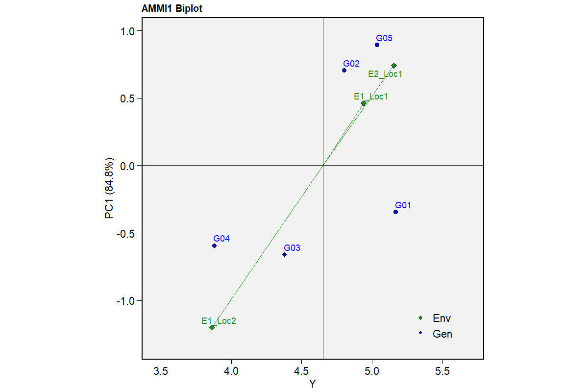

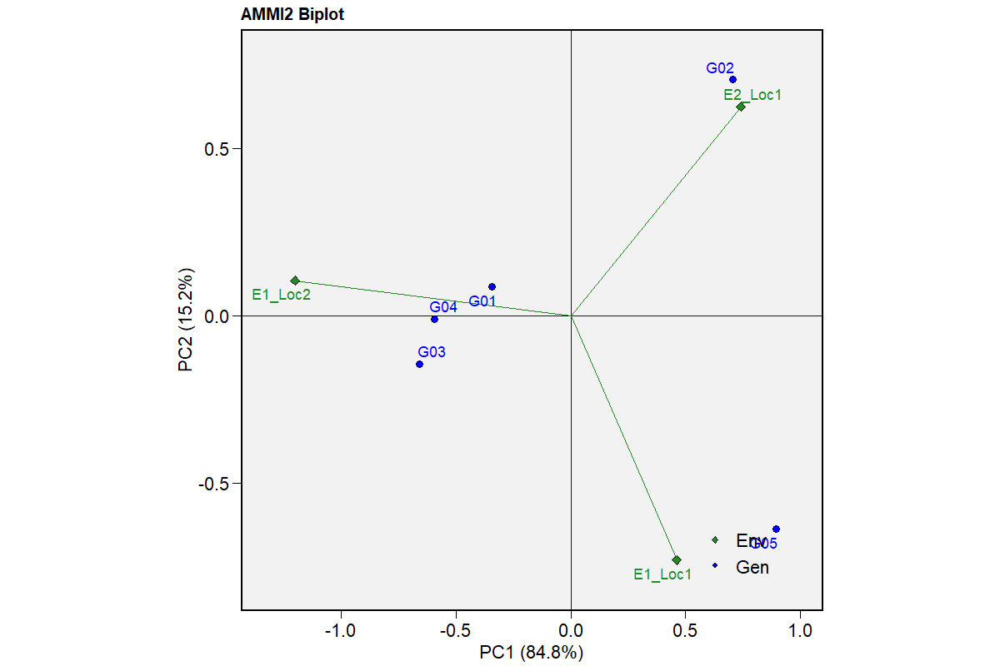


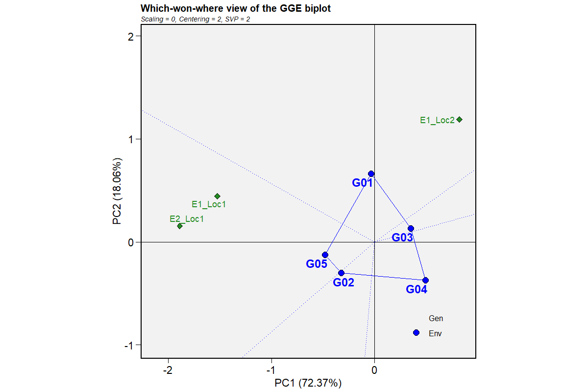

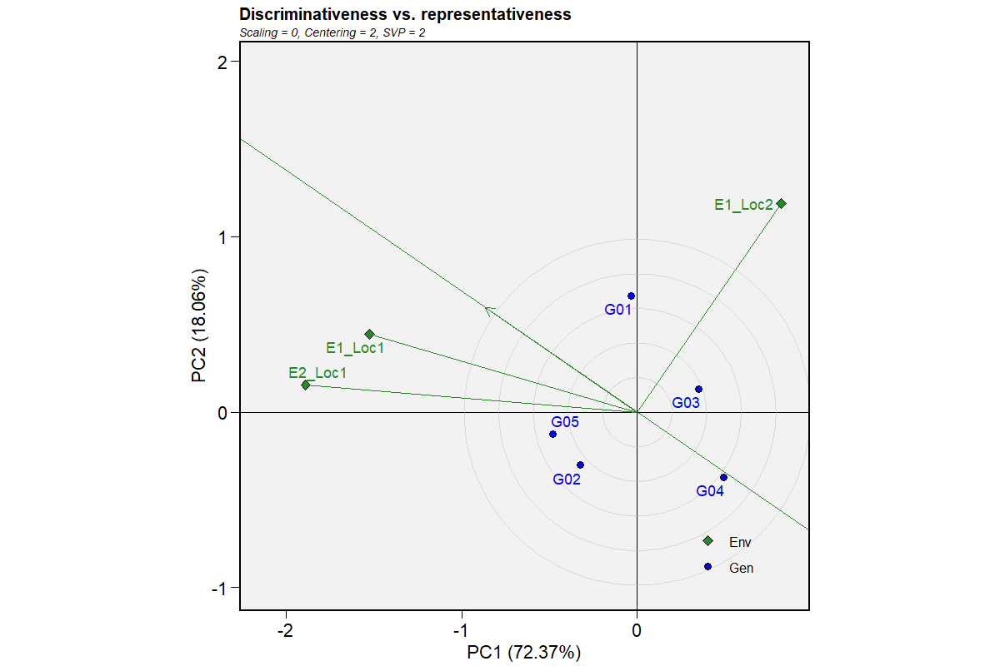

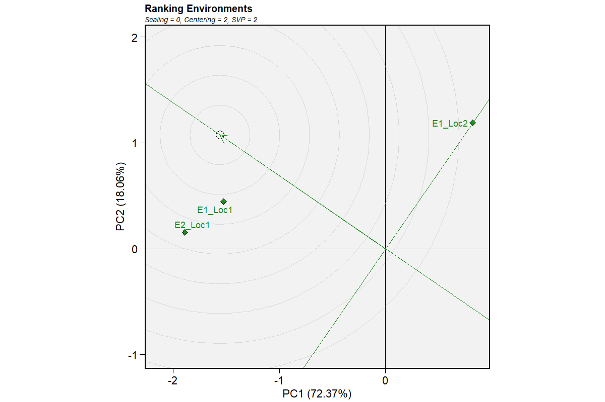

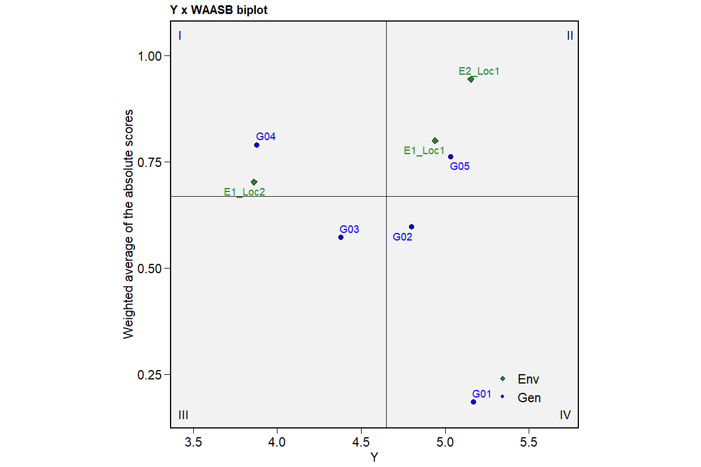

### Diagnostics and model notes

- AMMI ANOVA extraction failed: Invalid value in 'what' for object of class 'performs_ammi'.
- boundary (singular) fit: see help('isSingular')

- Trait: Yield | Direction: higher_is_better | Genotypes: 5 | Environments: 3 | Observations: 45 Diagnostics: AMMI ANOVA extraction failed: Invalid value in 'what' for object of class 'performs_ammi'. | boundary (singular) fit: see help('isSingular')


## met-l

[Example CSV](../data/met-l.csv) · [R script](../code/met-l.R)

Synthetic teaching data; not observations from a field experiment.

```r
data <- read_pasted_table(met_example)
result <- run_met_analysis(data,"GEN","ENV","REP","Yield",direction="l")
```

### Dataset

[Full-precision CSV](../data/met-l-table-1.csv)

| Genotype | Environment | Replication | Y |
| --- | --- | --- | --- |
| G01 | E1_Loc1 | R1 | 5.200 |
| G01 | E1_Loc1 | R2 | 5.400 |
| G01 | E1_Loc1 | R3 | 5.100 |
| G01 | E1_Loc2 | R1 | 4.800 |
| G01 | E1_Loc2 | R2 | 4.600 |
| G01 | E1_Loc2 | R3 | 5.000 |
| G01 | E2_Loc1 | R1 | 5.500 |
| G01 | E2_Loc1 | R2 | 5.300 |
| G01 | E2_Loc1 | R3 | 5.600 |
| G02 | E1_Loc1 | R1 | 4.800 |

First 10 rows shown. Download the CSV for every row.

### Exclusions

[Full-precision CSV](../data/met-l-table-2.csv)

No rows to report.

### Genotype_Means

[Full-precision CSV](../data/met-l-table-3.csv)

| Source / term | Genotype | Genotype.1 | N | Mean | SD | CV pct | Rank Mean |
| --- | --- | --- | --- | --- | --- | --- | --- |
| 4 | G04 | G04 | 9 | 3.878 | 0.120 | 3.099 | 1.000 |
| 3 | G03 | G03 | 9 | 4.378 | 0.164 | 3.750 | 2.000 |
| 2 | G02 | G02 | 9 | 4.800 | 1.323 | 27.560 | 3.000 |
| 5 | G05 | G05 | 9 | 5.033 | 1.471 | 29.216 | 4.000 |
| 1 | G01 | G01 | 9 | 5.167 | 0.328 | 6.346 | 5.000 |

### Combined_ANOVA

[Full-precision CSV](../data/met-l-table-4.csv)

| Source / term | df | Denominator df | SS | MS | F | p-value | Sig |
| --- | --- | --- | --- | --- | --- | --- | --- |
| GEN | 4 | 30.000 | 9.961 | 2.490 | 90.375 | <0.001 | *** |
| ENV | 2 | 30.000 | 14.423 | 7.212 | 261.710 | <0.001 | *** |
| GEN:ENV | 8 | 30.000 | 17.241 | 2.155 | 78.212 | <0.001 | *** |
| Residual (Error) | NA | NA | NA | 0.028 | NA | NA |  |

### AMMI_IPCA

[Full-precision CSV](../data/met-l-table-5.csv)

| IPCA | df | SS | MS | F | p-value | Explained percent | Accumulated percent |
| --- | --- | --- | --- | --- | --- | --- | --- |
| PC1 | 5 | 14.629 | 2.926 | 106.180 | <0.001 | 84.800 | 84.800 |
| PC2 | 3 | 2.612 | 0.871 | 31.600 | <0.001 | 15.200 | 100.000 |

### AMMI_PC_Scores

[Full-precision CSV](../data/met-l-table-6.csv)

| Genotype | PC1 | PC2 |
| --- | --- | --- |
| G01 | -0.345 | 0.086 |
| G02 | 0.707 | 0.706 |
| G03 | -0.661 | -0.144 |
| G04 | -0.594 | -0.010 |
| G05 | 0.894 | -0.638 |

### AMMI_Stability

[Full-precision CSV](../data/met-l-table-7.csv)

| Genotype | ASV | EV | SIPC | WAAS | ZA |
| --- | --- | --- | --- | --- | --- |
| G01 | 1.936 | 0.031 | 0.432 | 0.306 | 0.211 |
| G02 | 4.019 | 0.380 | 1.412 | 0.706 | 0.514 |
| G03 | 3.705 | 0.110 | 0.805 | 0.583 | 0.400 |
| G04 | 3.327 | 0.080 | 0.604 | 0.505 | 0.341 |
| G05 | 5.048 | 0.399 | 1.532 | 0.855 | 0.611 |

### WAASB_WAASBY

[Full-precision CSV](../data/met-l-table-8.csv)

| Genotype | HMGV | HMGV R | RPGV | RPGV Y | HMRPGV | HMRPGV R | WAASB | WAASB R | Pct Resp | Pct WAASB | WAASBY | Rank WAASBY |
| --- | --- | --- | --- | --- | --- | --- | --- | --- | --- | --- | --- | --- |
| G01 | 5.145 | 1.000 | 1.120 | 5.209 | 1.114 | 1.000 | 0.185 | 1.000 | 0.000 | 100.000 | 30.000 | 3.000 |
| G02 | 4.461 | 3.000 | 1.015 | 4.721 | 0.992 | 3.000 | 0.597 | 3.000 | 28.448 | 31.916 | 29.489 | 4.000 |
| G03 | 4.380 | 4.000 | 0.957 | 4.451 | 0.942 | 4.000 | 0.573 | 2.000 | 61.207 | 35.954 | 53.631 | 2.000 |
| G04 | 3.885 | 5.000 | 0.847 | 3.941 | 0.837 | 5.000 | 0.790 | 5.000 | 100.000 | 0.000 | 70.000 | 1.000 |
| G05 | 4.574 | 2.000 | 1.061 | 4.933 | 1.024 | 2.000 | 0.762 | 4.000 | 10.345 | 4.616 | 8.626 | 5.000 |

### BLUP_HMGV_RPGV_HMRPGV

[Full-precision CSV](../data/met-l-table-9.csv)

| Genotype | HMGV | RPGV | HMRPGV | Genotype.1 | Mean | Rank Mean | Rank HMGV | Rank RPGV | Rank HMRPGV |
| --- | --- | --- | --- | --- | --- | --- | --- | --- | --- |
| G04 | 3.885 | 0.847 | 0.837 | G04 | 3.878 | 1.000 | 1.000 | 1.000 | 1.000 |
| G03 | 4.380 | 0.957 | 0.942 | G03 | 4.378 | 2.000 | 2.000 | 2.000 | 2.000 |
| G02 | 4.461 | 1.015 | 0.992 | G02 | 4.800 | 3.000 | 3.000 | 3.000 | 3.000 |
| G05 | 4.574 | 1.061 | 1.024 | G05 | 5.033 | 4.000 | 4.000 | 4.000 | 4.000 |
| G01 | 5.145 | 1.120 | 1.114 | G01 | 5.167 | 5.000 | 5.000 | 5.000 | 5.000 |

### SSI

[Full-precision CSV](../data/met-l-table-10.csv)

| Source / term | Genotype | HMGV | HMGV R | RPGV | RPGV Y | HMRPGV | HMRPGV R | WAASB | WAASB R | Pct Resp | Pct WAASB | WAASBY | Rank WAASBY | Genotype.1 | Mean | Rank Mean | Rank Yield | Rank Stability | NP SSI | Rank NP SSI | P SSI | Rank P SSI | Stable by culling |
| --- | --- | --- | --- | --- | --- | --- | --- | --- | --- | --- | --- | --- | --- | --- | --- | --- | --- | --- | --- | --- | --- | --- | --- |
| 4 | G04 | 3.885 | 5.000 | 0.847 | 3.941 | 0.837 | 5.000 | 0.790 | 5.000 | 100.000 | 0.000 | 70.000 | 1.000 | G04 | 3.878 | 1.000 | 1.000 | 5.000 | 6.000 | 3.000 | 70.000 | 1.000 | False |
| 3 | G03 | 4.380 | 4.000 | 0.957 | 4.451 | 0.942 | 4.000 | 0.573 | 2.000 | 61.207 | 35.954 | 53.631 | 2.000 | G03 | 4.378 | 2.000 | 2.000 | 2.000 | 4.000 | 1.000 | 53.631 | 2.000 | True |
| 1 | G01 | 5.145 | 1.000 | 1.120 | 5.209 | 1.114 | 1.000 | 0.185 | 1.000 | 0.000 | 100.000 | 30.000 | 3.000 | G01 | 5.167 | 5.000 | 5.000 | 1.000 | 6.000 | 3.000 | 30.000 | 3.000 | True |
| 2 | G02 | 4.461 | 3.000 | 1.015 | 4.721 | 0.992 | 3.000 | 0.597 | 3.000 | 28.448 | 31.916 | 29.489 | 4.000 | G02 | 4.800 | 3.000 | 3.000 | 3.000 | 6.000 | 3.000 | 29.489 | 4.000 | False |
| 5 | G05 | 4.574 | 2.000 | 1.061 | 4.933 | 1.024 | 2.000 | 0.762 | 4.000 | 10.345 | 4.616 | 8.626 | 5.000 | G05 | 5.033 | 4.000 | 4.000 | 4.000 | 8.000 | 5.000 | 8.626 | 5.000 | False |

### C_SSI

[Full-precision CSV](../data/met-l-table-11.csv)

| Source / term | Genotype | HMGV | HMGV R | RPGV | RPGV Y | HMRPGV | HMRPGV R | WAASB | WAASB R | Pct Resp | Pct WAASB | WAASBY | Rank WAASBY | Genotype.1 | Mean | Rank Mean | Rank Yield | Rank Stability | NP SSI | Rank NP SSI | P SSI | Rank P SSI | Stable by culling | Rank C SSI |
| --- | --- | --- | --- | --- | --- | --- | --- | --- | --- | --- | --- | --- | --- | --- | --- | --- | --- | --- | --- | --- | --- | --- | --- | --- |
| 3 | G03 | 4.380 | 4.000 | 0.957 | 4.451 | 0.942 | 4.000 | 0.573 | 2.000 | 61.207 | 35.954 | 53.631 | 2.000 | G03 | 4.378 | 2.000 | 2.000 | 2.000 | 4.000 | 1.000 | 53.631 | 2.000 | True | 1.000 |
| 1 | G01 | 5.145 | 1.000 | 1.120 | 5.209 | 1.114 | 1.000 | 0.185 | 1.000 | 0.000 | 100.000 | 30.000 | 3.000 | G01 | 5.167 | 5.000 | 5.000 | 1.000 | 6.000 | 3.000 | 30.000 | 3.000 | True | 2.000 |

### Environment E1_Loc1

[Full-precision CSV](../data/met-l-table-12.csv)

| Source / term | df | Denominator df | SS | MS | F | p-value | Sig |
| --- | --- | --- | --- | --- | --- | --- | --- |
| GEN | 4 | NA | 8.943 | 2.236 | 90.635 | <0.001 | *** |
| REP | 2 | NA | 0.016 | 0.008 | 0.324 | 0.732 | ns |
| Residuals | 8 | NA | 0.197 | 0.025 | NA | NA |  |

### Environment E1_Loc2

[Full-precision CSV](../data/met-l-table-13.csv)

| Source / term | df | Denominator df | SS | MS | F | p-value | Sig |
| --- | --- | --- | --- | --- | --- | --- | --- |
| GEN | 4 | NA | 6.343 | 1.586 | 47.099 | <0.001 | *** |
| REP | 2 | NA | 0.004 | 0.002 | 0.059 | 0.943 | ns |
| Residuals | 8 | NA | 0.269 | 0.034 | NA | NA |  |

### Environment E2_Loc1

[Full-precision CSV](../data/met-l-table-14.csv)

| Source / term | df | Denominator df | SS | MS | F | p-value | Sig |
| --- | --- | --- | --- | --- | --- | --- | --- |
| GEN | 4 | NA | 11.917 | 2.979 | 122.438 | <0.001 | *** |
| REP | 2 | NA | 0.145 | 0.073 | 2.986 | 0.107 | ns |
| Residuals | 8 | NA | 0.195 | 0.024 | NA | NA |  |

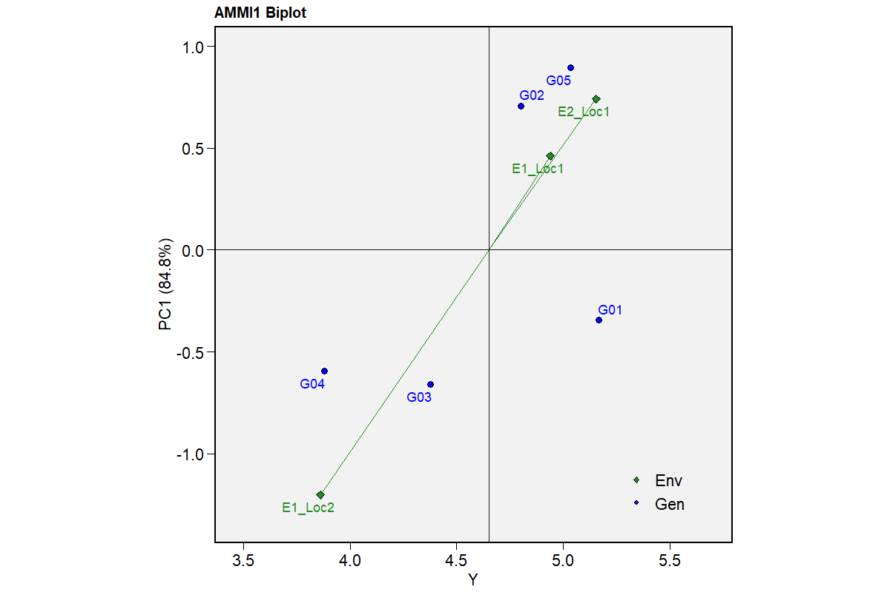

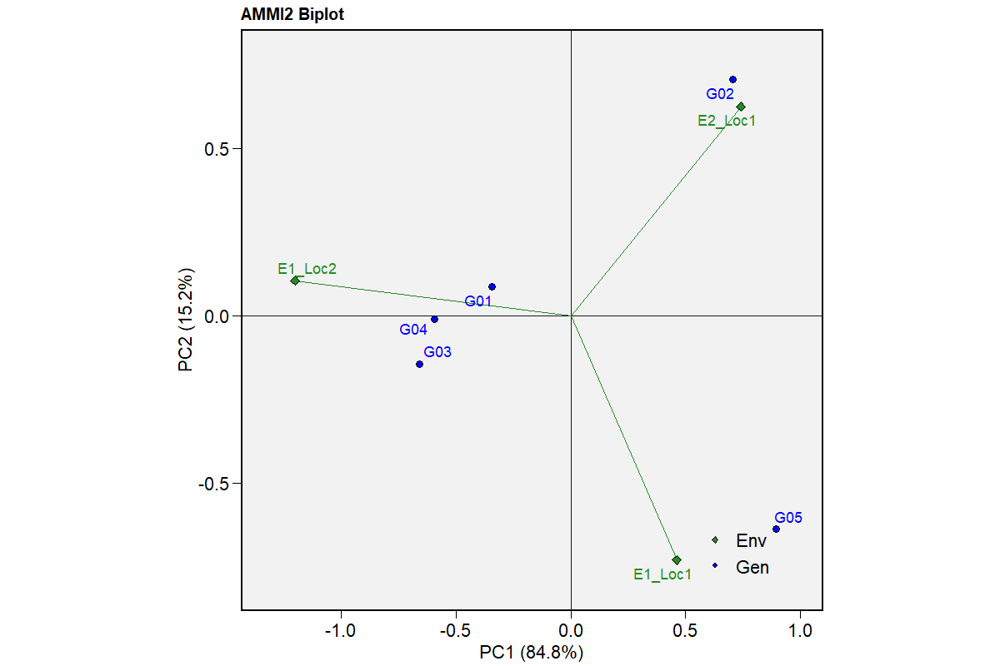

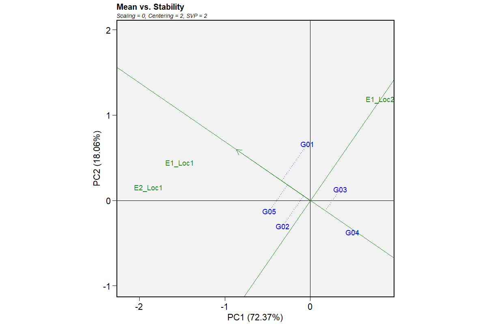

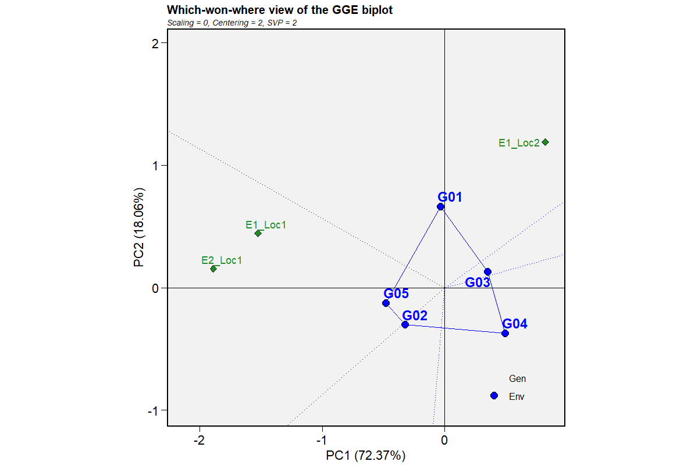

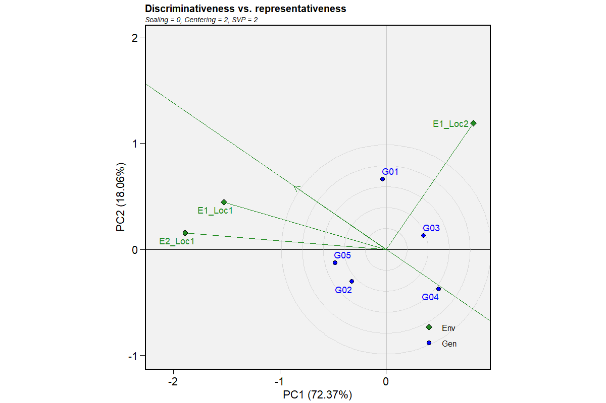

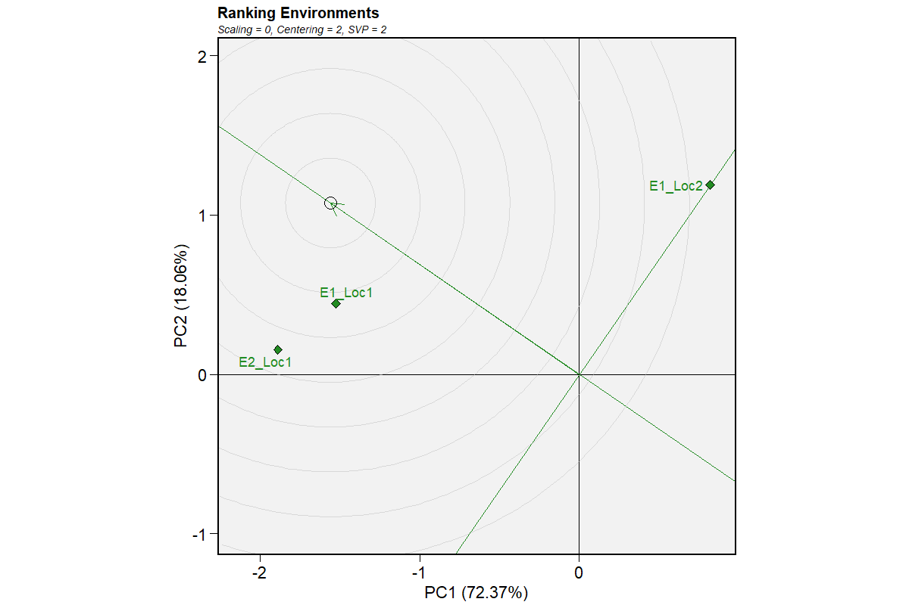

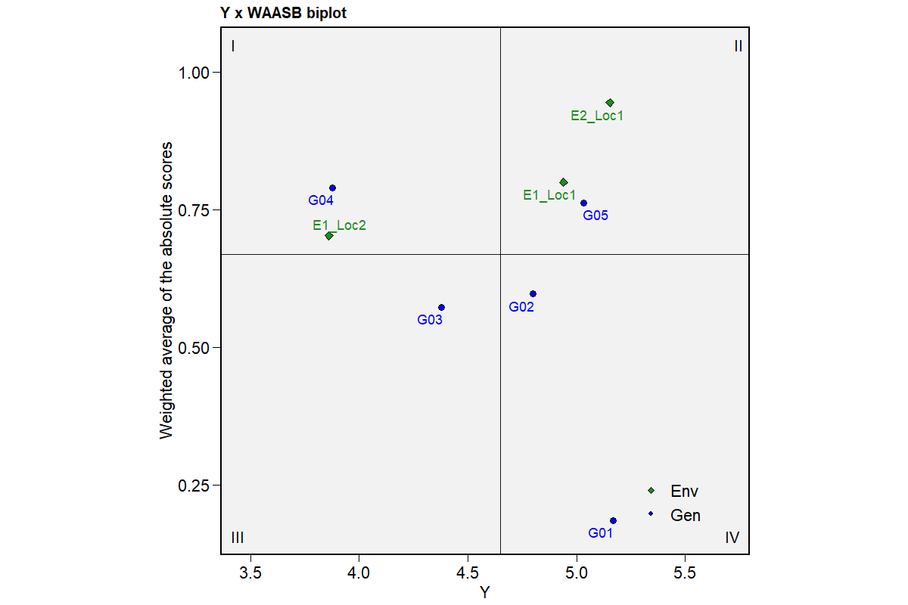

### Diagnostics and model notes

- AMMI ANOVA extraction failed: Invalid value in 'what' for object of class 'performs_ammi'.
- boundary (singular) fit: see help('isSingular')

- Trait: Yield | Direction: lower_is_better | Genotypes: 5 | Environments: 3 | Observations: 45 Diagnostics: AMMI ANOVA extraction failed: Invalid value in 'what' for object of class 'performs_ammi'. | boundary (singular) fit: see help('isSingular')


## met-batch

[Example CSV](../data/met-batch.csv) · [R script](../code/met-batch.R)

Synthetic teaching data; not observations from a field experiment.

```r
data <- read_pasted_table(met_example)
data$Height <- 50+2*data$Yield+cos(seq_len(nrow(data)))
batch <- run_met_batch_analysis(data,"GEN","ENV","REP",c("Yield","Height"),c(Yield="h",Height="l"))
result <- list(tables=met_all_batch_result_tables(batch,batch$results[[1]]))
```

### Top_10_All_Traits

[Full-precision CSV](../data/met-batch-table-1.csv)

| Trait | Direction | Genotype | Mean | WAASB | WAASBY | Rank P SSI | Rank NP SSI |
| --- | --- | --- | --- | --- | --- | --- | --- |
| Yield | higher_is_better | G01 | 5.167 | 0.185 | 100.000 | 1.000 | 1.000 |
| Yield | higher_is_better | G05 | 5.033 | 0.762 | 64.144 | 2.000 | 3.000 |
| Yield | higher_is_better | G02 | 4.800 | 0.597 | 59.661 | 3.000 | 3.000 |
| Yield | higher_is_better | G03 | 4.378 | 0.573 | 37.941 | 4.000 | 3.000 |
| Yield | higher_is_better | G04 | 3.878 | 0.790 | 0.000 | 5.000 | 5.000 |
| Height | lower_is_better | G04 | 57.567 | 1.415 | 70.777 | 1.000 | 2.500 |
| Height | lower_is_better | G03 | 58.876 | 0.528 | 60.287 | 2.000 | 1.000 |
| Height | lower_is_better | G02 | 59.569 | 0.597 | 40.695 | 3.000 | 4.000 |
| Height | lower_is_better | G01 | 60.269 | 0.297 | 30.547 | 4.000 | 2.500 |
| Height | lower_is_better | G05 | 60.290 | 1.445 | 0.000 | 5.000 | 5.000 |

### Multi_Trait_Index

[Full-precision CSV](../data/met-batch-table-2.csv)

| Genotype | Traits in top10 | Mean rank | Traits |
| --- | --- | --- | --- |
| G01 | 2.000 | 2.500 | Height, Yield |
| G02 | 2.000 | 3.000 | Height, Yield |
| G03 | 2.000 | 3.000 | Height, Yield |
| G04 | 2.000 | 3.000 | Height, Yield |
| G05 | 2.000 | 3.500 | Height, Yield |

### Batch_Errors

[Full-precision CSV](../data/met-batch-table-3.csv)

No rows to report.

### Yield_Dataset

[Full-precision CSV](../data/met-batch-table-4.csv)

| Genotype | Environment | Replication | Y |
| --- | --- | --- | --- |
| G01 | E1_Loc1 | R1 | 5.200 |
| G01 | E1_Loc1 | R2 | 5.400 |
| G01 | E1_Loc1 | R3 | 5.100 |
| G01 | E1_Loc2 | R1 | 4.800 |
| G01 | E1_Loc2 | R2 | 4.600 |
| G01 | E1_Loc2 | R3 | 5.000 |
| G01 | E2_Loc1 | R1 | 5.500 |
| G01 | E2_Loc1 | R2 | 5.300 |
| G01 | E2_Loc1 | R3 | 5.600 |
| G02 | E1_Loc1 | R1 | 4.800 |

First 10 rows shown. Download the CSV for every row.

### Yield_Exclusions

[Full-precision CSV](../data/met-batch-table-5.csv)

No rows to report.

### Yield_Genotype_Means

[Full-precision CSV](../data/met-batch-table-6.csv)

| Source / term | Genotype | Genotype.1 | N | Mean | SD | CV pct | Rank Mean |
| --- | --- | --- | --- | --- | --- | --- | --- |
| 1 | G01 | G01 | 9 | 5.167 | 0.328 | 6.346 | 1.000 |
| 5 | G05 | G05 | 9 | 5.033 | 1.471 | 29.216 | 2.000 |
| 2 | G02 | G02 | 9 | 4.800 | 1.323 | 27.560 | 3.000 |
| 3 | G03 | G03 | 9 | 4.378 | 0.164 | 3.750 | 4.000 |
| 4 | G04 | G04 | 9 | 3.878 | 0.120 | 3.099 | 5.000 |

### Yield_Combined_ANOVA

[Full-precision CSV](../data/met-batch-table-7.csv)

| Source / term | df | Denominator df | SS | MS | F | p-value | Sig |
| --- | --- | --- | --- | --- | --- | --- | --- |
| GEN | 4 | 30.000 | 9.961 | 2.490 | 90.375 | <0.001 | *** |
| ENV | 2 | 30.000 | 14.423 | 7.212 | 261.710 | <0.001 | *** |
| GEN:ENV | 8 | 30.000 | 17.241 | 2.155 | 78.212 | <0.001 | *** |
| Residual (Error) | NA | NA | NA | 0.028 | NA | NA |  |

### Yield_AMMI_IPCA

[Full-precision CSV](../data/met-batch-table-8.csv)

| IPCA | df | SS | MS | F | p-value | Explained percent | Accumulated percent |
| --- | --- | --- | --- | --- | --- | --- | --- |
| PC1 | 5 | 14.629 | 2.926 | 106.180 | <0.001 | 84.800 | 84.800 |
| PC2 | 3 | 2.612 | 0.871 | 31.600 | <0.001 | 15.200 | 100.000 |

### Yield_AMMI_PC_Scores

[Full-precision CSV](../data/met-batch-table-9.csv)

| Genotype | PC1 | PC2 |
| --- | --- | --- |
| G01 | -0.345 | 0.086 |
| G02 | 0.707 | 0.706 |
| G03 | -0.661 | -0.144 |
| G04 | -0.594 | -0.010 |
| G05 | 0.894 | -0.638 |

### Yield_AMMI_Stability

[Full-precision CSV](../data/met-batch-table-10.csv)

| Genotype | ASV | EV | SIPC | WAAS | ZA |
| --- | --- | --- | --- | --- | --- |
| G01 | 1.936 | 0.031 | 0.432 | 0.306 | 0.211 |
| G02 | 4.019 | 0.380 | 1.412 | 0.706 | 0.514 |
| G03 | 3.705 | 0.110 | 0.805 | 0.583 | 0.400 |
| G04 | 3.327 | 0.080 | 0.604 | 0.505 | 0.341 |
| G05 | 5.048 | 0.399 | 1.532 | 0.855 | 0.611 |

### Yield_WAASB_WAASBY

[Full-precision CSV](../data/met-batch-table-11.csv)

| Genotype | HMGV | HMGV R | RPGV | RPGV Y | HMRPGV | HMRPGV R | WAASB | WAASB R | Pct Resp | Pct WAASB | WAASBY | Rank WAASBY |
| --- | --- | --- | --- | --- | --- | --- | --- | --- | --- | --- | --- | --- |
| G01 | 5.145 | 1.000 | 1.120 | 5.209 | 1.114 | 1.000 | 0.185 | 1.000 | 100.000 | 100.000 | 100.000 | 1.000 |
| G02 | 4.461 | 3.000 | 1.015 | 4.721 | 0.992 | 3.000 | 0.597 | 3.000 | 71.552 | 31.916 | 59.661 | 3.000 |
| G03 | 4.380 | 4.000 | 0.957 | 4.451 | 0.942 | 4.000 | 0.573 | 2.000 | 38.793 | 35.954 | 37.941 | 4.000 |
| G04 | 3.885 | 5.000 | 0.847 | 3.941 | 0.837 | 5.000 | 0.790 | 5.000 | 0.000 | 0.000 | 0.000 | 5.000 |
| G05 | 4.574 | 2.000 | 1.061 | 4.933 | 1.024 | 2.000 | 0.762 | 4.000 | 89.655 | 4.616 | 64.144 | 2.000 |

### Yield_BLUP_HMGV_RPGV_HMRPGV

[Full-precision CSV](../data/met-batch-table-12.csv)

| Genotype | HMGV | RPGV | HMRPGV | Genotype.1 | Mean | Rank Mean | Rank HMGV | Rank RPGV | Rank HMRPGV |
| --- | --- | --- | --- | --- | --- | --- | --- | --- | --- |
| G01 | 5.145 | 1.120 | 1.114 | G01 | 5.167 | 1.000 | 1.000 | 1.000 | 1.000 |
| G05 | 4.574 | 1.061 | 1.024 | G05 | 5.033 | 2.000 | 2.000 | 2.000 | 2.000 |
| G02 | 4.461 | 1.015 | 0.992 | G02 | 4.800 | 3.000 | 3.000 | 3.000 | 3.000 |
| G03 | 4.380 | 0.957 | 0.942 | G03 | 4.378 | 4.000 | 4.000 | 4.000 | 4.000 |
| G04 | 3.885 | 0.847 | 0.837 | G04 | 3.878 | 5.000 | 5.000 | 5.000 | 5.000 |

### Yield_SSI

[Full-precision CSV](../data/met-batch-table-13.csv)

| Source / term | Genotype | HMGV | HMGV R | RPGV | RPGV Y | HMRPGV | HMRPGV R | WAASB | WAASB R | Pct Resp | Pct WAASB | WAASBY | Rank WAASBY | Genotype.1 | Mean | Rank Mean | Rank Yield | Rank Stability | NP SSI | Rank NP SSI | P SSI | Rank P SSI | Stable by culling |
| --- | --- | --- | --- | --- | --- | --- | --- | --- | --- | --- | --- | --- | --- | --- | --- | --- | --- | --- | --- | --- | --- | --- | --- |
| 1 | G01 | 5.145 | 1.000 | 1.120 | 5.209 | 1.114 | 1.000 | 0.185 | 1.000 | 100.000 | 100.000 | 100.000 | 1.000 | G01 | 5.167 | 1.000 | 1.000 | 1.000 | 2.000 | 1.000 | 100.000 | 1.000 | True |
| 5 | G05 | 4.574 | 2.000 | 1.061 | 4.933 | 1.024 | 2.000 | 0.762 | 4.000 | 89.655 | 4.616 | 64.144 | 2.000 | G05 | 5.033 | 2.000 | 2.000 | 4.000 | 6.000 | 3.000 | 64.144 | 2.000 | False |
| 2 | G02 | 4.461 | 3.000 | 1.015 | 4.721 | 0.992 | 3.000 | 0.597 | 3.000 | 71.552 | 31.916 | 59.661 | 3.000 | G02 | 4.800 | 3.000 | 3.000 | 3.000 | 6.000 | 3.000 | 59.661 | 3.000 | False |
| 3 | G03 | 4.380 | 4.000 | 0.957 | 4.451 | 0.942 | 4.000 | 0.573 | 2.000 | 38.793 | 35.954 | 37.941 | 4.000 | G03 | 4.378 | 4.000 | 4.000 | 2.000 | 6.000 | 3.000 | 37.941 | 4.000 | True |
| 4 | G04 | 3.885 | 5.000 | 0.847 | 3.941 | 0.837 | 5.000 | 0.790 | 5.000 | 0.000 | 0.000 | 0.000 | 5.000 | G04 | 3.878 | 5.000 | 5.000 | 5.000 | 10.000 | 5.000 | 0.000 | 5.000 | False |

### Yield_C_SSI

[Full-precision CSV](../data/met-batch-table-14.csv)

| Genotype | HMGV | HMGV R | RPGV | RPGV Y | HMRPGV | HMRPGV R | WAASB | WAASB R | Pct Resp | Pct WAASB | WAASBY | Rank WAASBY | Genotype.1 | Mean | Rank Mean | Rank Yield | Rank Stability | NP SSI | Rank NP SSI | P SSI | Rank P SSI | Stable by culling | Rank C SSI |
| --- | --- | --- | --- | --- | --- | --- | --- | --- | --- | --- | --- | --- | --- | --- | --- | --- | --- | --- | --- | --- | --- | --- | --- |
| G01 | 5.145 | 1.000 | 1.120 | 5.209 | 1.114 | 1.000 | 0.185 | 1.000 | 100.000 | 100.000 | 100.000 | 1.000 | G01 | 5.167 | 1.000 | 1.000 | 1.000 | 2.000 | 1.000 | 100.000 | 1.000 | True | 1.000 |
| G03 | 4.380 | 4.000 | 0.957 | 4.451 | 0.942 | 4.000 | 0.573 | 2.000 | 38.793 | 35.954 | 37.941 | 4.000 | G03 | 4.378 | 4.000 | 4.000 | 2.000 | 6.000 | 3.000 | 37.941 | 4.000 | True | 2.000 |

### Yield_Dataset.1

[Full-precision CSV](../data/met-batch-table-15.csv)

| Genotype | Environment | Replication | Y |
| --- | --- | --- | --- |
| G01 | E1_Loc1 | R1 | 5.200 |
| G01 | E1_Loc1 | R2 | 5.400 |
| G01 | E1_Loc1 | R3 | 5.100 |
| G01 | E1_Loc2 | R1 | 4.800 |
| G01 | E1_Loc2 | R2 | 4.600 |
| G01 | E1_Loc2 | R3 | 5.000 |
| G01 | E2_Loc1 | R1 | 5.500 |
| G01 | E2_Loc1 | R2 | 5.300 |
| G01 | E2_Loc1 | R3 | 5.600 |
| G02 | E1_Loc1 | R1 | 4.800 |

First 10 rows shown. Download the CSV for every row.

### Yield_Exclusions.1

[Full-precision CSV](../data/met-batch-table-16.csv)

No rows to report.

### Yield_Genotype_Means.1

[Full-precision CSV](../data/met-batch-table-17.csv)

| Source / term | Genotype | Genotype.1 | N | Mean | SD | CV pct | Rank Mean |
| --- | --- | --- | --- | --- | --- | --- | --- |
| 1 | G01 | G01 | 9 | 5.167 | 0.328 | 6.346 | 1.000 |
| 5 | G05 | G05 | 9 | 5.033 | 1.471 | 29.216 | 2.000 |
| 2 | G02 | G02 | 9 | 4.800 | 1.323 | 27.560 | 3.000 |
| 3 | G03 | G03 | 9 | 4.378 | 0.164 | 3.750 | 4.000 |
| 4 | G04 | G04 | 9 | 3.878 | 0.120 | 3.099 | 5.000 |

### Yield_Combined_ANOVA.1

[Full-precision CSV](../data/met-batch-table-18.csv)

| Source / term | df | Denominator df | SS | MS | F | p-value | Sig |
| --- | --- | --- | --- | --- | --- | --- | --- |
| GEN | 4 | 30.000 | 9.961 | 2.490 | 90.375 | <0.001 | *** |
| ENV | 2 | 30.000 | 14.423 | 7.212 | 261.710 | <0.001 | *** |
| GEN:ENV | 8 | 30.000 | 17.241 | 2.155 | 78.212 | <0.001 | *** |
| Residual (Error) | NA | NA | NA | 0.028 | NA | NA |  |

### Yield_AMMI_IPCA.1

[Full-precision CSV](../data/met-batch-table-19.csv)

| IPCA | df | SS | MS | F | p-value | Explained percent | Accumulated percent |
| --- | --- | --- | --- | --- | --- | --- | --- |
| PC1 | 5 | 14.629 | 2.926 | 106.180 | <0.001 | 84.800 | 84.800 |
| PC2 | 3 | 2.612 | 0.871 | 31.600 | <0.001 | 15.200 | 100.000 |

### Yield_AMMI_PC_Scores.1

[Full-precision CSV](../data/met-batch-table-20.csv)

| Genotype | PC1 | PC2 |
| --- | --- | --- |
| G01 | -0.345 | 0.086 |
| G02 | 0.707 | 0.706 |
| G03 | -0.661 | -0.144 |
| G04 | -0.594 | -0.010 |
| G05 | 0.894 | -0.638 |

### Yield_AMMI_Stability.1

[Full-precision CSV](../data/met-batch-table-21.csv)

| Genotype | ASV | EV | SIPC | WAAS | ZA |
| --- | --- | --- | --- | --- | --- |
| G01 | 1.936 | 0.031 | 0.432 | 0.306 | 0.211 |
| G02 | 4.019 | 0.380 | 1.412 | 0.706 | 0.514 |
| G03 | 3.705 | 0.110 | 0.805 | 0.583 | 0.400 |
| G04 | 3.327 | 0.080 | 0.604 | 0.505 | 0.341 |
| G05 | 5.048 | 0.399 | 1.532 | 0.855 | 0.611 |

### Yield_WAASB_WAASBY.1

[Full-precision CSV](../data/met-batch-table-22.csv)

| Genotype | HMGV | HMGV R | RPGV | RPGV Y | HMRPGV | HMRPGV R | WAASB | WAASB R | Pct Resp | Pct WAASB | WAASBY | Rank WAASBY |
| --- | --- | --- | --- | --- | --- | --- | --- | --- | --- | --- | --- | --- |
| G01 | 5.145 | 1.000 | 1.120 | 5.209 | 1.114 | 1.000 | 0.185 | 1.000 | 100.000 | 100.000 | 100.000 | 1.000 |
| G02 | 4.461 | 3.000 | 1.015 | 4.721 | 0.992 | 3.000 | 0.597 | 3.000 | 71.552 | 31.916 | 59.661 | 3.000 |
| G03 | 4.380 | 4.000 | 0.957 | 4.451 | 0.942 | 4.000 | 0.573 | 2.000 | 38.793 | 35.954 | 37.941 | 4.000 |
| G04 | 3.885 | 5.000 | 0.847 | 3.941 | 0.837 | 5.000 | 0.790 | 5.000 | 0.000 | 0.000 | 0.000 | 5.000 |
| G05 | 4.574 | 2.000 | 1.061 | 4.933 | 1.024 | 2.000 | 0.762 | 4.000 | 89.655 | 4.616 | 64.144 | 2.000 |

### Yield_BLUP_HMGV_RPGV_HMRPGV.1

[Full-precision CSV](../data/met-batch-table-23.csv)

| Genotype | HMGV | RPGV | HMRPGV | Genotype.1 | Mean | Rank Mean | Rank HMGV | Rank RPGV | Rank HMRPGV |
| --- | --- | --- | --- | --- | --- | --- | --- | --- | --- |
| G01 | 5.145 | 1.120 | 1.114 | G01 | 5.167 | 1.000 | 1.000 | 1.000 | 1.000 |
| G05 | 4.574 | 1.061 | 1.024 | G05 | 5.033 | 2.000 | 2.000 | 2.000 | 2.000 |
| G02 | 4.461 | 1.015 | 0.992 | G02 | 4.800 | 3.000 | 3.000 | 3.000 | 3.000 |
| G03 | 4.380 | 0.957 | 0.942 | G03 | 4.378 | 4.000 | 4.000 | 4.000 | 4.000 |
| G04 | 3.885 | 0.847 | 0.837 | G04 | 3.878 | 5.000 | 5.000 | 5.000 | 5.000 |

### Yield_SSI.1

[Full-precision CSV](../data/met-batch-table-24.csv)

| Source / term | Genotype | HMGV | HMGV R | RPGV | RPGV Y | HMRPGV | HMRPGV R | WAASB | WAASB R | Pct Resp | Pct WAASB | WAASBY | Rank WAASBY | Genotype.1 | Mean | Rank Mean | Rank Yield | Rank Stability | NP SSI | Rank NP SSI | P SSI | Rank P SSI | Stable by culling |
| --- | --- | --- | --- | --- | --- | --- | --- | --- | --- | --- | --- | --- | --- | --- | --- | --- | --- | --- | --- | --- | --- | --- | --- |
| 1 | G01 | 5.145 | 1.000 | 1.120 | 5.209 | 1.114 | 1.000 | 0.185 | 1.000 | 100.000 | 100.000 | 100.000 | 1.000 | G01 | 5.167 | 1.000 | 1.000 | 1.000 | 2.000 | 1.000 | 100.000 | 1.000 | True |
| 5 | G05 | 4.574 | 2.000 | 1.061 | 4.933 | 1.024 | 2.000 | 0.762 | 4.000 | 89.655 | 4.616 | 64.144 | 2.000 | G05 | 5.033 | 2.000 | 2.000 | 4.000 | 6.000 | 3.000 | 64.144 | 2.000 | False |
| 2 | G02 | 4.461 | 3.000 | 1.015 | 4.721 | 0.992 | 3.000 | 0.597 | 3.000 | 71.552 | 31.916 | 59.661 | 3.000 | G02 | 4.800 | 3.000 | 3.000 | 3.000 | 6.000 | 3.000 | 59.661 | 3.000 | False |
| 3 | G03 | 4.380 | 4.000 | 0.957 | 4.451 | 0.942 | 4.000 | 0.573 | 2.000 | 38.793 | 35.954 | 37.941 | 4.000 | G03 | 4.378 | 4.000 | 4.000 | 2.000 | 6.000 | 3.000 | 37.941 | 4.000 | True |
| 4 | G04 | 3.885 | 5.000 | 0.847 | 3.941 | 0.837 | 5.000 | 0.790 | 5.000 | 0.000 | 0.000 | 0.000 | 5.000 | G04 | 3.878 | 5.000 | 5.000 | 5.000 | 10.000 | 5.000 | 0.000 | 5.000 | False |

### Yield_C_SSI.1

[Full-precision CSV](../data/met-batch-table-25.csv)

| Genotype | HMGV | HMGV R | RPGV | RPGV Y | HMRPGV | HMRPGV R | WAASB | WAASB R | Pct Resp | Pct WAASB | WAASBY | Rank WAASBY | Genotype.1 | Mean | Rank Mean | Rank Yield | Rank Stability | NP SSI | Rank NP SSI | P SSI | Rank P SSI | Stable by culling | Rank C SSI |
| --- | --- | --- | --- | --- | --- | --- | --- | --- | --- | --- | --- | --- | --- | --- | --- | --- | --- | --- | --- | --- | --- | --- | --- |
| G01 | 5.145 | 1.000 | 1.120 | 5.209 | 1.114 | 1.000 | 0.185 | 1.000 | 100.000 | 100.000 | 100.000 | 1.000 | G01 | 5.167 | 1.000 | 1.000 | 1.000 | 2.000 | 1.000 | 100.000 | 1.000 | True | 1.000 |
| G03 | 4.380 | 4.000 | 0.957 | 4.451 | 0.942 | 4.000 | 0.573 | 2.000 | 38.793 | 35.954 | 37.941 | 4.000 | G03 | 4.378 | 4.000 | 4.000 | 2.000 | 6.000 | 3.000 | 37.941 | 4.000 | True | 2.000 |

### Height_Dataset

[Full-precision CSV](../data/met-batch-table-26.csv)

| Genotype | Environment | Replication | Y |
| --- | --- | --- | --- |
| G01 | E1_Loc1 | R1 | 60.940 |
| G01 | E1_Loc1 | R2 | 60.384 |
| G01 | E1_Loc1 | R3 | 59.210 |
| G01 | E1_Loc2 | R1 | 58.946 |
| G01 | E1_Loc2 | R2 | 59.484 |
| G01 | E1_Loc2 | R3 | 60.960 |
| G01 | E2_Loc1 | R1 | 61.754 |
| G01 | E2_Loc1 | R2 | 60.454 |
| G01 | E2_Loc1 | R3 | 60.289 |
| G02 | E1_Loc1 | R1 | 58.761 |

First 10 rows shown. Download the CSV for every row.

### Height_Exclusions

[Full-precision CSV](../data/met-batch-table-27.csv)

No rows to report.

### Height_Genotype_Means

[Full-precision CSV](../data/met-batch-table-28.csv)

| Source / term | Genotype | Genotype.1 | N | Mean | SD | CV pct | Rank Mean |
| --- | --- | --- | --- | --- | --- | --- | --- |
| 4 | G04 | G04 | 9 | 57.567 | 0.640 | 1.111 | 1.000 |
| 3 | G03 | G03 | 9 | 58.876 | 0.853 | 1.449 | 2.000 |
| 2 | G02 | G02 | 9 | 59.569 | 2.631 | 4.417 | 3.000 |
| 1 | G01 | G01 | 9 | 60.269 | 0.913 | 1.515 | 4.000 |
| 5 | G05 | G05 | 9 | 60.290 | 3.612 | 5.991 | 5.000 |

### Height_Combined_ANOVA

[Full-precision CSV](../data/met-batch-table-29.csv)

| Source / term | df | Denominator df | SS | MS | F | p-value | Sig |
| --- | --- | --- | --- | --- | --- | --- | --- |
| GEN | 4 | 30.000 | 46.580 | 11.645 | 20.422 | <0.001 | *** |
| ENV | 2 | 30.000 | 61.333 | 30.667 | 53.779 | <0.001 | *** |
| GEN:ENV | 8 | 30.000 | 97.096 | 12.137 | 21.284 | <0.001 | *** |
| Residual (Error) | NA | NA | NA | 0.570 | NA | NA |  |

### Height_AMMI_IPCA

[Full-precision CSV](../data/met-batch-table-30.csv)

| IPCA | df | SS | MS | F | p-value | Explained percent | Accumulated percent |
| --- | --- | --- | --- | --- | --- | --- | --- |
| PC1 | 5 | 87.353 | 17.471 | 25.900 | <0.001 | 90.000 | 90.000 |
| PC2 | 3 | 9.743 | 3.248 | 4.810 | 0.009 | 10.000 | 100.000 |

### Height_AMMI_PC_Scores

[Full-precision CSV](../data/met-batch-table-31.csv)

| Genotype | PC1 | PC2 |
| --- | --- | --- |
| G01 | -0.610 | 0.132 |
| G02 | 0.738 | 1.079 |
| G03 | -0.593 | -0.301 |
| G04 | -1.185 | -0.214 |
| G05 | 1.650 | -0.696 |

### Height_AMMI_Stability

[Full-precision CSV](../data/met-batch-table-32.csv)

| Genotype | ASV | EV | SIPC | WAAS | ZA |
| --- | --- | --- | --- | --- | --- |
| G01 | 5.467 | 0.039 | 0.742 | 0.562 | 0.246 |
| G02 | 6.708 | 0.373 | 1.817 | 0.772 | 0.366 |
| G03 | 5.329 | 0.058 | 0.895 | 0.564 | 0.252 |
| G04 | 10.630 | 0.143 | 1.399 | 1.088 | 0.475 |
| G05 | 14.809 | 0.387 | 2.346 | 1.555 | 0.691 |

### Height_WAASB_WAASBY

[Full-precision CSV](../data/met-batch-table-33.csv)

| Genotype | HMGV | HMGV R | RPGV | RPGV Y | HMRPGV | HMRPGV R | WAASB | WAASB R | Pct Resp | Pct WAASB | WAASBY | Rank WAASBY |
| --- | --- | --- | --- | --- | --- | --- | --- | --- | --- | --- | --- | --- |
| G01 | 60.212 | 1.000 | 1.015 | 60.231 | 1.015 | 1.000 | 0.297 | 1.000 | 0.781 | 100.000 | 30.547 | 4.000 |
| G02 | 59.466 | 3.000 | 1.004 | 59.534 | 1.003 | 3.000 | 0.597 | 3.000 | 26.483 | 73.859 | 40.695 | 3.000 |
| G03 | 58.898 | 4.000 | 0.993 | 58.916 | 0.993 | 4.000 | 0.528 | 2.000 | 51.916 | 79.820 | 60.287 | 2.000 |
| G04 | 57.663 | 5.000 | 0.973 | 57.694 | 0.972 | 5.000 | 1.415 | 4.000 | 100.000 | 2.590 | 70.777 | 1.000 |
| G05 | 60.052 | 2.000 | 1.015 | 60.196 | 1.014 | 2.000 | 1.445 | 5.000 | 0.000 | 0.000 | 0.000 | 5.000 |

### Height_BLUP_HMGV_RPGV_HMRPGV

[Full-precision CSV](../data/met-batch-table-34.csv)

| Genotype | HMGV | RPGV | HMRPGV | Genotype.1 | Mean | Rank Mean | Rank HMGV | Rank RPGV | Rank HMRPGV |
| --- | --- | --- | --- | --- | --- | --- | --- | --- | --- |
| G04 | 57.648 | 0.972 | 0.972 | G04 | 57.567 | 1.000 | 1.000 | 1.000 | 1.000 |
| G03 | 58.894 | 0.993 | 0.993 | G03 | 58.876 | 2.000 | 2.000 | 2.000 | 2.000 |
| G02 | 59.467 | 1.004 | 1.003 | G02 | 59.569 | 3.000 | 3.000 | 3.000 | 3.000 |
| G05 | 60.058 | 1.015 | 1.014 | G05 | 60.290 | 5.000 | 4.000 | 4.000 | 4.000 |
| G01 | 60.220 | 1.016 | 1.015 | G01 | 60.269 | 4.000 | 5.000 | 5.000 | 5.000 |

### Height_SSI

[Full-precision CSV](../data/met-batch-table-35.csv)

| Source / term | Genotype | HMGV | HMGV R | RPGV | RPGV Y | HMRPGV | HMRPGV R | WAASB | WAASB R | Pct Resp | Pct WAASB | WAASBY | Rank WAASBY | Genotype.1 | Mean | Rank Mean | Rank Yield | Rank Stability | NP SSI | Rank NP SSI | P SSI | Rank P SSI | Stable by culling |
| --- | --- | --- | --- | --- | --- | --- | --- | --- | --- | --- | --- | --- | --- | --- | --- | --- | --- | --- | --- | --- | --- | --- | --- |
| 4 | G04 | 57.663 | 5.000 | 0.973 | 57.694 | 0.972 | 5.000 | 1.415 | 4.000 | 100.000 | 2.590 | 70.777 | 1.000 | G04 | 57.567 | 1.000 | 1.000 | 4.000 | 5.000 | 2.500 | 70.777 | 1.000 | False |
| 3 | G03 | 58.898 | 4.000 | 0.993 | 58.916 | 0.993 | 4.000 | 0.528 | 2.000 | 51.916 | 79.820 | 60.287 | 2.000 | G03 | 58.876 | 2.000 | 2.000 | 2.000 | 4.000 | 1.000 | 60.287 | 2.000 | True |
| 2 | G02 | 59.466 | 3.000 | 1.004 | 59.534 | 1.003 | 3.000 | 0.597 | 3.000 | 26.483 | 73.859 | 40.695 | 3.000 | G02 | 59.569 | 3.000 | 3.000 | 3.000 | 6.000 | 4.000 | 40.695 | 3.000 | True |
| 1 | G01 | 60.212 | 1.000 | 1.015 | 60.231 | 1.015 | 1.000 | 0.297 | 1.000 | 0.781 | 100.000 | 30.547 | 4.000 | G01 | 60.269 | 4.000 | 4.000 | 1.000 | 5.000 | 2.500 | 30.547 | 4.000 | True |
| 5 | G05 | 60.052 | 2.000 | 1.015 | 60.196 | 1.014 | 2.000 | 1.445 | 5.000 | 0.000 | 0.000 | 0.000 | 5.000 | G05 | 60.290 | 5.000 | 5.000 | 5.000 | 10.000 | 5.000 | 0.000 | 5.000 | False |

### Height_C_SSI

[Full-precision CSV](../data/met-batch-table-36.csv)

| Source / term | Genotype | HMGV | HMGV R | RPGV | RPGV Y | HMRPGV | HMRPGV R | WAASB | WAASB R | Pct Resp | Pct WAASB | WAASBY | Rank WAASBY | Genotype.1 | Mean | Rank Mean | Rank Yield | Rank Stability | NP SSI | Rank NP SSI | P SSI | Rank P SSI | Stable by culling | Rank C SSI |
| --- | --- | --- | --- | --- | --- | --- | --- | --- | --- | --- | --- | --- | --- | --- | --- | --- | --- | --- | --- | --- | --- | --- | --- | --- |
| 3 | G03 | 58.898 | 4.000 | 0.993 | 58.916 | 0.993 | 4.000 | 0.528 | 2.000 | 51.916 | 79.820 | 60.287 | 2.000 | G03 | 58.876 | 2.000 | 2.000 | 2.000 | 4.000 | 1.000 | 60.287 | 2.000 | True | 1.000 |
| 2 | G02 | 59.466 | 3.000 | 1.004 | 59.534 | 1.003 | 3.000 | 0.597 | 3.000 | 26.483 | 73.859 | 40.695 | 3.000 | G02 | 59.569 | 3.000 | 3.000 | 3.000 | 6.000 | 4.000 | 40.695 | 3.000 | True | 2.000 |
| 1 | G01 | 60.212 | 1.000 | 1.015 | 60.231 | 1.015 | 1.000 | 0.297 | 1.000 | 0.781 | 100.000 | 30.547 | 4.000 | G01 | 60.269 | 4.000 | 4.000 | 1.000 | 5.000 | 2.500 | 30.547 | 4.000 | True | 3.000 |

## Reporting conventions
Tables: estimates and standard errors to 3 decimals; p-values below 0.001 shown as <0.001. Very small or large values use scientific notation. NA means unavailable or not applicable. CSV files retain numerical precision. Confidence levels and multiplicity corrections follow the stated analysis settings; shared letters indicate non-rejection, not equivalence.

[Validation and limitations](../VALIDATION.md)
