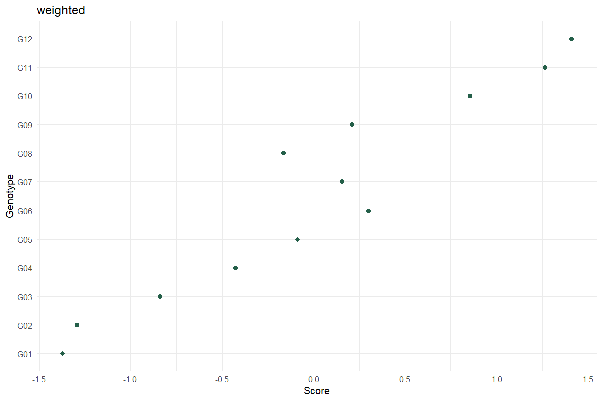
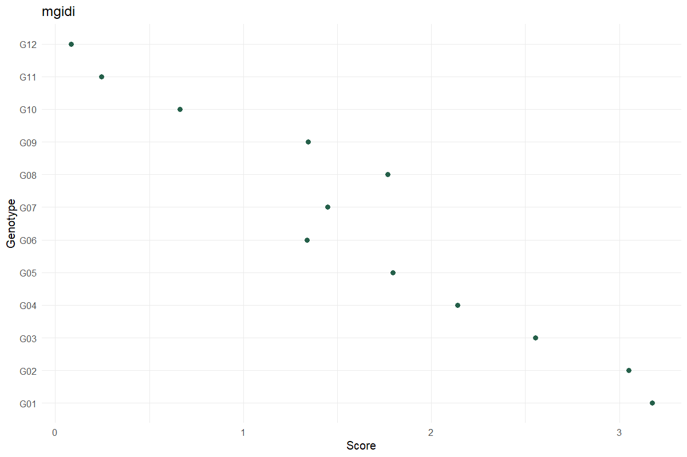

# Multi-Trait Selection

Make the ideotype and weights explicit

## Question and data
Supply one row per genotype and numeric trait columns. Specify traits where lower is desirable, the weights and the selected percentage; confirm the direction choices before running.

## Read and report the results
Weighted scores average signed standardized traits. MGIDI instead uses a factor model and distance to an ideotype. Report the chosen method and weights. The selection cutoff uses ceiling(n × percentage/100), retaining all ties.

## Scope and assumptions
The methods are not interchangeable. Selection differentials describe the input matrix, whether it contains observed means, adjusted means or BLUPs; they are not promised genetic gain.

## Setup
```r
source("tools/example-cases.R")
load_drdesign()
```

## selection-weighted

[Example CSV](../data/selection-weighted.csv) · [R script](../code/selection-weighted.R)

Synthetic teaching data; not observations from a field experiment.

```r
data <- research_example("multi-trait-selection")
result <- run_multi_trait_selection(data,c("Yield","Height","Maturity"),lower_traits="Maturity",method="weighted")
```

### Rankings

[Full-precision CSV](../data/selection-weighted-table-1.csv)

| Source / term | Genotype | Score | Selected | Rank |
| --- | --- | --- | --- | --- |
| 12 | G12 | 1.410 | True | 1 |
| 11 | G11 | 1.266 | True | 2 |
| 10 | G10 | 0.853 | False | 3 |
| 6 | G06 | 0.299 | False | 4 |
| 9 | G09 | 0.208 | False | 5 |
| 7 | G07 | 0.154 | False | 6 |
| 5 | G05 | -0.088 | False | 7 |
| 8 | G08 | -0.163 | False | 8 |
| 4 | G04 | -0.428 | False | 9 |
| 3 | G03 | -0.842 | False | 10 |

First 10 rows shown. Download the CSV for every row.

### Selection differentials

[Full-precision CSV](../data/selection-weighted-table-2.csv)

| Trait | Desired | Population Mean | Selected Mean | Differential |
| --- | --- | --- | --- | --- |
| Yield | Higher | 26.032 | 30.092 | 4.060 |
| Height | Higher | 57.665 | 63.080 | 5.415 |
| Maturity | Lower | 98.745 | 95.346 | -3.399 |

### Exclusions

[Full-precision CSV](../data/selection-weighted-table-3.csv)

No rows to report.

### Reviewed data

[Full-precision CSV](../data/selection-weighted-table-4.csv)

| Genotype | Yield | Height | Maturity |
| --- | --- | --- | --- |
| G01 | 21.974 | 49.476 | 100.929 |
| G02 | 22.135 | 52.809 | 102.262 |
| G03 | 23.178 | 55.219 | 101.148 |
| G04 | 24.293 | 53.974 | 98.426 |
| G05 | 24.431 | 54.594 | 96.416 |
| G06 | 25.799 | 58.388 | 96.782 |
| G07 | 26.504 | 59.500 | 99.003 |
| G08 | 26.862 | 58.128 | 100.854 |
| G09 | 28.346 | 60.080 | 100.449 |
| G10 | 28.677 | 63.657 | 97.976 |

First 10 rows shown. Download the CSV for every row.

### Software versions

[Full-precision CSV](../data/selection-weighted-table-5.csv)

| Source / term | Package | Version |
| --- | --- | --- |
|  | R | 4.5.3 |
| shiny | shiny | 1.13.0 |
| agricolae | agricolae | 1.3.7 |
| metan | metan | 1.19.0 |
| lme4 | lme4 | 2.0.1 |
| emmeans | emmeans | 2.0.2 |
| SpATS | SpATS | 1.0.20 |
| DiallelAnalysisR | DiallelAnalysisR | 0.6.0 |

### Analysis settings

[Full-precision CSV](../data/selection-weighted-table-6.csv)

| Setting | Value |
| --- | --- |
| Method | weighted |
| Lower_traits | Maturity |
| Weights | 1, 1, 1 |
| Selection_percent | 15 |



### Diagnostics and model notes

- Selection differentials describe this input matrix, not predicted genetic gain. Ties at the selection boundary are retained. Confirm whether inputs are means, adjusted means, or BLUPs.

## selection-mgidi

[Example CSV](../data/selection-mgidi.csv) · [R script](../code/selection-mgidi.R)

Synthetic teaching data; not observations from a field experiment.

```r
data <- research_example("multi-trait-selection")
result <- run_multi_trait_selection(data,c("Yield","Height","Maturity"),lower_traits="Maturity",method="mgidi")
```

### Rankings

[Full-precision CSV](../data/selection-mgidi-table-1.csv)

| Genotype | Score | Selected | Rank |
| --- | --- | --- | --- |
| G12 | 0.084 | True | 1 |
| G11 | 0.245 | True | 2 |
| G10 | 0.662 | False | 3 |
| G06 | 1.338 | False | 4 |
| G09 | 1.346 | False | 5 |
| G07 | 1.449 | False | 6 |
| G08 | 1.768 | False | 7 |
| G05 | 1.796 | False | 8 |
| G04 | 2.140 | False | 9 |
| G03 | 2.552 | False | 10 |

First 10 rows shown. Download the CSV for every row.

### Selection differentials

[Full-precision CSV](../data/selection-mgidi-table-2.csv)

| Trait | Desired | Population Mean | Selected Mean | Differential |
| --- | --- | --- | --- | --- |
| Yield | Higher | 26.032 | 30.092 | 4.060 |
| Height | Higher | 57.665 | 63.080 | 5.415 |
| Maturity | Lower | 98.745 | 95.346 | -3.399 |

### Factor loadings

[Full-precision CSV](../data/selection-mgidi-table-3.csv)

| VAR | FA1 |
| --- | --- |
| Yield | -0.962 |
| Height | -0.945 |
| Maturity | -0.799 |

### Exclusions

[Full-precision CSV](../data/selection-mgidi-table-4.csv)

No rows to report.

### Reviewed data

[Full-precision CSV](../data/selection-mgidi-table-5.csv)

| Genotype | Yield | Height | Maturity |
| --- | --- | --- | --- |
| G01 | 21.974 | 49.476 | 100.929 |
| G02 | 22.135 | 52.809 | 102.262 |
| G03 | 23.178 | 55.219 | 101.148 |
| G04 | 24.293 | 53.974 | 98.426 |
| G05 | 24.431 | 54.594 | 96.416 |
| G06 | 25.799 | 58.388 | 96.782 |
| G07 | 26.504 | 59.500 | 99.003 |
| G08 | 26.862 | 58.128 | 100.854 |
| G09 | 28.346 | 60.080 | 100.449 |
| G10 | 28.677 | 63.657 | 97.976 |

First 10 rows shown. Download the CSV for every row.

### Software versions

[Full-precision CSV](../data/selection-mgidi-table-6.csv)

| Source / term | Package | Version |
| --- | --- | --- |
|  | R | 4.5.3 |
| shiny | shiny | 1.13.0 |
| agricolae | agricolae | 1.3.7 |
| metan | metan | 1.19.0 |
| lme4 | lme4 | 2.0.1 |
| emmeans | emmeans | 2.0.2 |
| SpATS | SpATS | 1.0.20 |
| DiallelAnalysisR | DiallelAnalysisR | 0.6.0 |

### Analysis settings

[Full-precision CSV](../data/selection-mgidi-table-7.csv)

| Setting | Value |
| --- | --- |
| Method | mgidi |
| Lower_traits | Maturity |
| Weights | 1, 1, 1 |
| Selection_percent | 15 |



### Diagnostics and model notes

- Selection differentials describe this input matrix, not predicted genetic gain. Ties at the selection boundary are retained. Confirm whether inputs are means, adjusted means, or BLUPs.

## Reporting conventions
Tables: estimates and standard errors to 3 decimals; p-values below 0.001 shown as <0.001. Very small or large values use scientific notation. NA means unavailable or not applicable. CSV files retain numerical precision. Confidence levels and multiplicity corrections follow the stated analysis settings; shared letters indicate non-rejection, not equivalence.

[Validation and limitations](../VALIDATION.md)
