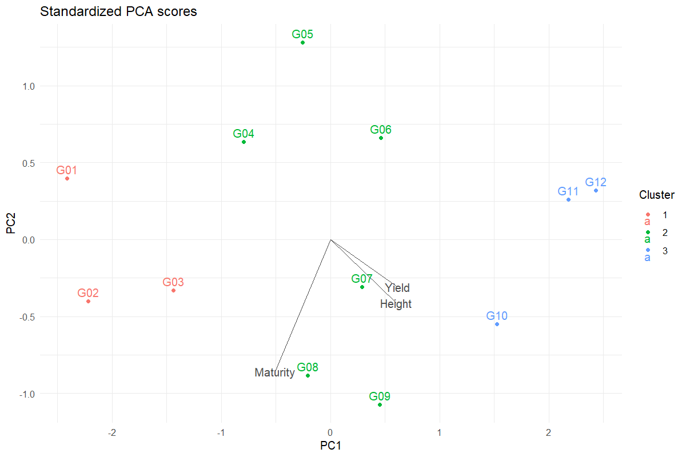
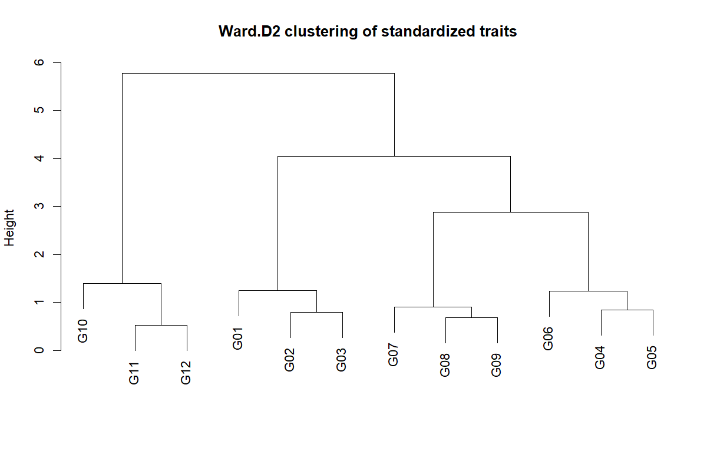

# PCA & Diversity Exploration

Explore multivariate relationships on a defined scale

## Question and data
Use one row per genotype and at least two varying numeric traits. Traits are centred and divided by their sample SD before PCA and Euclidean Ward.D2 clustering.

## Read and report the results
Report eigenvalue percentages, loadings and scores. The biplot overlays unit loading vectors on score coordinates; read numerical loadings for exact contributions. The dendrogram describes the chosen standardized trait distance.

## Scope and assumptions
Cluster membership is exploratory, not proof of genetic ancestry or population structure. Principal-component signs may reverse between equivalent decompositions without changing the solution.

## Setup
```r
source("tools/example-cases.R")
load_drdesign()
```

## pca

[Example CSV](../data/pca.csv) · [R script](../code/pca.R)

Synthetic teaching data; not observations from a field experiment.

```r
data <- research_example("pca-diversity")
result <- run_diversity(data,c("Yield","Height","Maturity"),clusters=3)
```

### Explained variance

[Full-precision CSV](../data/pca-table-1.csv)

| Component | Variance Percent | Cumulative Percent |
| --- | --- | --- |
| PC1 | 81.889 | 81.889 |
| PC2 | 16.399 | 98.287 |
| PC3 | 1.713 | 100.000 |

### Scores and clusters

[Full-precision CSV](../data/pca-table-2.csv)

| Genotype | PC1 | PC2 | PC3 | Cluster |
| --- | --- | --- | --- | --- |
| G01 | -2.415 | 0.396 | 0.284 | 1 |
| G02 | -2.219 | -0.400 | -0.144 | 1 |
| G03 | -1.440 | -0.332 | -0.278 | 1 |
| G04 | -0.793 | 0.634 | 0.114 | 2 |
| G05 | -0.255 | 1.281 | -0.001 | 2 |
| G06 | 0.464 | 0.660 | -0.222 | 2 |
| G07 | 0.290 | -0.309 | -0.152 | 2 |
| G08 | -0.210 | -0.883 | 0.196 | 2 |
| G09 | 0.451 | -1.074 | 0.261 | 2 |
| G10 | 1.522 | -0.552 | -0.266 | 3 |

First 10 rows shown. Download the CSV for every row.

### Loadings

[Full-precision CSV](../data/pca-table-3.csv)

| Trait | PC1 | PC2 | PC3 |
| --- | --- | --- | --- |
| Yield | 0.614 | -0.308 | 0.727 |
| Height | 0.603 | -0.411 | -0.684 |
| Maturity | -0.509 | -0.858 | 0.067 |

### Clustering merges

[Full-precision CSV](../data/pca-table-4.csv)

| X1 | X2 | Height |
| --- | --- | --- |
| -11.000 | -12.000 | 0.521 |
| -8.000 | -9.000 | 0.690 |
| -2.000 | -3.000 | 0.793 |
| -4.000 | -5.000 | 0.849 |
| -7.000 | 2.000 | 0.911 |
| -6.000 | 4.000 | 1.234 |
| -1.000 | 3.000 | 1.248 |
| -10.000 | 1.000 | 1.392 |
| 5.000 | 6.000 | 2.879 |
| 7.000 | 9.000 | 4.048 |

First 10 rows shown. Download the CSV for every row.

### Exclusions

[Full-precision CSV](../data/pca-table-5.csv)

No rows to report.

### Reviewed data

[Full-precision CSV](../data/pca-table-6.csv)

| Genotype | Yield | Height | Maturity |
| --- | --- | --- | --- |
| G01 | 21.974 | 49.476 | 100.929 |
| G02 | 22.135 | 52.809 | 102.262 |
| G03 | 23.178 | 55.219 | 101.148 |
| G04 | 24.293 | 53.974 | 98.426 |
| G05 | 24.431 | 54.594 | 96.416 |
| G06 | 25.799 | 58.388 | 96.782 |
| G07 | 26.504 | 59.500 | 99.003 |
| G08 | 26.862 | 58.128 | 100.854 |
| G09 | 28.346 | 60.080 | 100.449 |
| G10 | 28.677 | 63.657 | 97.976 |

First 10 rows shown. Download the CSV for every row.

### Software versions

[Full-precision CSV](../data/pca-table-7.csv)

| Source / term | Package | Version |
| --- | --- | --- |
|  | R | 4.5.3 |
| shiny | shiny | 1.13.0 |
| agricolae | agricolae | 1.3.7 |
| metan | metan | 1.19.0 |
| lme4 | lme4 | 2.0.1 |
| emmeans | emmeans | 2.0.2 |
| SpATS | SpATS | 1.0.20 |
| DiallelAnalysisR | DiallelAnalysisR | 0.6.0 |

### Analysis settings

[Full-precision CSV](../data/pca-table-8.csv)

| Setting | Value |
| --- | --- |
| Scaling | Centre and unit standard deviation |
| Distance | Euclidean |
| Linkage | Ward.D2 |
| Clusters | 3 |





## Reporting conventions
Tables: estimates and standard errors to 3 decimals; p-values below 0.001 shown as <0.001. Very small or large values use scientific notation. NA means unavailable or not applicable. CSV files retain numerical precision. Confidence levels and multiplicity corrections follow the stated analysis settings; shared letters indicate non-rejection, not equivalence.

[Validation and limitations](../VALIDATION.md)
