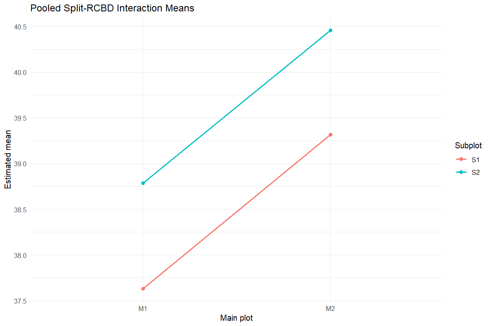
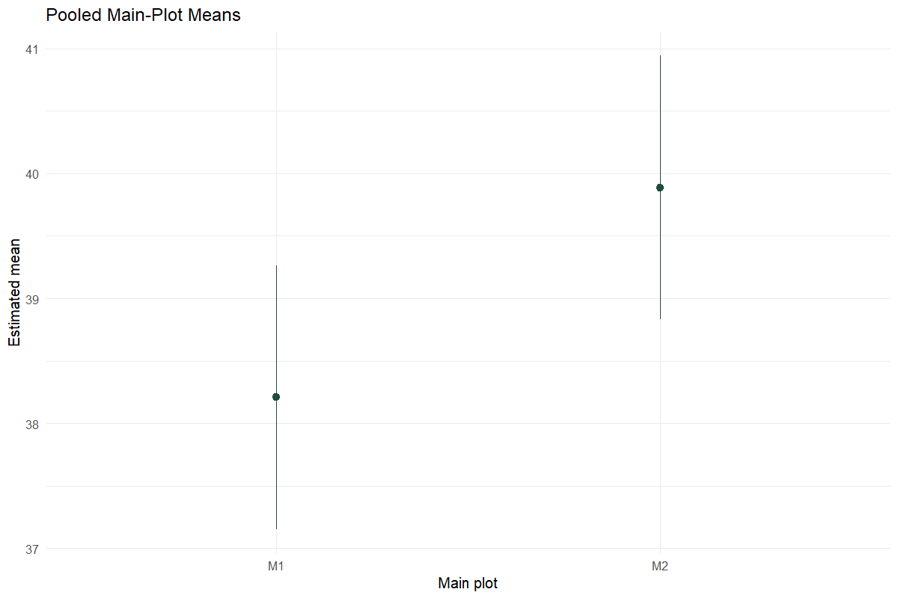
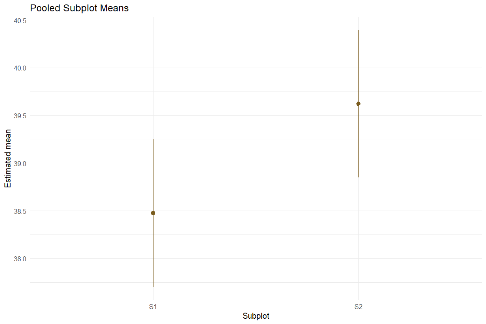
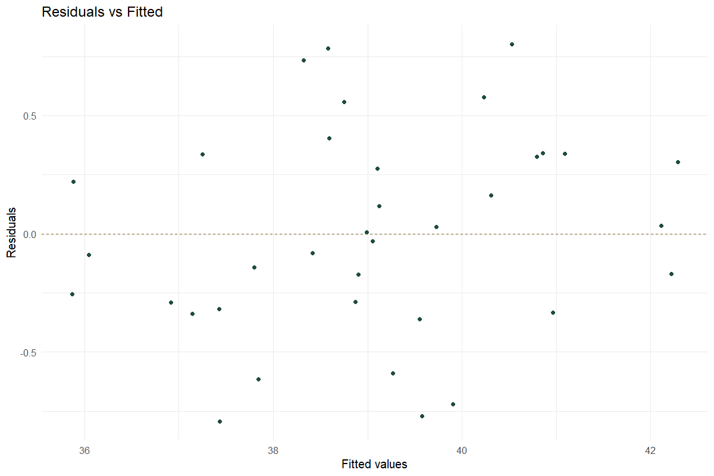
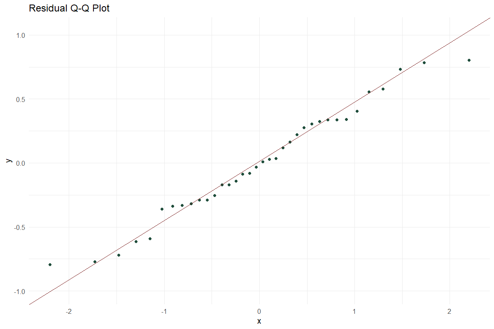
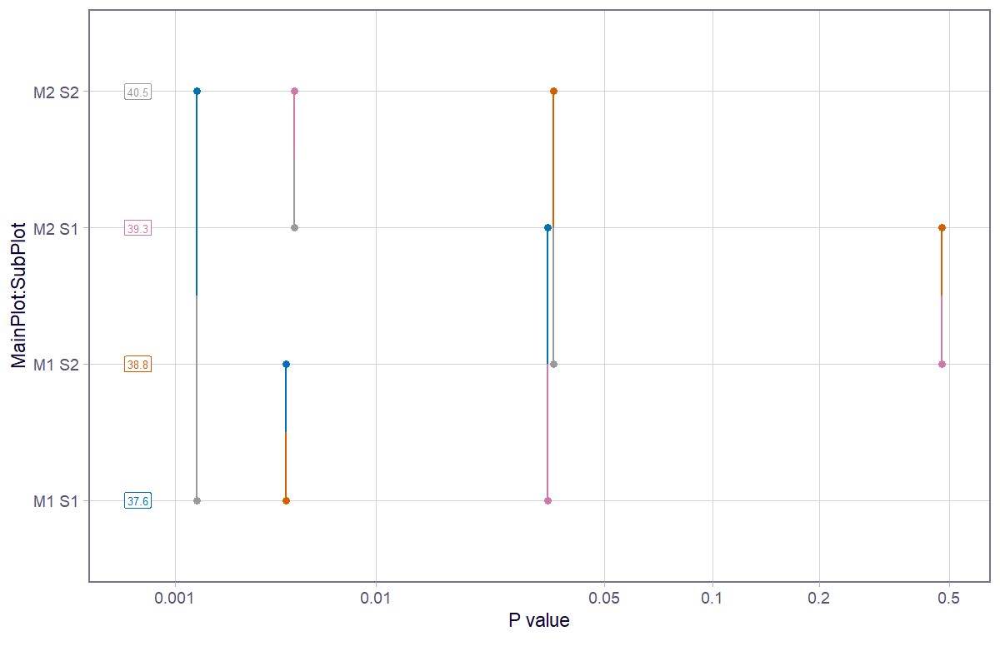

# Pooled Split Plot

Combine split-plot trials across years

## Question and data
Supply Year, Rep, MainPlot, SubPlot and Value. The same complete treatment structure and replicate count are required in every year.

## Read and report the results
The mixed model contains fixed year and treatment interactions, with random Year:Rep and Year:Rep:MainPlot intercepts. Report Satterthwaite df, variance components, estimated means and the specified Fisher LSD contrasts.

## Scope and assumptions
Fisher LSD contrast p-values are unadjusted. Marginal comparisons across years average interactions. The saturated treatment structure is retained; boundary fits and convergence warnings require scientific review.

## Setup
```r
source("tools/example-cases.R")
load_drdesign()
```

## pooled-split-plot

[Example CSV](../data/pooled-split-plot.csv) · [R script](../code/pooled-split-plot.R)

Synthetic teaching data; not observations from a field experiment.

```r
data <- read_pasted_table(pooled_split_plot_example)
data$Value <- data$Value+sin(seq_len(nrow(data))*1.7)
result <- run_pooled_split_plot(data,include_pwpp=TRUE)
```

### dataset

[Full-precision CSV](../data/pooled-split-plot-table-1.csv)

| Year | Rep | Main-plot factor | Subplot factor | Value |
| --- | --- | --- | --- | --- |
| 2023 | R1 | M1 | S1 | 38.333 |
| 2024 | R1 | M1 | S1 | 36.639 |
| 2025 | R1 | M1 | S1 | 36.098 |
| 2023 | R2 | M1 | S1 | 37.588 |
| 2024 | R2 | M1 | S1 | 38.997 |
| 2025 | R2 | M1 | S1 | 36.800 |
| 2023 | R3 | M1 | S1 | 35.614 |
| 2024 | R3 | M1 | S1 | 39.368 |
| 2025 | R3 | M1 | S1 | 39.243 |
| 2023 | R1 | M2 | S1 | 36.627 |

First 10 rows shown. Download the CSV for every row.

### anova

[Full-precision CSV](../data/pooled-split-plot-table-2.csv)

| Source / term | SS | MS | Numerator df | Denominator df | F | p-value |
| --- | --- | --- | --- | --- | --- | --- |
| Year | 0.949 | 0.474 | 2 | 12.000 | 0.968 | 0.408 |
| MainPlot | 2.940 | 2.940 | 1 | 12.000 | 5.997 | 0.031 |
| SubPlot | 11.831 | 11.831 | 1 | 12.000 | 24.134 | <0.001 |
| MainPlot:SubPlot | 0.001 | 0.001 | 1 | 12.000 | 0.001 | 0.974 |
| Year:MainPlot | 1.309 | 0.655 | 2 | 12.000 | 1.335 | 0.299 |
| Year:SubPlot | 0.090 | 0.045 | 2 | 12.000 | 0.092 | 0.913 |
| Year:MainPlot:SubPlot | 4.879 | 2.439 | 2 | 12.000 | 4.976 | 0.027 |

### model_info

[Full-precision CSV](../data/pooled-split-plot-table-3.csv)

| Metric | Value |
| --- | --- |
| Formula | Value ~ Year + (1 \| Year:Rep) + MainPlot * SubPlot + Year:(MainPlot *      SubPlot) + (1 \| Year:Rep:MainPlot) |
| Degrees of freedom | Satterthwaite |
| Comparison method | Fisher LSD (unadjusted pairwise contrasts) |
| CD formula | qt(1 - alpha / 2, df) * SE |
| Years | 3.000 |
| Replications per year | 3.000 |
| Main-plot levels | 2.000 |
| Subplot levels | 2.000 |
| Residual normality p-value | 0.545 |

### fixed_effects

[Full-precision CSV](../data/pooled-split-plot-table-4.csv)

| Source / term | Estimate | SE | df | t | p-value |
| --- | --- | --- | --- | --- | --- |
| (Intercept) | 37.178 | 0.887 | 14.742 | 41.903 | <0.001 |
| Year2024 | 1.156 | 1.255 | 14.742 | 0.922 | 0.372 |
| Year2025 | 0.202 | 1.255 | 14.742 | 0.161 | 0.874 |
| MainPlotM2 | 1.494 | 1.255 | 14.742 | 1.191 | 0.252 |
| SubPlotS2 | 0.177 | 0.572 | 12.000 | 0.309 | 0.763 |
| MainPlotM2:SubPlotS2 | 1.811 | 0.808 | 12.000 | 2.240 | 0.045 |
| Year2024:MainPlotM2 | -1.367 | 1.775 | 14.742 | -0.770 | 0.453 |
| Year2025:MainPlotM2 | 1.945 | 1.775 | 14.742 | 1.096 | 0.291 |
| Year2024:SubPlotS2 | 1.142 | 0.808 | 12.000 | 1.413 | 0.183 |
| Year2025:SubPlotS2 | 1.790 | 0.808 | 12.000 | 2.214 | 0.047 |

First 10 rows shown. Download the CSV for every row.

### random_effect_variance

[Full-precision CSV](../data/pooled-split-plot-table-5.csv)

| grp | var1 | var2 | vcov | sdcor |
| --- | --- | --- | --- | --- |
| Year:Rep:MainPlot | (Intercept) | NA | 1.871 | 1.368 |
| Year:Rep | (Intercept) | NA | 0.000 | 0.000 |
| Residual | NA | NA | 0.490 | 0.700 |

### main_means

[Full-precision CSV](../data/pooled-split-plot-table-6.csv)

| Main-plot factor | Estimated mean | SE | df | CI lower | CI upper | t | p-value |
| --- | --- | --- | --- | --- | --- | --- | --- |
| M1 | 38.208 | 0.485 | 12.000 | 37.152 | 39.265 | 78.789 | <0.001 |
| M2 | 39.888 | 0.485 | 12.000 | 38.831 | 40.945 | 82.252 | <0.001 |

Results are averaged over the levels of: Year, SubPlot

Degrees-of-freedom method: satterthwaite

Confidence level used: 0.95

### sub_means

[Full-precision CSV](../data/pooled-split-plot-table-7.csv)

| Subplot factor | Estimated mean | SE | df | CI lower | CI upper | t | p-value |
| --- | --- | --- | --- | --- | --- | --- | --- |
| S1 | 38.475 | 0.362 | 14.742 | 37.702 | 39.248 | 106.220 | <0.001 |
| S2 | 39.621 | 0.362 | 14.742 | 38.848 | 40.395 | 109.385 | <0.001 |

Results are averaged over the levels of: Year, MainPlot

Degrees-of-freedom method: satterthwaite

Confidence level used: 0.95

### interaction_means

[Full-precision CSV](../data/pooled-split-plot-table-8.csv)

| Main-plot factor | Subplot factor | Estimated mean | SE | df | CI lower | CI upper | t | p-value |
| --- | --- | --- | --- | --- | --- | --- | --- | --- |
| M1 | S1 | 37.631 | 0.512 | 14.742 | 36.538 | 38.725 | 73.462 | <0.001 |
| M2 | S1 | 39.319 | 0.512 | 14.742 | 38.225 | 40.412 | 76.755 | <0.001 |
| M1 | S2 | 38.785 | 0.512 | 14.742 | 37.692 | 39.879 | 75.715 | <0.001 |
| M2 | S2 | 40.457 | 0.512 | 14.742 | 39.364 | 41.551 | 78.979 | <0.001 |

Results are averaged over the levels of: Year

Degrees-of-freedom method: satterthwaite

Confidence level used: 0.95

### cd_summary

[Full-precision CSV](../data/pooled-split-plot-table-9.csv)

| Comparison | Comparisons | Minimum CD | Maximum CD | Mean CD | Minimum df | Maximum df |
| --- | --- | --- | --- | --- | --- | --- |
| Main plot means | 1.000 | 1.494 | 1.494 | 1.494 | 12.000 | 12.000 |
| Subplot means | 1.000 | 0.508 | 0.508 | 0.508 | 12.000 | 12.000 |
| Subplot means within main plot | 2.000 | 0.719 | 0.719 | 0.719 | 12.000 | 12.000 |
| Main-plot means within subplot | 2.000 | 1.546 | 1.546 | 1.546 | 14.742 | 14.742 |

### lsd_main

[Full-precision CSV](../data/pooled-split-plot-table-10.csv)

| contrast | estimate | SE | df | CI lower | CI upper | t | p-value | Critical t | CD |
| --- | --- | --- | --- | --- | --- | --- | --- | --- | --- |
| M1 - M2 | -1.680 | 0.686 | 12.000 | -3.174 | -0.185 | -2.449 | 0.031 | 2.179 | 1.494 |

Results are averaged over the levels of: Year, SubPlot

Degrees-of-freedom method: satterthwaite

Confidence level used: 0.95

### lsd_sub

[Full-precision CSV](../data/pooled-split-plot-table-11.csv)

| contrast | estimate | SE | df | CI lower | CI upper | t | p-value | Critical t | CD |
| --- | --- | --- | --- | --- | --- | --- | --- | --- | --- |
| S1 - S2 | -1.147 | 0.233 | 12.000 | -1.655 | -0.638 | -4.913 | <0.001 | 2.179 | 0.508 |

Results are averaged over the levels of: Year, MainPlot

Degrees-of-freedom method: satterthwaite

Confidence level used: 0.95

### lsd_interaction

[Full-precision CSV](../data/pooled-split-plot-table-12.csv)

| contrast | estimate | SE | df | CI lower | CI upper | t | p-value | Critical t | CD |
| --- | --- | --- | --- | --- | --- | --- | --- | --- | --- |
| M1 S1 - M2 S1 | -1.687 | 0.724 | 14.742 | -3.234 | -0.141 | -2.329 | 0.035 | 2.135 | 1.546 |
| M1 S1 - M1 S2 | -1.154 | 0.330 | 12.000 | -1.873 | -0.435 | -3.497 | 0.004 | 2.179 | 0.719 |
| M1 S1 - M2 S2 | -2.826 | 0.724 | 14.742 | -4.373 | -1.280 | -3.901 | 0.001 | 2.135 | 1.546 |
| M2 S1 - M1 S2 | 0.533 | 0.724 | 14.742 | -1.013 | 2.079 | 0.736 | 0.473 | 2.135 | 1.546 |
| M2 S1 - M2 S2 | -1.139 | 0.330 | 12.000 | -1.858 | -0.420 | -3.451 | 0.005 | 2.179 | 0.719 |
| M1 S2 - M2 S2 | -1.672 | 0.724 | 14.742 | -3.218 | -0.125 | -2.308 | 0.036 | 2.135 | 1.546 |

Results are averaged over the levels of: Year

Degrees-of-freedom method: satterthwaite

Confidence level used: 0.95

### lsd_sub_within_main

[Full-precision CSV](../data/pooled-split-plot-table-13.csv)

| contrast | Main-plot factor | estimate | SE | df | CI lower | CI upper | t | p-value | Critical t | CD |
| --- | --- | --- | --- | --- | --- | --- | --- | --- | --- | --- |
| S1 - S2 | M1 | -1.154 | 0.330 | 12.000 | -1.873 | -0.435 | -3.497 | 0.004 | 2.179 | 0.719 |
| S1 - S2 | M2 | -1.139 | 0.330 | 12.000 | -1.858 | -0.420 | -3.451 | 0.005 | 2.179 | 0.719 |

Results are averaged over the levels of: Year

Degrees-of-freedom method: satterthwaite

Confidence level used: 0.95

### lsd_main_within_sub

[Full-precision CSV](../data/pooled-split-plot-table-14.csv)

| contrast | Subplot factor | estimate | SE | df | CI lower | CI upper | t | p-value | Critical t | CD |
| --- | --- | --- | --- | --- | --- | --- | --- | --- | --- | --- |
| M1 - M2 | S1 | -1.687 | 0.724 | 14.742 | -3.234 | -0.141 | -2.329 | 0.035 | 2.135 | 1.546 |
| M1 - M2 | S2 | -1.672 | 0.724 | 14.742 | -3.218 | -0.125 | -2.308 | 0.036 | 2.135 | 1.546 |

Results are averaged over the levels of: Year

Degrees-of-freedom method: satterthwaite

Confidence level used: 0.95

### diagnostics

[Full-precision CSV](../data/pooled-split-plot-table-15.csv)

| Observation | Fitted | Residual |
| --- | --- | --- |
| 1 | 38.415 | -0.081 |
| 2 | 37.432 | -0.793 |
| 3 | 35.878 | 0.220 |
| 4 | 37.252 | 0.337 |
| 5 | 38.989 | 0.008 |
| 6 | 37.139 | -0.339 |
| 7 | 35.869 | -0.255 |
| 8 | 38.583 | 0.785 |
| 9 | 39.125 | 0.118 |
| 10 | 36.916 | -0.289 |

First 10 rows shown. Download the CSV for every row.













### Diagnostics and model notes

- boundary (singular) fit: see help('isSingular')

- NOTE: Results may be misleading due to involvement in interactions

- Pooled Split-RCBD mixed model across 3 years with 3 replications per year; Fisher LSD contrasts use Satterthwaite degrees of freedom. Diagnostics: boundary (singular) fit: see help('isSingular')
 | NOTE: Results may be misleading due to involvement in interactions


## Reporting conventions
Tables: estimates and standard errors to 3 decimals; p-values below 0.001 shown as <0.001. Very small or large values use scientific notation. NA means unavailable or not applicable. CSV files retain numerical precision. Confidence levels and multiplicity corrections follow the stated analysis settings; shared letters indicate non-rejection, not equivalence.

[Validation and limitations](../VALIDATION.md)
