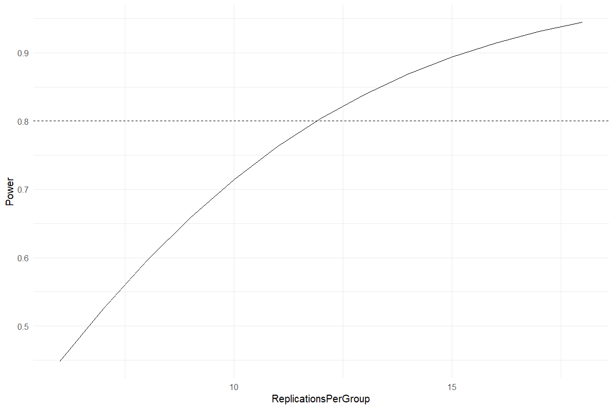
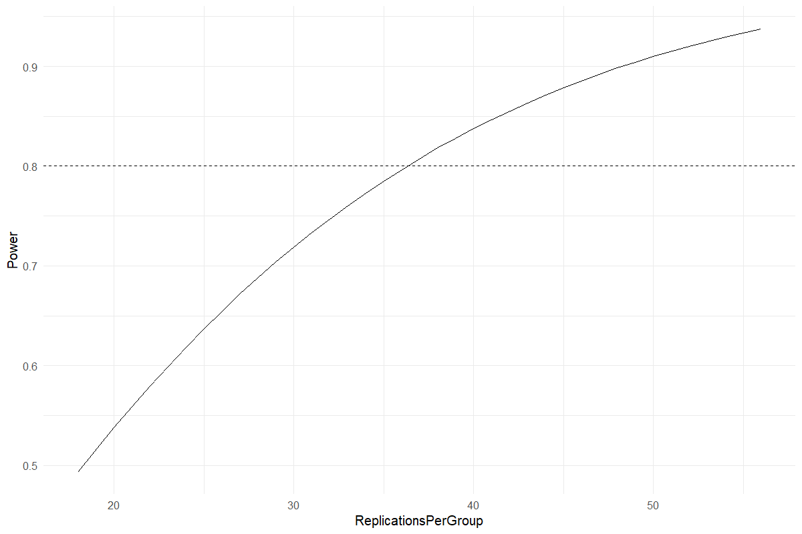

# Power & Replication Planning

Plan replication from an effect worth detecting

## Question and data
Supply anticipated group means, residual SD, significance level and target power. Choose balanced CRD ANOVA or two independent groups.

## Read and report the results
The recommended count is rounded up per group and power is recalculated for that integer design. The sensitivity curve shows how power changes with replication.

## Scope and assumptions
The calculation assumes independent normal observations and a common variance. It does not include blocks, split plots, clustering, attrition or multiple-primary-outcome adjustment.

## Setup
```r
source("tools/example-cases.R")
load_drdesign()
```

## power-anova

[Example CSV](../data/power-anova.csv) · [R script](../code/power-anova.R)

Synthetic teaching data; not observations from a field experiment.

```r
data <- data.frame(Mean=c(20,22,24))
result <- run_power_planning(data$Mean,residual_sd=3,method="anova")
```

### Recommended design

[Full-precision CSV](../data/power-anova-table-1.csv)

| Replications Per Group | Groups | Total Units | Target Power | Achieved Power |
| --- | --- | --- | --- | --- |
| 12.000 | 3 | 36 | 0.800 | 0.804 |

### Sensitivity

[Full-precision CSV](../data/power-anova-table-2.csv)

| Replications Per Group | Power |
| --- | --- |
| 6.000 | 0.448 |
| 7.000 | 0.525 |
| 8.000 | 0.596 |
| 9.000 | 0.659 |
| 10.000 | 0.714 |
| 11.000 | 0.762 |
| 12.000 | 0.804 |
| 13.000 | 0.839 |
| 14.000 | 0.869 |
| 15.000 | 0.894 |

First 10 rows shown. Download the CSV for every row.

### Exclusions

[Full-precision CSV](../data/power-anova-table-3.csv)

No rows to report.

### Reviewed data

[Full-precision CSV](../data/power-anova-table-4.csv)

| Group | Anticipated Mean |
| --- | --- |
| 1.000 | 20.000 |
| 2.000 | 22.000 |
| 3.000 | 24.000 |

### Software versions

[Full-precision CSV](../data/power-anova-table-5.csv)

| Source / term | Package | Version |
| --- | --- | --- |
|  | R | 4.5.3 |
| shiny | shiny | 1.13.0 |
| agricolae | agricolae | 1.3.7 |
| metan | metan | 1.19.0 |
| lme4 | lme4 | 2.0.1 |
| emmeans | emmeans | 2.0.2 |
| SpATS | SpATS | 1.0.20 |
| DiallelAnalysisR | DiallelAnalysisR | 0.6.0 |

### Analysis settings

[Full-precision CSV](../data/power-anova-table-6.csv)

| Setting | Value |
| --- | --- |
| Method | anova |
| ResidualSD | 3 |
| Alpha | 0.05 |
| TargetPower | 0.8 |



### Diagnostics and model notes

- Assumes independent normal observations and common residual variance. This calculation does not account for blocking, split plots, or attrition.

## power-two-sample

[Example CSV](../data/power-two-sample.csv) · [R script](../code/power-two-sample.R)

Synthetic teaching data; not observations from a field experiment.

```r
data <- data.frame(Mean=c(20,22))
result <- run_power_planning(data$Mean,residual_sd=3,method="two-sample")
```

### Recommended design

[Full-precision CSV](../data/power-two-sample-table-1.csv)

| Replications Per Group | Groups | Total Units | Target Power | Achieved Power |
| --- | --- | --- | --- | --- |
| 37.000 | 2 | 74 | 0.800 | 0.808 |

### Sensitivity

[Full-precision CSV](../data/power-two-sample-table-2.csv)

| Replications Per Group | Power |
| --- | --- |
| 18.000 | 0.493 |
| 20.000 | 0.538 |
| 21.000 | 0.559 |
| 22.000 | 0.579 |
| 24.000 | 0.618 |
| 25.000 | 0.637 |
| 26.000 | 0.654 |
| 27.000 | 0.672 |
| 29.000 | 0.704 |
| 30.000 | 0.719 |

First 10 rows shown. Download the CSV for every row.

### Exclusions

[Full-precision CSV](../data/power-two-sample-table-3.csv)

No rows to report.

### Reviewed data

[Full-precision CSV](../data/power-two-sample-table-4.csv)

| Group | Anticipated Mean |
| --- | --- |
| 1.000 | 20.000 |
| 2.000 | 22.000 |

### Software versions

[Full-precision CSV](../data/power-two-sample-table-5.csv)

| Source / term | Package | Version |
| --- | --- | --- |
|  | R | 4.5.3 |
| shiny | shiny | 1.13.0 |
| agricolae | agricolae | 1.3.7 |
| metan | metan | 1.19.0 |
| lme4 | lme4 | 2.0.1 |
| emmeans | emmeans | 2.0.2 |
| SpATS | SpATS | 1.0.20 |
| DiallelAnalysisR | DiallelAnalysisR | 0.6.0 |

### Analysis settings

[Full-precision CSV](../data/power-two-sample-table-6.csv)

| Setting | Value |
| --- | --- |
| Method | two-sample |
| ResidualSD | 3 |
| Alpha | 0.05 |
| TargetPower | 0.8 |



### Diagnostics and model notes

- Assumes independent normal observations and common residual variance. This calculation does not account for blocking, split plots, or attrition.

## Reporting conventions
Tables: estimates and standard errors to 3 decimals; p-values below 0.001 shown as <0.001. Very small or large values use scientific notation. NA means unavailable or not applicable. CSV files retain numerical precision. Confidence levels and multiplicity corrections follow the stated analysis settings; shared letters indicate non-rejection, not equivalence.

[Validation and limitations](../VALIDATION.md)
