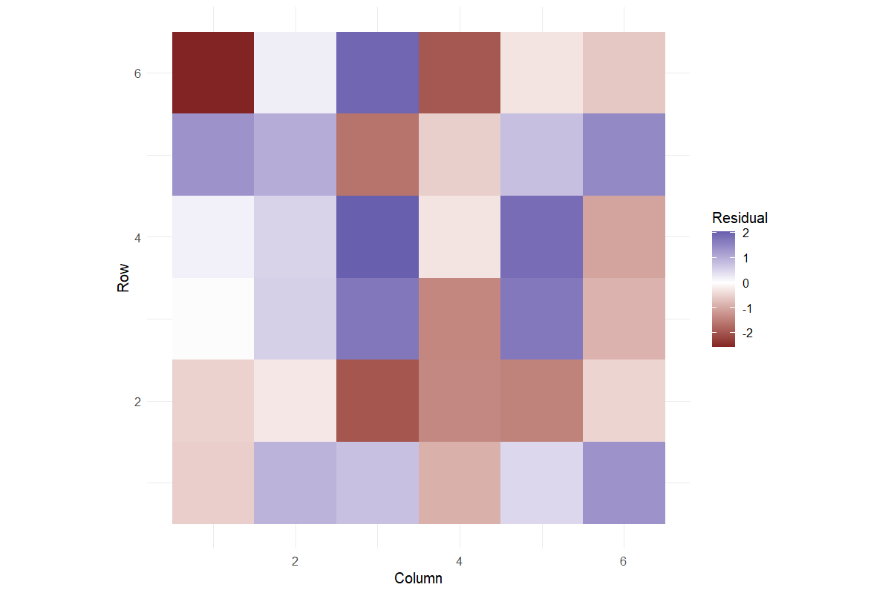
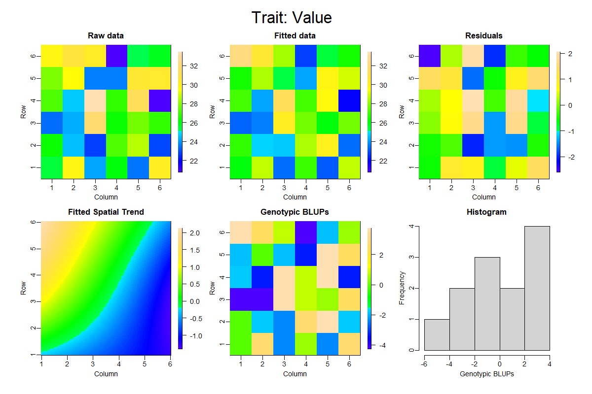
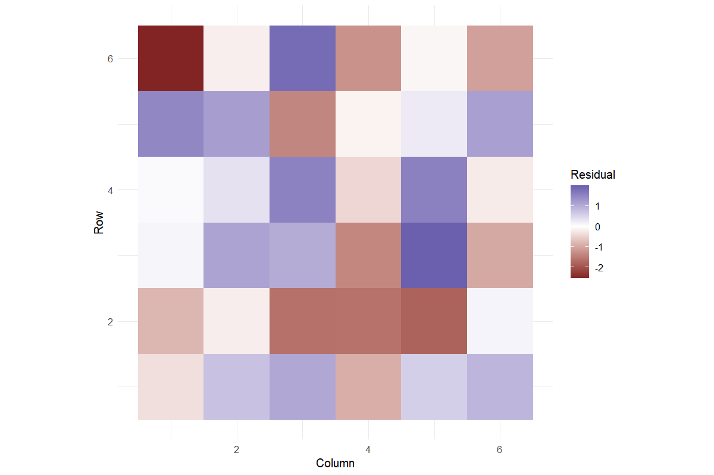
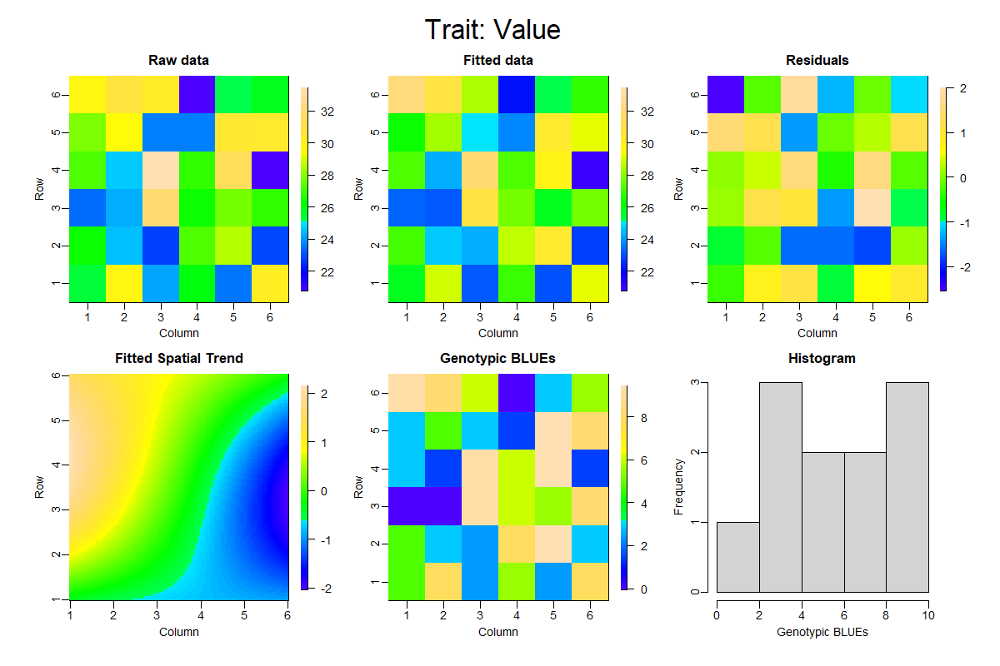

# Spatial Field Analysis

Model spatial variation using observed field coordinates

## Question and data
Map genotype, replication, numeric row, numeric column and response. Coordinates must identify unique plots, with at least four distinct rows and columns.

## Read and report the results
SpATS fits a PSANOVA surface with fixed replication and fixed or random genotype. Report the specification and genotype estimates with their model-provided SEs. Inspect the field map, fitted surface and residual map together.

## Scope and assumptions
Residual RMSE is in-sample fit, not proof of predictive improvement. A model reaching its iteration limit is not a validated fit. Coordinate scales and field geometry are part of the scientific model.

## Setup
```r
source("tools/example-cases.R")
load_drdesign()
```

## spatial-random

[Example CSV](../data/spatial-random.csv) · [R script](../code/spatial-random.R)

Synthetic teaching data; not observations from a field experiment.

```r
data <- research_example("spatial-field")
result <- run_spatial_trial(data,genotype_random=TRUE)
```

### Genotype predictions

[Full-precision CSV](../data/spatial-random-table-1.csv)

| Source / term | Genotype | Column | Row | Rep | predicted.values | standard.errors |
| --- | --- | --- | --- | --- | --- | --- |
| 1 | G01 | Excluded | Excluded | Averaged | 22.518 | 0.959 |
| 14 | G02 | Excluded | Excluded | Averaged | 23.374 | 0.932 |
| 3 | G03 | Excluded | Excluded | Averaged | 24.379 | 1.013 |
| 4 | G04 | Excluded | Excluded | Averaged | 24.946 | 0.938 |
| 17 | G05 | Excluded | Excluded | Averaged | 24.841 | 0.989 |
| 30 | G06 | Excluded | Excluded | Averaged | 27.186 | 0.961 |
| 7 | G07 | Excluded | Excluded | Averaged | 26.564 | 1.050 |
| 32 | G08 | Excluded | Excluded | Averaged | 27.472 | 0.929 |
| 21 | G09 | Excluded | Excluded | Averaged | 29.243 | 0.984 |
| 22 | G10 | Excluded | Excluded | Averaged | 29.455 | 1.019 |

First 10 rows shown. Download the CSV for every row.

### Residual diagnostics

[Full-precision CSV](../data/spatial-random-table-2.csv)

| Source / term | Observation | Row | Column | Fitted | Residual | Nonspatial Residual |
| --- | --- | --- | --- | --- | --- | --- |
| 7 | 1 | 1 | 1 | 25.989 | -0.554 | -1.197 |
| 22 | 2 | 1 | 2 | 28.732 | 0.924 | 1.145 |
| 3 | 3 | 1 | 3 | 23.392 | 0.765 | 0.635 |
| 30 | 4 | 1 | 4 | 26.873 | -0.903 | -1.030 |
| 15 | 5 | 1 | 5 | 23.037 | 0.478 | -0.235 |
| 34 | 6 | 1 | 6 | 28.730 | 1.337 | 0.920 |
| 19 | 7 | 2 | 1 | 26.749 | -0.506 | -0.618 |
| 4 | 8 | 2 | 2 | 24.711 | -0.265 | -0.273 |
| 27 | 9 | 2 | 3 | 24.661 | -1.998 | -1.722 |
| 10 | 10 | 2 | 4 | 28.495 | -1.388 | -1.176 |

First 10 rows shown. Download the CSV for every row.

### Model comparison

[Full-precision CSV](../data/spatial-random-table-3.csv)

| Model | Residual RMSE |
| --- | --- |
| Spatial | 1.229 |
| Nonspatial | 1.495 |

### Variance components

[Full-precision CSV](../data/spatial-random-table-4.csv)

| Component | Variance |
| --- | --- |
| Genotype | 8.480 |
| f(Column) | 1.04e-38 |
| f(Row) | 0.006 |
| f(Column):Row | 2.20e-15 |
| Column:f(Row) | 8.749 |
| f(Column):f(Row) | 2.22e-12 |

### Exclusions

[Full-precision CSV](../data/spatial-random-table-5.csv)

No rows to report.

### Reviewed data

[Full-precision CSV](../data/spatial-random-table-6.csv)

| Source / term | Genotype | Rep | Row | Column | Value |
| --- | --- | --- | --- | --- | --- |
| 7 | G07 | R1 | 1 | 1 | 25.436 |
| 22 | G10 | R2 | 1 | 2 | 29.657 |
| 3 | G03 | R1 | 1 | 3 | 24.157 |
| 30 | G06 | R3 | 1 | 4 | 25.970 |
| 15 | G03 | R2 | 1 | 5 | 23.515 |
| 34 | G10 | R3 | 1 | 6 | 30.067 |
| 19 | G07 | R2 | 2 | 1 | 26.243 |
| 4 | G04 | R1 | 2 | 2 | 24.446 |
| 27 | G03 | R3 | 2 | 3 | 22.664 |
| 10 | G10 | R1 | 2 | 4 | 27.108 |

First 10 rows shown. Download the CSV for every row.

### Software versions

[Full-precision CSV](../data/spatial-random-table-7.csv)

| Source / term | Package | Version |
| --- | --- | --- |
|  | R | 4.5.3 |
| shiny | shiny | 1.13.0 |
| agricolae | agricolae | 1.3.7 |
| metan | metan | 1.19.0 |
| lme4 | lme4 | 2.0.1 |
| emmeans | emmeans | 2.0.2 |
| SpATS | SpATS | 1.0.20 |
| DiallelAnalysisR | DiallelAnalysisR | 0.6.0 |

### Analysis settings

[Full-precision CSV](../data/spatial-random-table-8.csv)

| Setting | Value |
| --- | --- |
| Genotype | Random |
| Replication | Fixed |
| Spatial | PSANOVA(Column, Row), 3 x 3 segments |
| Alpha | 0.05 |





### Diagnostics and model notes

- RMSE is descriptive in-sample fit, not evidence of predictive superiority. Spatial genotype standard errors are supplied by SpATS.

## spatial-fixed

[Example CSV](../data/spatial-fixed.csv) · [R script](../code/spatial-fixed.R)

Synthetic teaching data; not observations from a field experiment.

```r
data <- research_example("spatial-field")
result <- run_spatial_trial(data,genotype_random=FALSE)
```

### Genotype predictions

[Full-precision CSV](../data/spatial-fixed-table-1.csv)

| Source / term | Genotype | Column | Row | Rep | predicted.values | standard.errors |
| --- | --- | --- | --- | --- | --- | --- |
| 1 | G01 | Excluded | Excluded | Averaged | 21.677 | 1.010 |
| 14 | G02 | Excluded | Excluded | Averaged | 23.131 | 0.956 |
| 3 | G03 | Excluded | Excluded | Averaged | 24.025 | 1.063 |
| 4 | G04 | Excluded | Excluded | Averaged | 24.560 | 0.971 |
| 17 | G05 | Excluded | Excluded | Averaged | 24.514 | 1.030 |
| 30 | G06 | Excluded | Excluded | Averaged | 27.213 | 0.999 |
| 7 | G07 | Excluded | Excluded | Averaged | 26.420 | 1.103 |
| 32 | G08 | Excluded | Excluded | Averaged | 27.682 | 0.954 |
| 21 | G09 | Excluded | Excluded | Averaged | 29.937 | 1.050 |
| 22 | G10 | Excluded | Excluded | Averaged | 29.667 | 1.064 |

First 10 rows shown. Download the CSV for every row.

### Residual diagnostics

[Full-precision CSV](../data/spatial-fixed-table-2.csv)

| Source / term | Observation | Row | Column | Fitted | Residual | Nonspatial Residual |
| --- | --- | --- | --- | --- | --- | --- |
| 7 | 1 | 1 | 1 | 25.786 | -0.350 | -1.238 |
| 22 | 2 | 1 | 2 | 28.920 | 0.736 | 0.849 |
| 3 | 3 | 1 | 3 | 23.098 | 1.058 | 1.075 |
| 30 | 4 | 1 | 4 | 26.879 | -0.908 | -0.995 |
| 15 | 5 | 1 | 5 | 22.944 | 0.571 | 0.206 |
| 34 | 6 | 1 | 6 | 29.182 | 0.885 | 0.624 |
| 19 | 7 | 2 | 1 | 27.070 | -0.827 | -0.659 |
| 4 | 8 | 2 | 2 | 24.640 | -0.194 | -0.017 |
| 27 | 9 | 2 | 3 | 24.293 | -1.629 | -1.281 |
| 10 | 10 | 2 | 4 | 28.729 | -1.621 | -1.473 |

First 10 rows shown. Download the CSV for every row.

### Model comparison

[Full-precision CSV](../data/spatial-fixed-table-3.csv)

| Model | Residual RMSE |
| --- | --- |
| Spatial | 1.136 |
| Nonspatial | 1.447 |

### Variance components

[Full-precision CSV](../data/spatial-fixed-table-4.csv)

| Component | Variance |
| --- | --- |
| f(Column) | 8.97e-78 |
| f(Row) | 0.050 |
| f(Column):Row | 1.698 |
| Column:f(Row) | 44.635 |
| f(Column):f(Row) | 1.41e-27 |

### Exclusions

[Full-precision CSV](../data/spatial-fixed-table-5.csv)

No rows to report.

### Reviewed data

[Full-precision CSV](../data/spatial-fixed-table-6.csv)

| Source / term | Genotype | Rep | Row | Column | Value |
| --- | --- | --- | --- | --- | --- |
| 7 | G07 | R1 | 1 | 1 | 25.436 |
| 22 | G10 | R2 | 1 | 2 | 29.657 |
| 3 | G03 | R1 | 1 | 3 | 24.157 |
| 30 | G06 | R3 | 1 | 4 | 25.970 |
| 15 | G03 | R2 | 1 | 5 | 23.515 |
| 34 | G10 | R3 | 1 | 6 | 30.067 |
| 19 | G07 | R2 | 2 | 1 | 26.243 |
| 4 | G04 | R1 | 2 | 2 | 24.446 |
| 27 | G03 | R3 | 2 | 3 | 22.664 |
| 10 | G10 | R1 | 2 | 4 | 27.108 |

First 10 rows shown. Download the CSV for every row.

### Software versions

[Full-precision CSV](../data/spatial-fixed-table-7.csv)

| Source / term | Package | Version |
| --- | --- | --- |
|  | R | 4.5.3 |
| shiny | shiny | 1.13.0 |
| agricolae | agricolae | 1.3.7 |
| metan | metan | 1.19.0 |
| lme4 | lme4 | 2.0.1 |
| emmeans | emmeans | 2.0.2 |
| SpATS | SpATS | 1.0.20 |
| DiallelAnalysisR | DiallelAnalysisR | 0.6.0 |

### Analysis settings

[Full-precision CSV](../data/spatial-fixed-table-8.csv)

| Setting | Value |
| --- | --- |
| Genotype | Fixed |
| Replication | Fixed |
| Spatial | PSANOVA(Column, Row), 3 x 3 segments |
| Alpha | 0.05 |





### Diagnostics and model notes

- RMSE is descriptive in-sample fit, not evidence of predictive superiority. Spatial genotype standard errors are supplied by SpATS.

## Reporting conventions
Tables: estimates and standard errors to 3 decimals; p-values below 0.001 shown as <0.001. Very small or large values use scientific notation. NA means unavailable or not applicable. CSV files retain numerical precision. Confidence levels and multiplicity corrections follow the stated analysis settings; shared letters indicate non-rejection, not equivalence.

[Validation and limitations](../VALIDATION.md)
