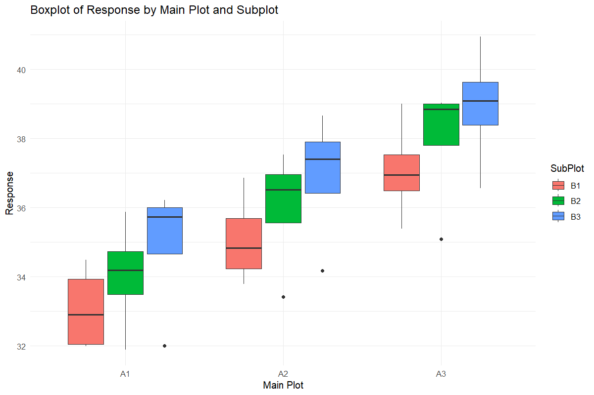
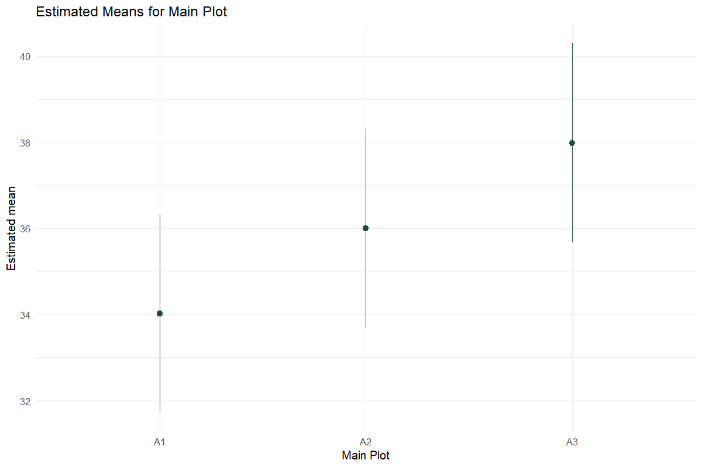
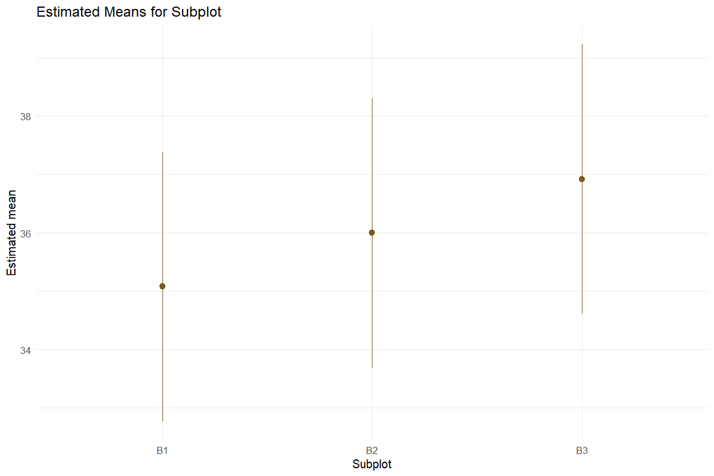
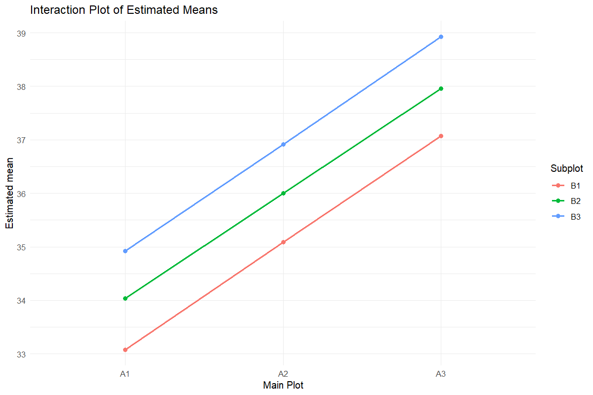
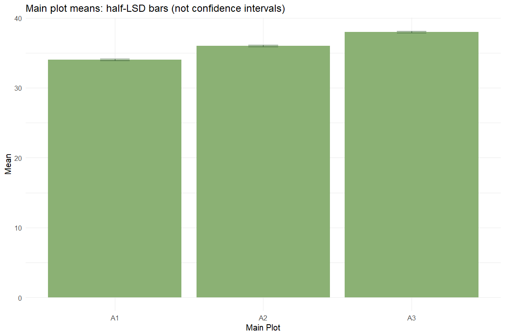
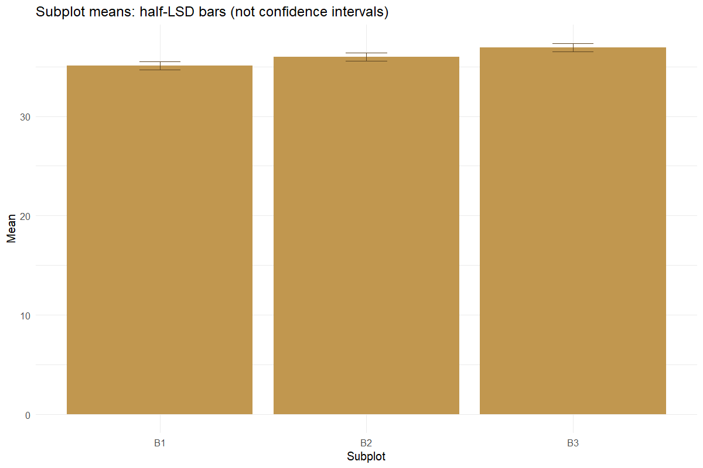
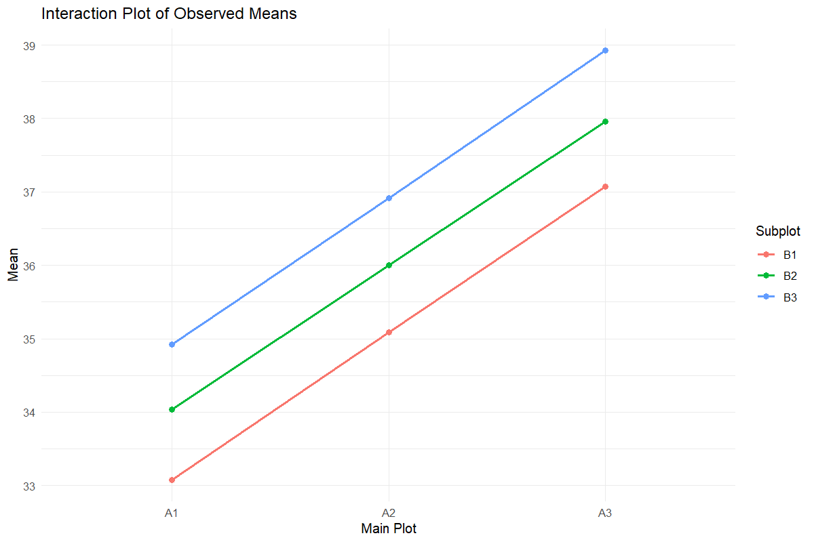

# Split Plot

Respect the whole-plot and subplot errors

## Question and data
Provide Rep, MainPlot, SubPlot and Value, with one observation per complete cell. Custom columns can be mapped explicitly. The classical tables require a complete balanced design.

## Read and report the results
The classical ANOVA uses Error(a) for main plots and Error(b) for subplots and interaction. Comparison summaries report SE(d), not SE(m). Comparisons spanning main plots use an approximate Satterthwaite df. Mixed-model outputs are separately identified.

## Scope and assumptions
Half-LSD bars are comparison aids, not confidence intervals. Keep the interaction in the model. Fixed and mixed analyses can differ at boundary variance estimates; inspect diagnostics rather than selecting whichever gives significance.

## Setup
```r
source("tools/example-cases.R")
load_drdesign()
```

## split-plot

[Example CSV](../data/split-plot.csv) · [R script](../code/split-plot.R)

Synthetic teaching data; not observations from a field experiment.

```r
data <- expand.grid(Rep=paste0("R",1:4),MainPlot=paste0("A",1:3),SubPlot=paste0("B",1:3))
i <- seq_len(nrow(data))
data$Value <- 30+as.numeric(data$MainPlot)*2+as.numeric(data$SubPlot)+sin(i*1.7)+rep(c(-2,1,0,1),9)
result <- run_split_plot(data)
```

### dataset

[Full-precision CSV](../data/split-plot-table-1.csv)

| Rep | Main-plot factor | Subplot factor | Value |
| --- | --- | --- | --- |
| R1 | A1 | B1 | 31.992 |
| R2 | A1 | B1 | 33.744 |
| R3 | A1 | B1 | 32.074 |
| R4 | A1 | B1 | 34.494 |
| R1 | A2 | B1 | 33.798 |
| R2 | A2 | B1 | 35.300 |
| R3 | A2 | B1 | 34.382 |
| R4 | A2 | B1 | 36.859 |
| R1 | A3 | B1 | 35.397 |
| R2 | A3 | B1 | 37.039 |

First 10 rows shown. Download the CSV for every row.

### full_anova

[Full-precision CSV](../data/split-plot-table-2.csv)

| SS | MS | Numerator df | Denominator df | F | p-value | Source / term |
| --- | --- | --- | --- | --- | --- | --- |
| 94.607 | 47.303 | 2 | 24.000 | 67.730 | <0.001 | MainPlot |
| 20.421 | 10.211 | 2 | 24.000 | 14.620 | <0.001 | SubPlot |
| 0.010 | 0.002 | 4 | 24.000 | 0.003 | 1.000 | MainPlot:SubPlot |

### additive_anova

[Full-precision CSV](../data/split-plot-table-3.csv)

| SS | MS | Numerator df | Denominator df | F | p-value | Source / term |
| --- | --- | --- | --- | --- | --- | --- |
| 94.607 | 47.303 | 2 | 28.000 | 78.973 | <0.001 | MainPlot |
| 20.421 | 10.211 | 2 | 28.000 | 17.046 | <0.001 | SubPlot |

### assumptions

[Full-precision CSV](../data/split-plot-table-4.csv)

| Metric | Value |
| --- | --- |
| Alpha | 0.050 |
| Interaction p-value | 1.000 |
| Selected final model | Interaction model |
| Random effect | Replication/block as random intercept |

### emmeans_main

[Full-precision CSV](../data/split-plot-table-5.csv)

| Main-plot factor | Estimated mean | SE | df | CI lower | CI upper |
| --- | --- | --- | --- | --- | --- |
| A1 | 34.014 | 0.778 | 3.417 | 31.701 | 36.326 |
| A2 | 35.999 | 0.778 | 3.417 | 33.687 | 38.311 |
| A3 | 37.985 | 0.778 | 3.417 | 35.672 | 40.297 |

Results are averaged over the levels of: SubPlot

Degrees-of-freedom method: kenward-roger

Confidence level used: 0.95

### emmeans_sub

[Full-precision CSV](../data/split-plot-table-6.csv)

| Subplot factor | Estimated mean | SE | df | CI lower | CI upper |
| --- | --- | --- | --- | --- | --- |
| B1 | 35.078 | 0.778 | 3.423 | 32.767 | 37.388 |
| B2 | 35.997 | 0.778 | 3.423 | 33.687 | 38.308 |
| B3 | 36.922 | 0.778 | 3.423 | 34.612 | 39.233 |

Results are averaged over the levels of: MainPlot

Degrees-of-freedom method: kenward-roger

Confidence level used: 0.95

### emmeans_interaction

[Full-precision CSV](../data/split-plot-table-7.csv)

| Main-plot factor | Subplot factor | Estimated mean | SE | df | CI lower | CI upper |
| --- | --- | --- | --- | --- | --- | --- |
| A1 | B1 | 33.076 | 0.849 | 4.826 | 30.869 | 35.283 |
| A2 | B1 | 35.085 | 0.849 | 4.826 | 32.878 | 37.292 |
| A3 | B1 | 37.072 | 0.849 | 4.826 | 34.865 | 39.278 |
| A1 | B2 | 34.039 | 0.849 | 4.826 | 31.833 | 36.246 |
| A2 | B2 | 35.997 | 0.849 | 4.826 | 33.790 | 38.204 |
| A3 | B2 | 37.955 | 0.849 | 4.826 | 35.749 | 40.162 |
| A1 | B3 | 34.926 | 0.849 | 4.826 | 32.719 | 37.132 |
| A2 | B3 | 36.915 | 0.849 | 4.826 | 34.708 | 39.122 |
| A3 | B3 | 38.927 | 0.849 | 4.826 | 36.720 | 41.134 |

Degrees-of-freedom method: kenward-roger

Confidence level used: 0.95

### tukey_main

[Full-precision CSV](../data/split-plot-table-8.csv)

| contrast | estimate | SE | df | t | p-value |
| --- | --- | --- | --- | --- | --- |
| A1 - A2 | -1.985 | 0.341 | 6.000 | -5.819 | 0.003 |
| A1 - A3 | -3.971 | 0.341 | 6.000 | -11.639 | <0.001 |
| A2 - A3 | -1.986 | 0.341 | 6.000 | -5.820 | 0.003 |

Results are averaged over the levels of: SubPlot

Degrees-of-freedom method: kenward-roger

P value adjustment: tukey method for comparing a family of 3 estimates

### tukey_sub

[Full-precision CSV](../data/split-plot-table-9.csv)

| contrast | estimate | SE | df | t | p-value |
| --- | --- | --- | --- | --- | --- |
| B1 - B2 | -0.920 | 0.341 | 18.000 | -2.696 | 0.037 |
| B1 - B3 | -1.845 | 0.341 | 18.000 | -5.407 | <0.001 |
| B2 - B3 | -0.925 | 0.341 | 18.000 | -2.711 | 0.036 |

Results are averaged over the levels of: MainPlot

Degrees-of-freedom method: kenward-roger

P value adjustment: tukey method for comparing a family of 3 estimates

### cld_main

[Full-precision CSV](../data/split-plot-table-10.csv)

| Main-plot factor | Estimated mean | SE | df | CI lower | CI upper | Group |
| --- | --- | --- | --- | --- | --- | --- |
| A1 | 34.014 | 0.778 | 3.417 | 30.622 | 37.406 |  a   |
| A2 | 35.999 | 0.778 | 3.417 | 32.607 | 39.391 |   b  |
| A3 | 37.985 | 0.778 | 3.417 | 34.592 | 41.377 |    c |

Results are averaged over the levels of: SubPlot

Degrees-of-freedom method: kenward-roger

Confidence level used: 0.95

Conf-level adjustment: sidak method for 3 estimates

P value adjustment: tukey method for comparing a family of 3 estimates

significance level used: alpha = 0.05

NOTE: If two or more means share the same grouping symbol, then we cannot show them to be different. But we also did not show them to be the same.

### cld_sub

[Full-precision CSV](../data/split-plot-table-11.csv)

| Subplot factor | Estimated mean | SE | df | CI lower | CI upper | Group |
| --- | --- | --- | --- | --- | --- | --- |
| B1 | 35.078 | 0.778 | 3.423 | 31.689 | 38.466 |  a   |
| B2 | 35.997 | 0.778 | 3.423 | 32.609 | 39.386 |   b  |
| B3 | 36.922 | 0.778 | 3.423 | 33.534 | 40.311 |    c |

Results are averaged over the levels of: MainPlot

Degrees-of-freedom method: kenward-roger

Confidence level used: 0.95

Conf-level adjustment: sidak method for 3 estimates

P value adjustment: tukey method for comparing a family of 3 estimates

significance level used: alpha = 0.05

NOTE: If two or more means share the same grouping symbol, then we cannot show them to be different. But we also did not show them to be the same.

### diagnostics

[Full-precision CSV](../data/split-plot-table-12.csv)

| Observation | Fitted | Residual |
| --- | --- | --- |
| 1 | 30.966 | 1.025 |
| 2 | 33.820 | -0.075 |
| 3 | 33.314 | -1.239 |
| 4 | 34.205 | 0.290 |
| 5 | 32.975 | 0.823 |
| 6 | 35.829 | -0.529 |
| 7 | 35.322 | -0.940 |
| 8 | 36.213 | 0.646 |
| 9 | 34.962 | 0.435 |
| 10 | 37.815 | -0.777 |

First 10 rows shown. Download the CSV for every row.

### split_anova

[Full-precision CSV](../data/split-plot-table-13.csv)

| Source / term | df | SS | MS | F | p-value |
| --- | --- | --- | --- | --- | --- |
| Replication | 3 | 61.122 | 20.374 | NA | NA |
| MainPlot | 2 | 94.607 | 47.303 | 712.251 | <0.001 |
| Error(a) | 6 | 0.398 | 0.066 | NA | NA |
| SubPlot | 2 | 20.421 | 10.211 | 11.232 | <0.001 |
| MainPlot:SubPlot | 4 | 0.010 | 0.002 | 0.003 | 1.000 |
| Error(b) | 18 | 16.363 | 0.909 | NA | NA |

### split_main_means

[Full-precision CSV](../data/split-plot-table-14.csv)

| Main-plot factor | Mean |
| --- | --- |
| A1 | 34.014 |
| A2 | 35.999 |
| A3 | 37.985 |

### split_sub_means

[Full-precision CSV](../data/split-plot-table-15.csv)

| Subplot factor | Mean |
| --- | --- |
| B1 | 35.078 |
| B2 | 35.997 |
| B3 | 36.922 |

### split_interaction_means

[Full-precision CSV](../data/split-plot-table-16.csv)

| Main-plot factor | Subplot factor | Mean |
| --- | --- | --- |
| A1 | B1 | 33.076 |
| A2 | B1 | 35.085 |
| A3 | B1 | 37.072 |
| A1 | B2 | 34.039 |
| A2 | B2 | 35.997 |
| A3 | B2 | 37.955 |
| A1 | B3 | 34.926 |
| A2 | B3 | 36.915 |
| A3 | B3 | 38.927 |

### split_lsd_cv

[Full-precision CSV](../data/split-plot-table-17.csv)

| Comparison | Error MS | df | SE(d) | CD | CV (%) |
| --- | --- | --- | --- | --- | --- |
| Main plot | 0.0664137970738634 | 6 | 0.105 | 0.257 | 0.716 |
| Subplot | 0.909075642374039 | 18 | 0.389 | 0.818 | 2.649 |
| Subplot within main plot | 0.909075642374039 | 18 | 0.674 | 1.416 | NA |
| Main-plot means at same/different subplot levels | Ea: 0.0664137970738634; Eb: 0.909075642374039 | DFa: 6; DFb: 18 | 0.560 | 1.172 | NA |

### random_effects

[Full-precision CSV](../data/split-plot-table-18.csv)

| Source / term | (Intercept) |
| --- | --- |
| R1 | -2.110 |
| R2 | 0.744 |
| R3 | 0.237 |
| R4 | 1.128 |















### Diagnostics and model notes

- boundary (singular) fit: see help('isSingular')

- NOTE: Results may be misleading due to involvement in interactions

- Using `size` aesthetic for lines was deprecated in ggplot2 3.4.0.
i Please use `linewidth` instead.
- Split-plot mixed model fitted with 4 replications; final model: Interaction model Diagnostics: boundary (singular) fit: see help('isSingular')
 | NOTE: Results may be misleading due to involvement in interactions
 | Using `size` aesthetic for lines was deprecated in ggplot2 3.4.0.
i Please use `linewidth` instead.

## Reporting conventions
Tables: estimates and standard errors to 3 decimals; p-values below 0.001 shown as <0.001. Very small or large values use scientific notation. NA means unavailable or not applicable. CSV files retain numerical precision. Confidence levels and multiplicity corrections follow the stated analysis settings; shared letters indicate non-rejection, not equivalence.

[Validation and limitations](../VALIDATION.md)
