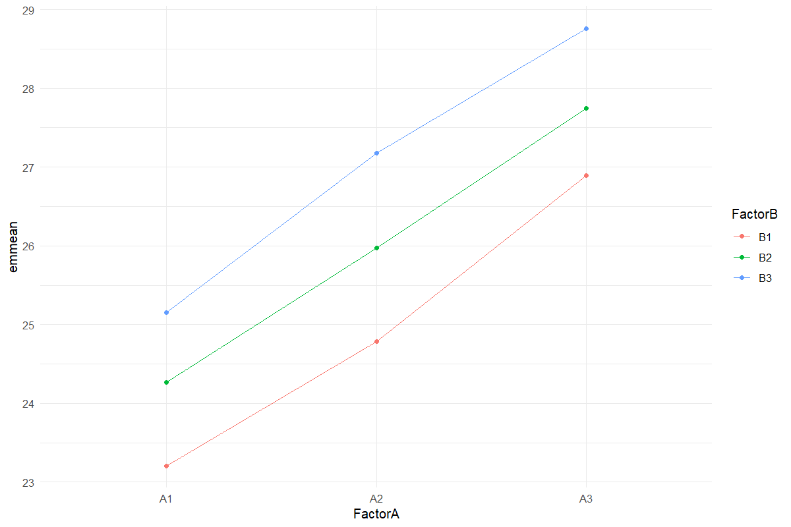

# Strip-Plot Analysis

Use three appropriate error strata

## Question and data
Supply a complete Rep × FactorA × FactorB layout. Both treatment factors are randomized in strips, making this different from a split-plot design.

## Read and report the results
Report factor A against Rep:A, factor B against Rep:B, and the interaction against the residual interaction error. The estimated-means model includes these strata. Tukey corrections apply within each displayed comparison family.

## Scope and assumptions
Do not analyze a strip plot as an ordinary factorial CRD. Unbalanced or duplicated cells are rejected in this workflow.

## Setup
```r
source("tools/example-cases.R")
load_drdesign()
```

## strip-plot

[Example CSV](../data/strip-plot.csv) · [R script](../code/strip-plot.R)

Synthetic teaching data; not observations from a field experiment.

```r
data <- research_example("strip-plot")
result <- run_strip_trial(data)
```

### ANOVA

[Full-precision CSV](../data/strip-plot-table-1.csv)

| Source / term | df | SS | MS | F | p-value |
| --- | --- | --- | --- | --- | --- |
| d$Rep | 2 | 0.062 | 0.031 | NA | NA |
| d$FactorA | 2 | 58.114 | 29.057 | 12.916 | 0.018 |
| Ea | 4 | 8.998 | 2.250 | NA | NA |
| d$FactorB | 2 | 19.241 | 9.621 | 165.578 | <0.001 |
| Eb | 4 | 0.232 | 0.058 | NA | NA |
| d$FactorB:d$FactorA | 4 | 0.277 | 0.069 | 0.144 | 0.961 |
| Ec | 8 | 3.849 | 0.481 | NA | NA |

### Interaction means

[Full-precision CSV](../data/strip-plot-table-2.csv)

| Factor A | Factor B | Estimated mean | SE | df | CI lower | CI upper |
| --- | --- | --- | --- | --- | --- | --- |
| A1 | B1 | 23.208 | 0.493 | 7.811 | 22.066 | 24.351 |
| A2 | B1 | 24.783 | 0.493 | 7.811 | 23.641 | 25.926 |
| A3 | B1 | 26.897 | 0.493 | 7.811 | 25.755 | 28.040 |
| A1 | B2 | 24.267 | 0.493 | 7.811 | 23.124 | 25.409 |
| A2 | B2 | 25.973 | 0.493 | 7.811 | 24.830 | 27.115 |
| A3 | B2 | 27.747 | 0.493 | 7.811 | 26.604 | 28.889 |
| A1 | B3 | 25.151 | 0.493 | 7.811 | 24.008 | 26.293 |
| A2 | B3 | 27.180 | 0.493 | 7.811 | 26.038 | 28.322 |
| A3 | B3 | 28.762 | 0.493 | 7.811 | 27.619 | 29.904 |

Warning: EMMs are biased unless design is perfectly balanced

Confidence level used: 0.95

### Factor A comparisons

[Full-precision CSV](../data/strip-plot-table-3.csv)

| contrast | estimate | SE | df | t | p-value |
| --- | --- | --- | --- | --- | --- |
| A1 - A2 | -1.770 | 0.707 | 4 | -2.504 | 0.136 |
| A1 - A3 | -3.594 | 0.707 | 4 | -5.082 | 0.015 |
| A2 - A3 | -1.823 | 0.707 | 4 | -2.579 | 0.126 |

Results are averaged over the levels of: FactorB

P value adjustment: tukey method for comparing a family of 3 estimates

### Factor B comparisons

[Full-precision CSV](../data/strip-plot-table-4.csv)

| contrast | estimate | SE | df | t | p-value |
| --- | --- | --- | --- | --- | --- |
| B1 - B2 | -1.032 | 0.114 | 4 | -9.085 | 0.002 |
| B1 - B3 | -2.068 | 0.114 | 4 | -18.198 | <0.001 |
| B2 - B3 | -1.035 | 0.114 | 4 | -9.112 | 0.002 |

Results are averaged over the levels of: FactorA

P value adjustment: tukey method for comparing a family of 3 estimates

### A within B comparisons

[Full-precision CSV](../data/strip-plot-table-5.csv)

| contrast | Factor B | estimate | SE | df | t | p-value |
| --- | --- | --- | --- | --- | --- | --- |
| A1 - A2 | B1 | -1.575 | 0.845 | 7.470 | -1.865 | 0.214 |
| A1 - A3 | B1 | -3.689 | 0.845 | 7.470 | -4.367 | 0.007 |
| A2 - A3 | B1 | -2.114 | 0.845 | 7.470 | -2.502 | 0.088 |
| A1 - A2 | B2 | -1.706 | 0.845 | 7.470 | -2.020 | 0.174 |
| A1 - A3 | B2 | -3.480 | 0.845 | 7.470 | -4.119 | 0.010 |
| A2 - A3 | B2 | -1.774 | 0.845 | 7.470 | -2.100 | 0.155 |
| A1 - A2 | B3 | -2.029 | 0.845 | 7.470 | -2.402 | 0.101 |
| A1 - A3 | B3 | -3.611 | 0.845 | 7.470 | -4.275 | 0.008 |
| A2 - A3 | B3 | -1.582 | 0.845 | 7.470 | -1.872 | 0.212 |

P value adjustment: tukey method for comparing a family of 3 estimates

### B within A comparisons

[Full-precision CSV](../data/strip-plot-table-6.csv)

| contrast | Factor A | estimate | SE | df | t | p-value |
| --- | --- | --- | --- | --- | --- | --- |
| B1 - B2 | A1 | -1.058 | 0.476 | 8.930 | -2.223 | 0.121 |
| B1 - B3 | A1 | -1.942 | 0.476 | 8.930 | -4.079 | 0.007 |
| B2 - B3 | A1 | -0.884 | 0.476 | 8.930 | -1.856 | 0.207 |
| B1 - B2 | A2 | -1.189 | 0.476 | 8.930 | -2.498 | 0.079 |
| B1 - B3 | A2 | -2.397 | 0.476 | 8.930 | -5.033 | 0.002 |
| B2 - B3 | A2 | -1.207 | 0.476 | 8.930 | -2.535 | 0.075 |
| B1 - B2 | A3 | -0.849 | 0.476 | 8.930 | -1.784 | 0.229 |
| B1 - B3 | A3 | -1.864 | 0.476 | 8.930 | -3.916 | 0.009 |
| B2 - B3 | A3 | -1.015 | 0.476 | 8.930 | -2.132 | 0.138 |

P value adjustment: tukey method for comparing a family of 3 estimates

### Exclusions

[Full-precision CSV](../data/strip-plot-table-7.csv)

No rows to report.

### Reviewed data

[Full-precision CSV](../data/strip-plot-table-8.csv)

| Rep | Factor A | Factor B | Value |
| --- | --- | --- | --- |
| R1 | A1 | B1 | 23.427 |
| R2 | A1 | B1 | 22.227 |
| R3 | A1 | B1 | 23.970 |
| R1 | A2 | B1 | 24.019 |
| R2 | A2 | B1 | 25.804 |
| R3 | A2 | B1 | 24.528 |
| R1 | A3 | B1 | 27.050 |
| R2 | A3 | B1 | 27.381 |
| R3 | A3 | B1 | 26.260 |
| R1 | A1 | B2 | 24.956 |

First 10 rows shown. Download the CSV for every row.

### Software versions

[Full-precision CSV](../data/strip-plot-table-9.csv)

| Source / term | Package | Version |
| --- | --- | --- |
|  | R | 4.5.3 |
| shiny | shiny | 1.13.0 |
| agricolae | agricolae | 1.3.7 |
| metan | metan | 1.19.0 |
| lme4 | lme4 | 2.0.1 |
| emmeans | emmeans | 2.0.2 |
| SpATS | SpATS | 1.0.20 |
| DiallelAnalysisR | DiallelAnalysisR | 0.6.0 |

### Analysis settings

[Full-precision CSV](../data/strip-plot-table-10.csv)

| Setting | Value |
| --- | --- |
| Alpha | 0.05 |
| Errors | Rep:A, Rep:B, residual interaction |
| Comparisons | Tukey within each displayed family |



## Reporting conventions
Tables: estimates and standard errors to 3 decimals; p-values below 0.001 shown as <0.001. Very small or large values use scientific notation. NA means unavailable or not applicable. CSV files retain numerical precision. Confidence levels and multiplicity corrections follow the stated analysis settings; shared letters indicate non-rejection, not equivalence.

[Validation and limitations](../VALIDATION.md)
